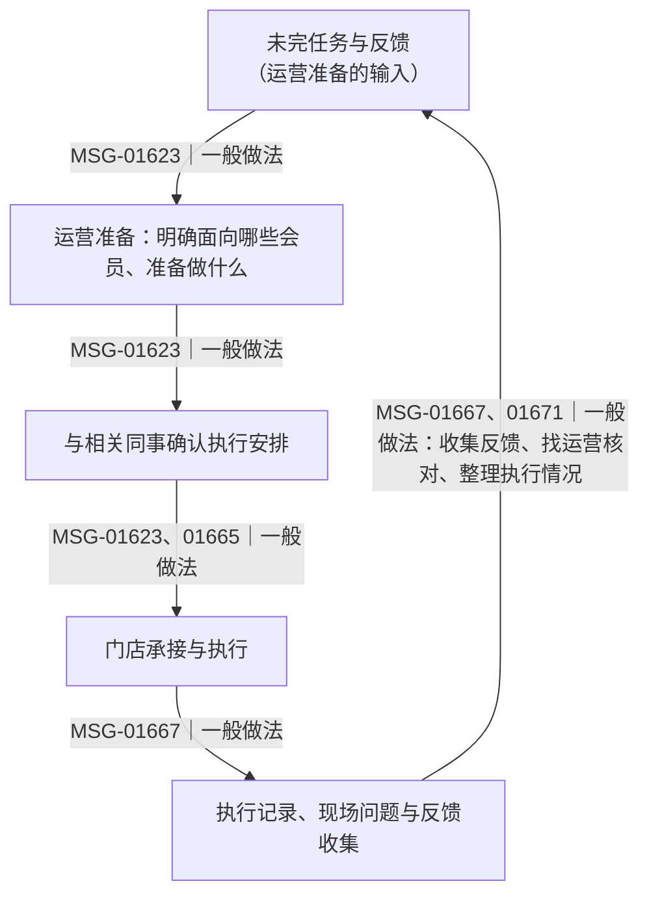
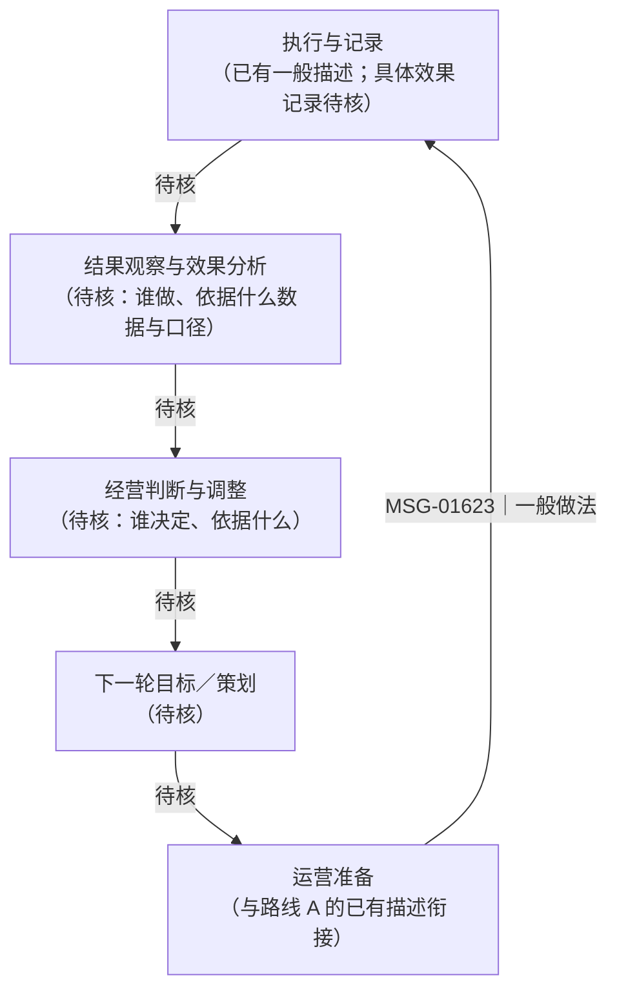

# W2 业务模型说明

状态（2026-10-29，第三版草稿，供 FDE 审阅，未 apply、未写入业务文件）：本版在同一 WF-0667765bc063466fa034a51e68a3228c／RUN-65188070e2bc4b3c92d533a17c1c668c 下，按导师复核意见修订两处边界（上游起点、反馈回流关系），并补上上一版漏画的一条有来源的回流线索。不构成完整业务模型，也不表示学员已确认。

**本版范围限定：** 沿用已确认的建模范围内容，本轮只修订局部流程的上游边界与回流关系；会员与指标概念、订单与渠道、数据核查协作、决策与效果观察等其他主题不在本版内，留待后续分组核查。

## 要回答的问题与范围（已确认内容）

**业务目标：** 围绕青禾的“复购改善”，先理解会员经营方式，明确业务概念和指标的含义，再组织下降原因的候选解释、证据与核查路径，支持后续与青禾共同选择值得优先验证的改善环节。岗位效率问题需要说明怎样影响经营判断或行动，其存在本身不证明它是复购下降的原因。

**本轮范围：** 发现会员复购下降 → 核对会员范围和统计口径 → 分析下降发生在哪里及可能原因 → 决定经营措施 → 运营与门店执行 → 整理结果并观察复购变化。这是本轮要理解的业务链，不是已核实的青禾标准流程。

**模型要帮助回答：**

1. 各方谈的会员、活跃、购买与复购分别指什么；统计对象、时间、渠道及规则哪些已有依据，哪些尚未取得。
2. 业务环节之间传递什么资料、由谁使用、支持什么判断；哪些关系已有角色陈述，哪些交接、分析责任和决策机制仍不清楚。
3. 每个候选原因需要什么证据检验，可能在哪个环节干预；后续怎样结合影响范围、业务影响、实施条件与成本判断价值，而不提前选定“最高价值”节点。
4. 怎样分别观察建议采纳、实际执行及复购变化，并保留它们之间尚未证实的影响关系。

**当前依据与限定：** 小林描述运营准备、协调和反馈（MSG-01623、01639），陈姐描述与小林的活动安排和现场反馈对接（MSG-01665、01671），老周描述业务问题到数据条件核查的协作（MSG-01752、01768）；它们支持局部衔接，尚不证明完整经营闭环。我们尚未取得共同确认的复购／活跃定义，不能推断公司没有口径。沈总的复购改善和三个月见效是方向与期望，会员老化是待检验假设，试点及提升幅度未获确认（MSG-01731、01733）。原文见[访谈记录及其来源](interview_notes.md)。

**本周完成边界：** 先用现有青禾材料走通提取方法、人工核查、业务模型初稿和 Agent 同题对照，再按暴露的缺口补访谈、更新模型与 Skill。未知可显式保留；本周不以拿到全部数据、算出真实复购率或实现复购回升为完成条件。后续指标定义可随证据修订，每次比较须明确采用的口径、范围和版本，避免把口径变化误作业务变化。

范围确认过程与学员原话见[访谈与核查记录](interview_notes.md)“建模范围确认与推进顺序”。

## 三层区分（本版的组织原则）

- **A 层｜角色已描述的一般现状：** 小林、陈姐两位角色自述“通常会怎么做”。是角色陈述，不是某次活动的执行记录，也不含频次、耗时或损失数据。
- **B 层｜为理解现状而保留的待核关系：** 现有证据不足、但影响本轮判断的环节、责任人与交接，标注待核，不填成事实。
- **C 层｜候选表达与共创方向：** 由建模讨论提出、尚未与客户确认内容或价值的可能方向。不是青禾现状，也不是已批准设计或系统承诺。

## A 层｜角色已描述的一般现状（局部，有来源）

以下四条候选来自本轮实际提取运行，已用 show_evidence 对照原文；FDE 反馈要求保留其来源支持的局部流程并标出上游待核，但**未逐条确认采用状态**，因此这里只作“一般做法”保留。

| 环节 | 角色、做什么 | 依据 | 限定 |
| --- | --- | --- | --- |
| 运营准备的依据 | **小林把没做完的任务和反馈作为运营准备的输入**，据此明确这次面向哪些会员、准备做什么，再和相关同事确认执行安排（CLM-001-0012） | MSG-01623 | 一般做法；名单条件与选择原因需查活动记录（MSG-01627），未取得；“相关同事”未指认 |
| 门店承接 | 陈姐：接到活动安排先核对“面向哪些会员、哪些门店参与、门店具体要做什么”，再向门店同事说明并确认人员和执行安排（CLM-002-0040） | MSG-01665 | 一般做法；安排送达的渠道／形式陈姐说不准，需查记录（MSG-01671） |
| 执行与现场反馈 | 陈姐：执行中收集顾客问题和门店反馈，有不清楚的找运营核对，结束后整理执行情况（CLM-002-0041） | MSG-01667 | 一般做法；“找运营核对”原文为泛称，不替换为小林；整理后的接受方未说明 |
| 角色对接 | 陈姐：与小林对接活动安排和现场反馈（CLM-002-0042） | MSG-01665、01671 | 角色陈述；小林侧未独立确认交接载体，不推为唯一路径 |

**A 层能支持的：** ①任务准备与执行协调（小林）←→ 门店承接与现场反馈（陈姐）之间存在角色陈述的对接关系；②**反馈回到运营准备**这一局部联系有角色陈述支持——小林自述把“没做完的任务和反馈”作为准备下一步的依据；③陈姐自述执行中收集反馈、结束后整理执行情况。

**A 层不能支持的：** 哪些反馈经过怎样的分析、分析怎样改变具体决策或下一轮安排、调整后用同一口径观察了结果——均无角色陈述；也不足以证明数据分析、效果归因或复购改善已经闭环。上述局部联系不能用来认定同一具体活动已完成“反馈—调整—验证”的全周期。

## B 层｜两条路线分开画

### 路线 A：有来源的一般做法（含反馈回到运营准备）

说明：A5 → A1 表示“反馈作为运营准备的输入”，依据是角色自述的一般做法；不代表每条反馈都被分析或都产生调整。

### 路线 B：待核经营闭环（未证实，不可当作已发生）

说明：B 路线上除“运营准备 → 执行与记录”这一段有角色自述的一般做法外，其余节点与箭头均为待核；其中“效果分析”与“经营判断”之间的连接完全没有角色陈述，不能填成已发生事实。

### 尚需核清的五项（只记核查缺口，不启动访谈、不编造公式、阈值、效果或责任人）

1. 反馈整理后给谁；
2. 哪些反馈经过怎样的分析，由谁依据什么数据与口径分析；
3. 分析结论怎样进入业务决策、怎样改变具体决策；
4. 决定如何落实为下一轮人群、活动或安排；
5. 下一轮结果用同一口径怎样观察（口径本身尚未取得）。

### 上游边界（待核）

**活动如何提出、目标怎样形成、是否存在独立的策划决策环节、以及它怎样与小林衔接，尚未核实。** 这一点只有建模讨论中的提问，没有角色陈述支持；也可能由小林本人参与。不推定另有部门、不推定确定审批次序、不补预算或交接细节。

## C 层｜候选表达（来源与状态）

**来源说明：** “让分析结果能够反馈到下一轮经营决策”这一表达，是**导师根据学员提问整理出的候选表述**，不是学员原话提出的完整方案，也未与客户讨论或获得批准。

**当前状态：** 仅作为日后可能与青禾共创时的候选方向；需先确认现状、价值与责任归属。不得当作用户已认可的 To-Be 方案、不得作为系统能力或执行承诺，也不改写 A 层现状。

## 对象、属性与关系

用业务语言定义对象类型、关键属性和对象之间的关系。写清哪些对象相互联系、通过什么关系联系，以及这种表达怎样帮助回答本轮业务问题，不只摘录原话或罗列未知。对容易混淆的名称解释含义；对有其他合理方案的地方，说明当前选择的理由。需要时用小例子检查同名、重复发生、历史与当前状态等情况。

（待相应候选经 FDE 分组核查后再填写。）

## 规则、条件与候选动作

说明规则适用的时间、范围和条件，并交代它影响哪些对象、流程或判断。候选动作描述希望做什么及尚需确认什么，不写成已经实现的工具或已经获得的执行权限。

（待相应候选经 FDE 分组核查后再填写。）

## 依据与建模选择

**客户原话提供的：** A 层各环节的动作与顺序；小林“先看没做完的任务和反馈”作为准备依据；反馈回到运营准备的局部联系；小林与陈姐的对接关系；陈姐整理执行情况；以及两人对完成口径、送达渠道、效果分析责任的知识边界。

**本次建模选择：**

1. 把有来源的一般做法与待核关系分层、分路线画，不合成一张“完整流程”。理由：A 层均为一般做法，缺具体活动记录；回流后段各节点在角色处为未知。
2. 明确画出“反馈 → 运营准备”这条有来源的局部回流，并标注来源与“一般做法”，避免把“没看到闭环”写成“所有回流都无角色陈述”。
3. B 路线逐段标“待核”，并让观察节点经分析、判断、下一轮策划回到运营准备，避免箭头混接或观察节点悬空。
4. 上游只作待核问题表述，保留小林可能参与，不推断部门与审批次序。
5. C 层标清是导师整理的候选表述、未获批准。
6. 本版局部流程涉及的角色为小林、陈姐两位。

## 未知与分歧

| 项 | 层 | 现有依据 | 需要的核实材料 |
| --- | --- | --- | --- |
| 活动如何提出、目标怎样形成、是否有独立策划决策环节、怎样与小林衔接 | B | 建模讨论中的提问；无角色陈述；小林可能参与 | 角色确认；活动方案提出与确认记录 |
| 安排送达的渠道／形式 | B | 陈姐说不准（MSG-01671） | 实际接收记录或样例 |
| 门店任务“完成”的口径与确认人 | B | 陈姐不掌握（MSG-01667） | 向小林／运营确认；执行记录 |
| 哪些反馈被分析、由谁分析与按什么口径 | B | 小林不掌握效果分析责任人与口径（MSG-01641）；沈总说不准（MSG-01723） | 效果分析产出物与责任人 |
| 分析结论怎样进入决策、怎样落实下一轮、怎样观察结果 | B | 无角色陈述 | 决策与复盘记录；观察口径说明 |
| 会员、活跃会员、复购率口径 | 未处理，留待后续分组核查 | 四位角色分别表示不掌握或需核实 | 统计说明、报表与业务确认人 |
| 80 万活跃与 120 万全量 | 未处理（CONFLICT-001） | 不同口径的待核陈述 | 按核查对象与用途核对来源、范围、时间；不相减、不判冲突 |

**结论性说明：** “没看到闭环”是核查状态的描述，不是对青禾经营管理的判断，也不足以判定访谈内容有误。上游与回流两处边界保留为待核，待补充材料与角色确认后再修订本模型。

## 本轮核查状态（摘要，详见核查记录）

- 已实际运行提取（WF-0667765bc063466fa034a51e68a3228c／RUN-65188070e2bc4b3c92d533a17c1c668c），产出候选 CLM-001-0001–CLM-005-0147。
- 第一组送审 CLM-001-0012、CLM-002-0040、CLM-002-0041、CLM-002-0042；两次 FDE 反馈均发生在 2026-10-29，本版为同一运行下的第三版草稿。四条候选**采用状态仍待学员决定**。
- 其他主题候选尚未分组核查，不写入本版。
