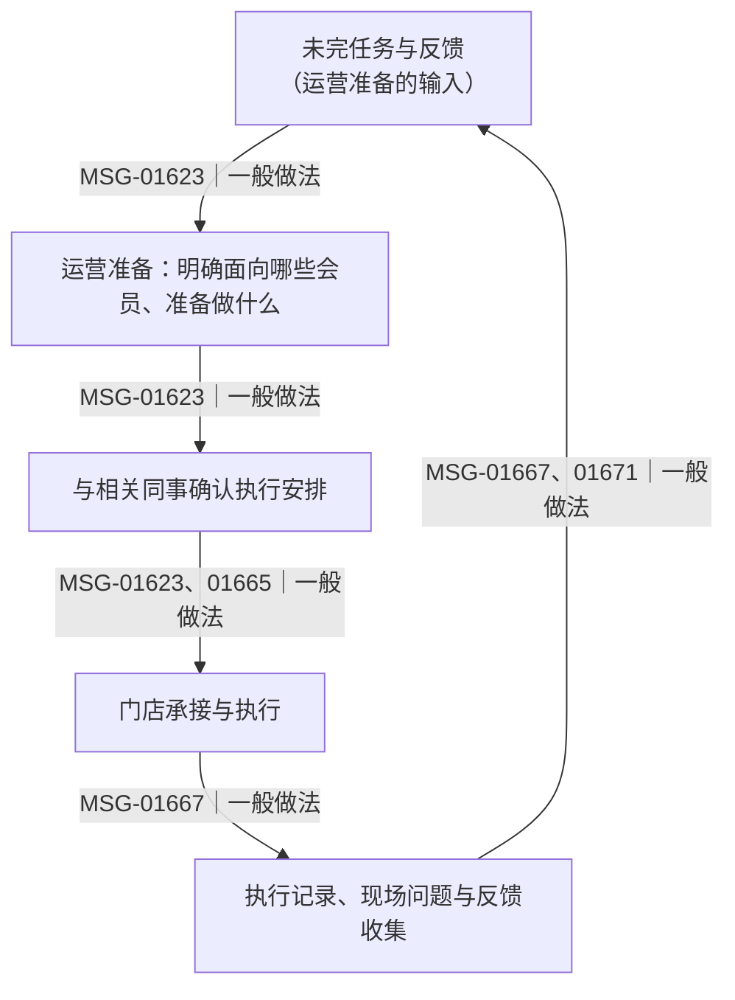
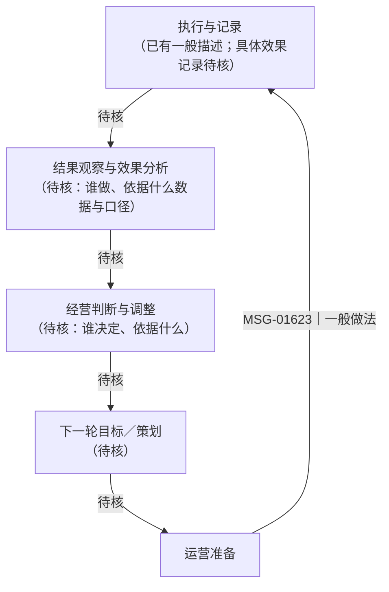

# W2 业务模型说明

状态（2026-10-29，第五版累计草稿，供导师检查，停在 awaiting_apply，未写入业务文件、未 apply）：本版把已收到人工反馈的建模选择真正落进模型正文，包括会员类别、两类"系统上不重叠"的学员判断、活跃作为业务自定义属性标签、统计口径与统计结果的关系、复购指标、订单与渠道、以及本轮学员标注形成的活动蓝图。不表示学员已确认整份模型；范围以外主题仍待后续核查。

**范围与来源：** 沿用已确认的建模范围；原始提取、原访谈与历史草稿均未改动。本版不重新提取、不新增访谈、不调用新访谈。

## 要回答的问题与范围（已确认内容）

**业务目标：** 围绕青禾的"复购改善"，先理解会员经营方式，明确业务概念和指标的含义，再组织下降原因的候选解释、证据与核查路径，支持后续与青禾共同选择值得优先验证的改善环节。岗位效率问题需要说明怎样影响经营判断或行动，其存在本身不证明它是复购下降的原因。

**本轮范围：** 发现会员复购下降 → 核对会员范围和统计口径 → 分析下降发生在哪里及可能原因 → 决定经营措施 → 运营与门店执行 → 整理结果并观察复购变化。这是本轮要理解的业务链，不是已核实的青禾标准流程。

**模型要帮助回答：**

1. 各方谈的会员、活跃、购买与复购分别指什么；统计对象、时间、渠道及规则哪些已有依据，哪些尚未取得。
2. 业务环节之间传递什么资料、由谁使用、支持什么判断；哪些关系已有角色陈述，哪些交接、分析责任和决策机制仍不清楚。
3. 每个候选原因需要什么证据检验，可能在哪个环节干预；后续怎样结合影响范围、业务影响、实施条件与成本判断价值，而不提前选定"最高价值"节点。
4. 怎样分别观察建议采纳、实际执行及复购变化，并保留它们之间尚未证实的影响关系。

**本周完成边界：** 先用现有青禾材料走通提取方法、人工核查、业务模型初稿和 Agent 同题对照，再按暴露的缺口补访谈、更新模型与 Skill。未知可显式保留；本周不以拿到全部数据、算出真实复购率或实现复购回升为完成条件。

## 各层来源与读法

| 层 | 含义 | 读法 |
| --- | --- | --- |
| 角色陈述 | 小林、陈姐、老周、沈总在访谈中说的话 | 角色自述，**未核实外部业务事实**；三人同说也不自动成为统一定义 |
| 学员建模选择 | 学员在核查中确认或补充的判断 | 是本轮模型的采用依据，**不是客户访谈证据**，也不是系统已验证的规则 |
| 待核现状 | 现有材料不足的环节、责任与规则 | 保留为未知，不填成事实 |
| 近期过渡方案 | 学员提出的过渡做法 | 非客户批准、非已实施 |
| 未来扩展方向 | 学员提出的候选设计 | 非现有系统能力，非本阶段建设承诺 |

## 会员

- **本轮经营对象是"会员"。** 材料中的两种称谓：**付费会员卡**与**免费注册会员**，小林、陈姐、老周都提示说"会员"时要分开（角色陈述）。
- **两类在系统上不重叠。** 来源：**学员 2026-10-29 补充判断**。原访谈只支持"两类需分开"，未提供系统检查记录，故不写作系统已验证的规则。
- 两类各自的资格条件、会员卡状态变化与身份有效期：未知，按实际规则另行确认；不作为要求角色现场作答的问题。
- 系统会员标签语义：老周称需结合实际填写方式核实（MSG-01742），按**角色提醒／待核**保留，不能直接当作类别判定依据。

## 活跃：业务自定义的属性标签

- **学员已采用的建模选择：**"活跃会员"是**业务需要的分析口径**，属于**业务自定义的会员属性标签**；具体定义仍需与业务确认。
- **定位：** 不把"活跃"当作付费会员卡／免费注册会员之外的**第三种会员身份**。它以"在某个会员范围内、某段时间内、满足某项条件的会员群体"来表达，条件暂未知。
- **边界（导师补充表述）：** 这是业务概念上的属性标签，**不代表现有系统中已有同名字段、维护功能或自动打标规则**；老周所述系统标签语义与此并非同一件事。

## 统计口径与统计结果

- 建模上把"**统计口径**（谁被计入、什么时间、满足什么条件、依据什么记录）"与"**按该口径得到的统计结果**"分开表达，再建立联系：**一个数字只有带上人群范围、时间、计入规则和来源，才能支持判断两份数字是否可比。**
- 这是建模选择，不表示公司已有统一定义或现成报表对象。

**当前两个数字（均为角色陈述，尚未取得实际统计依据）：**

| 称呼 | 谁说的 | 数值 | 人群范围 | 时间 | 计入条件 | 来源 |
| --- | --- | --- | --- | --- | --- | --- |
| 活跃会员 | 沈总（MSG-01719、01729） | 80 万 | 覆盖哪类或两类，**待核** | **待核** | **待核** | 沈总自述"看业务时用的口径，不是已经核实过的统计结果"；未给报表或记录 |
| 系统全量会员 | 老周（MSG-01744、01746） | 120 万 | 系统全量；**全量边界待核** | **时点待核** | 未说明 | 老周称与活跃不是同一口径；80 万来源他也无可确认记录 |

**冲突处理：** 原始产物中的 CONFLICT-001 与 conflicting 标记保留不动；人工解释为"不同口径及其依据待核"。目前不能判为同口径下的数字矛盾，也不相减得出不活跃人数或据此计算活跃率。

**核查路径（老周 MSG-01744）：** 先说明核查对象和用途，他与运营一起确认会员范围，再核对系统统计所用的范围、时间和统计说明。这是协作方式，未表示已核完或已批准数据访问。

## 复购率：业务指标与尚缺的计算口径

- **表达：** 把"复购率"作为会员经营的**业务指标**，与四类要素关联：**会员统计范围**、**观察时间**、**购买记录**（据什么认定会员有过购买）、**计算规则**（分子与分母）。当前只保留"该指标存在、被角色用于描述趋势"，不写公式。
- **依据：** 小林 MSG-01619："复购率连续四个季度下滑这个情况有，但统计的是哪类会员、两类合在一起看还是分开看，具体计算口径还要核实。"
- **待核：** 分子／分母、有效购买标准（含退款、取消如何处理）待业务确认；统计会员范围、是否分两类看亦待核。**80 万活跃会员不能直接指定为复购率分母**；岗位效率（反复整理、反复跟进）不直接证明复购下降的原因。

## 购买记录：订单与渠道

- **表达：** 建立**会员与购买记录的联系**；购买记录按**渠道（线上／门店）**识别与汇总，以服务后续复购分析。这是本轮的模型组织方式。
- **依据：** 老周 MSG-01752："订单涉及线上和门店渠道，看订单结果得先说清是哪个渠道。"
- **待核：** 会员与订单的实际对应方式、跨渠道能否关联、什么状态算"有效购买"。**不把一条订单等同一次有效购买**；不定一对多表结构、退款或取消规则；不宣称已有打通能力。

## 活动与优惠（本轮学员标注形成的蓝图）

**学员 2026-10-29 标注原文（原样保留）：**

> 其实应该要有一个活动系统，我不知道活动给用户的优惠，具体是怎么样的，但是我们有知道，每一场活动具体的活动效果是怎么样。有些活动是博饼、有些活动是满减、有些活动是赠送优惠券，而小林负责所有活动的运营和跟进，是需要有一个系统来为这个活动运营留下记录，进而后续能分析活动带过来的效果。优惠券的发放和核销确实是两个环节，但这个可能是活动准备阶段的工作，或者不是活动，而是让所有用户都能销售机会优惠价格。活动系统可以配置优惠券、可以配置满减，具体下一节点，活动怎么准备，我认为是下一节点需要详细设计的。考虑我们目前并没有要把系统支持做的那么大，可以由运营和技术手动把需要的数据导出进行分析作为暂时的解决方案，但是在业务蓝图上，我们要作为预设计，留出以后拓展的可能。现阶段确认需要核查优惠券或者其他形式给到用户的优惠，怎么关联到订单，进而怎么关联到人，来满足基础的运营分析。

**据标注形成的模型表达（业务对象分开，联系待核）：**

| 对象 | 表达 | 依据／状态 |
| --- | --- | --- |
| 活动 | 比优惠券更高一层的业务对象。一场活动可有**多种玩法或优惠方式**（如博饼、满减、赠送优惠券）。博饼、满减、赠券是**学员举例**，未取得青禾真实活动类型记录 | 学员标注；现有访谈只确认小林经手优惠券、会员权益说明、对一段时间未购买会员做回访（MSG-01623） |
| 优惠方式／优惠载体 | 优惠券是其中一种载体；活动可配置不同优惠方式。**并非每个活动都必须有优惠券或优惠**，也**不假定每项优惠都必属于某次专项活动**（也可能是面向所有用户的常态优惠） | 学员标注 |
| 优惠券发放 | 一个业务环节，有自己的记录 | 老周 MSG-01752、小林 MSG-01648：发放与核销是两个环节，发放记录不能替代核销记录；状态与口径待核 |
| 优惠券核销 | 另一个业务环节，有自己的记录 | 同上 |
| 活动运营记录 | 为每场活动保留足够运营记录，供后续分析活动效果 | 学员标注；**理解为分析需求，不是已取得每场活动的效果结论** |
| 活动效果分析 | 目标用途：分析活动带来的效果 | 分析责任人与口径均未确认（MSG-01641、01723） |

**保留的边界：**

- 发放与核销在具体活动或常态优惠中的位置与关系需核查；**不固定为一条全链**，也不把两者一概归入"活动准备阶段"——学员原文中这层意思本身也是推测。
- 小林是已知的运营协调角色；**"所有活动都由她负责"是本轮学员的概括**，其全公司覆盖范围没有访谈依据，不扩大为已核实的全量职责。
- **优先核查的业务联系：优惠／优惠券 → 订单 → 会员**（满足基础运营分析）。活动与优惠的归属在有依据时再连上；不因为记录能关联就推断活动带来复购改善。

**近期过渡方案（学员提出，非批准、非已实施）：** 现阶段可由**运营与技术人工整理／导出所需记录**开展基础分析，作为暂时方案。数据可取得范围、实际导出能力、关联质量、权限与责任均待核；本轮未执行导出或分析。老周 MSG-01760 说明现阶段提供的是配合核查的说明、未交付数据。

**未来扩展方向（学员提出的候选设计）：** 业务蓝图上预留活动配置（不同玩法与优惠方式）、活动执行记录与效果分析的扩展可能。**标明为学员提出的候选设计方向，不是现有系统能力，也不是本阶段完整系统建设的承诺**；活动如何准备、模块如何设计留待后续节点。

## 局部执行流程（角色已描述的一般做法）

| 环节 | 角色、做什么 | 依据 | 限定 |
| --- | --- | --- | --- |
| 运营准备的依据 | 小林把没做完的任务和反馈作为准备输入，明确面向哪些会员、准备做什么，再和相关同事确认执行安排 | MSG-01623 | 一般做法；名单条件需查活动记录（MSG-01627），未取得 |
| 门店承接 | 陈姐：先核对"面向哪些会员、哪些门店参与、门店具体要做什么"，再向门店同事说明并确认人员与执行安排 | MSG-01665 | 一般做法；安排送达渠道／形式待核（MSG-01671） |
| 执行与现场反馈 | 陈姐：执行中收集顾客问题和门店反馈，不清楚的找运营核对，结束后整理执行情况 | MSG-01667 | 一般做法；"运营"为泛称，整理后的接受方未说明 |
| 角色对接 | 陈姐：与小林对接活动安排和现场反馈 | MSG-01665、01671 | 角色陈述；交接载体未独立确认 |

**路线 A（有来源的一般做法，含反馈回到运营准备）：**



## 待核：上游边界与经营闭环

**上游：** 活动如何提出、目标怎样形成、是否存在独立的策划决策环节、它怎样与小林衔接，尚未核实；只有建模讨论中的提问，无角色陈述；也可能由小林本人参与。不推定另有部门、审批次序或预算。

**闭环（路线 B，未证实，不可当作已发生）：**



**五项核查缺口：** ①反馈整理后给谁；②哪些反馈经过怎样的分析、谁依据什么数据与口径分析；③结论怎样进入业务决策；④决定如何落实为下一轮人群、活动或安排；⑤下一轮结果用同一口径怎样观察。

**"让分析结果能够反馈到下一轮经营决策"** 是导师据学员提问整理的**候选共创方向**，非学员原话、未获批准，需先确认现状、价值与责任。

## 对象与关系总览（分析视角）

```
会员（付费会员卡 / 免费注册会员；两类系统上不重叠—学员判断）
   │ 属性：活跃＝业务自定义属性标签（定义待业务确认）
   │ 统计口径 → 统计结果（须带人群范围、时间、计入规则、来源）
   │
   ├─ 购买记录（订单）：按渠道线上／门店识别与汇总 ——对应关系待核
   │        ▲
   │        │ 优惠／优惠券 → 订单 的关联：优先核查，能力未确认
   │        │
   └─ 优惠（优惠券为一种载体；也有非专项活动的优惠）
            │ 发放 ── 核销（两个环节、各自记录；状态与口径待核）
            │
            活动（更高层对象：可含多种玩法／优惠；运营记录供效果分析）
```

**这张图如何帮助分析：** 它把"会员是谁"、"怎样才算活跃"、"指标怎么算、数字从哪来"、"购买记录如何按渠道汇总"、"优惠与活动怎样影响购买"分开又可连接，使后续能逐段问：这个数字的人群与时间是什么、这段关联是否有依据、这个结论有没有超出记录能支持的范围。

## 依据与建模选择

**角色陈述提供：** 两类会员称谓需分开；复购率连续四个季度下滑但口径待核；订单涉及线上与门店渠道；发放与核销是两个环节、发放记录不能替代核销记录；系统标签语义需结合实际填写；运营准备、门店承接与反馈的局部做法；老周的核查协作路径。

**学员建模选择提供：** 两类在系统上不重叠；活跃为业务自定义属性标签、定义待业务确认；统计口径与结果分层并可比较；复购作为业务指标与四要素关联；活动作为更高层对象、可含多种优惠方式；优惠→订单→会员为优先核查链；近期以人工整理／导出做基础分析；活动中长期扩展为候选设计。

**保留的原有内容：** 已确认范围、四人角色陈述及其原文来源、上游策划与经营闭环待核、会员分类与统计覆盖的已纠正边界，均保留。

## 未知与分歧（保留为未知，不阻塞）

| 项 | 说明 |
| --- | --- |
| 活跃会员的具体定义、统计时段、来源 | 小林、陈姐、老周均不掌握或需核实；沈总称 80 万非已核实统计 |
| 80 万覆盖哪类会员；120 万的全量边界与时点 | 待核查；不相减、不判同口径矛盾 |
| 复购率分子／分母、有效购买标准 | 待业务确认 |
| 会员与订单对应、跨渠道关联、订单状态 | 待核 |
| 优惠或优惠券 → 订单 → 会员的实际关联能力 | 优先核查项，尚未确认 |
| 发放与核销在具体活动或常态优惠中的位置与关系 | 待核 |
| 活动效果分析责任人与口径 | 小林不掌握（MSG-01641）；沈总说不准（MSG-01723） |
| 活动如何提出、是否有独立策划决策环节 | 无角色陈述；小林可能参与 |
| 门店任务"完成"的口径与确认人 | 陈姐不掌握（MSG-01667） |
| 反馈整理后交给谁、结论怎样进入决策、如何观察下一轮 | 无角色陈述 |
| 数据可取得范围、导出能力、权限与责任 | 老周称现阶段为配合核查说明、未交付数据（MSG-01760） |

## 本轮核查状态（摘要）

- 已实际运行提取（WF-0667765bc063466fa034a51e68a3228c／RUN-65188070e2bc4b3c92d533a17c1c668c），产出 CLM-001-0001–CLM-005-0147；本版未重新提取。
- 已完成的人工核查：①局部流程四条候选；②会员类别与标签四条；③全量／活跃统计口径四条；④复购率、订单渠道、优惠券发放核销一组，其中第 3 项按学员标注改为活动蓝图。
- 已采用的建模选择见上；候选采用状态、过渡方案与未来扩展的性质均已在正文分层标注。
- 下一批 3 项（另行组织）：目标会员名单与建议、门店执行任务、反馈与效果分析。
