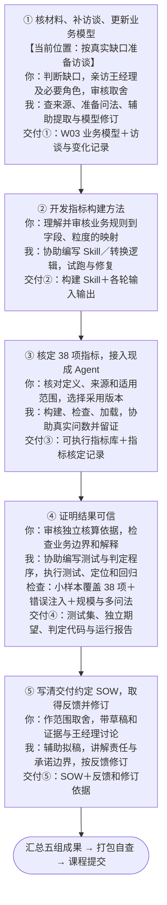

# W03 当前实操入口

工作目录：`/Users/chenzhaowen/czw-code/AIFDE/W03/实操工程`。


**全套验证停点（2026-11-07，最新）：** 按本人“继续往下验证所有问题”的要求，当前候选已完成82/82道问答真实覆盖，71完整通过、10语义需修、1格式失败（81份原生合格格式答复）；T01—T03对当前正文重新独立审查全部通过，不继承旧稿成绩。本轮新增33次调用/33HTTP，27通过、6语义需修，0重试/恢复；6份导师最小核对稿另审通过，不改原分。既有DQ10/P09/B05/U01/F06加本轮E03/E05/REG01/U05/A03/E01共11个原失败保留。见[全套结果与逐题账本](artifacts/w03/full-validation-20261107/结果速览.md)。

**当前范围与下一步：** 仅模型53题46通过/6语义需修/1格式失败；固定材料15题14通过/1需修；来源/交付应用14题11通过/3需修。覆盖100%不等于问答全通过或W03作业完成。下一步按[集中处理清单](artifacts/w03/full-validation-20261107/后续处理清单.md)修前提归属、来源/范围转述和格式/解释一致性，再针对原失败题与必要对照回归；该新调优未执行，不无变化抽样。当前无待本人新增业务裁决。正式模型仍W02 v0.4、工作流awaiting_apply及旧proposal3未变，未apply/替换提示或Skill；38项指标数值查询验证未运行。下方为历史停点。

**运营协作验证停点（2026-11-07，历史）：** U01/U04/F03—F06/F09七道仅模型题已执行，7请求/6原生合格答复，5通过、U01语义需修、F06格式失败，无重试。U01将待核统计时点/来源说成已不同，F06返回JSON尾部多两个字符；导师最小修正副本均独立复核通过，原分保留。F05缺记录只能待核，标未发生须肯定证据。启动前门禁状态、检查项与正文一致；见[本轮结果与进度](artifacts/w03/operations-qa-20261107/结果速览.md)。

**下一小步：** [证据边界与整体建议5题](artifacts/w03/operations-qa-20261107/下一步核查范围.md)E02/E03/E05/REG01/REG02，先审后跑，本轮未执行，无待本人新增业务裁决。当前候选实测49/82题（约60%覆盖），48份原生合格答复、44完整通过、4语义需修、1格式失败，另33题未在本版执行；仅模型36题与带材料13题分开计。跨版本61题尝试、60题有合格答复、21题从未跑，旧第三稿3项静态审查另计。正式模型v0.4、awaiting_apply及旧proposal3未变；38项指标数值验证未运行。下方为历史停点。

**基础材料应用停点（2026-11-07，历史）：** 重启后核前批记录完整，未重跑。B01—B06已执行：初批4通过、B05需修、B04网络无答；B04原样恢复一次通过后按题5通过/1需修，共7请求/6答复。B05额外解释误把净销售额当人均消费/有效订单均额的分母，导师另存整句修正稿并独立复核，原失分不变。恢复门禁首版状态与正文矛盾，启动后才纠正两处机械误报，原件及时序保留，未追记事前通过。见[结果与进度](artifacts/w03/basic-semantics-qa-20261107/结果速览.md)。

**下一小步：** [经营目标与运营协作7题](artifacts/w03/basic-semantics-qa-20261107/下一步核查范围.md)U01/U04/F03—F06/F09，按仅模型轨道准备、先审后跑；本轮未执行，无待本人新增裁决。当前候选覆盖42/82道问答：仅模型29道27通过/2原答失败，带材料13道12通过/B05失败；另40道未在本版执行。跨版本54道问答已取得答复、28道未运行，旧第三稿3项静态审查另计。正式模型v0.4、awaiting_apply及旧proposal3未变，38项指标数值验证未运行。下方为历史停点。

**月报材料应用停点（2026-11-07，历史）：** R01—R07已按各题指定原文实际运行，7题完整通过，7次HTTP请求无重试；独立来源判据、输入门禁、原答与真实请求均已审。已正确区分月底资格与当月购买、普通/付费复购、整月及门店/渠道支持范围。见[结果与建模进度](artifacts/w03/monthly-application-qa-20261107/结果速览.md)、[独立逐题评审](artifacts/w03/monthly-application-qa-20261107/independent-review/review.md)。

**下一小步：** 准备[订单/退款等6题B01—B06](artifacts/w03/monthly-application-qa-20261107/下一步核查范围.md)的来源判据和逐题材料，再运行验证；本轮未运行该组，无待本人新增业务裁决。当前候选按指定轨道覆盖36/82道问答：仅模型29道为27通过、DQ10/P09原答2需修；带材料应用7道全部通过，不能记为正文独立记忆成绩；另46道未在本版本运行。跨版本48道问答已跑、34道未跑，旧第三稿3项静态审查另计。正式模型仍v0.4，工作流awaiting_apply且proposal3仍为旧第三稿；38项指标数值验证未运行。下方为历史停点。

**来源细化候选资格回归停点（2026-11-07，历史）：** 已完成原17题对象/产品/账户资格回归：17次真实请求，主要结论17/17正确，完整回答16通过、P09因自行增加“一张”卡数而需修订。导师另存仅删“一张”的核对稿并通过独立复核，原成绩不变；日期DQ10原失败亦保留。模型、提示与前12题日期批相同，当前候选累计实测29道问答，27完整通过、2原答失败，另53道尚未在该版本运行。见[本轮结果与进度](artifacts/w03/source-refined-qualification-qa-20261107/结果速览.md)、[独立逐题评审](artifacts/w03/source-refined-qualification-qa-20261107/independent-review/review.md)。

**下一小步：** 按[7题月报应用范围](artifacts/w03/source-refined-qualification-qa-20261107/下一步核查范围.md)准备R01—R07逐题指定材料并审查实际输入，再验证月末资格、当月有效购买、整月及分母选择；本轮未执行该组，不继续为原答错误重抽样。当前无待本人新增业务裁决。85项设计中跨版本41道问答已运行、41道未运行，旧第三稿3项静态审查另计；38项指标数值验证未运行。正式模型仍v0.4，工作流awaiting_apply且proposal3仍为旧第三稿，来源细化候选未正式写入。本人已纠正“监督”为“进度”，以本段汇报接续；下方为历史停点。

**来源细化与模板回归停点（2026-11-07，历史）：** 第三稿另存来源细化候选，并改用完整空白ASCII表格。业务含义经独立审查未变；原12题真实回归：格式12/12、来源12/12、最终结论与区间12/12，机器与完整回答11/12。DQ10提前终止单项填“否”，与其“未触发”解释冲突；原失败保留。导师另存单格“否→是”核对稿并获独立复核，不能计入模型成绩或冒充本人作答。本轮12调用/12请求，无追加抽样。见[结果速览](artifacts/w03/source-bound-template-qa-20261107/结果速览.md)、[独立评审](artifacts/w03/source-bound-template-qa-20261107/independent-review/review.md)。

**下一小步：** 对[来源细化候选](artifacts/w03/source-bound-template-qa-20261107/candidate/business_model.md)回归已有17道对象/产品/账户资格题U02/U03、P01—P09、C01—C06，检查原正确理解是否受影响；DQ10原答缺陷继续跟踪，不原样重抽样挑通过。新候选只实际验证本批12题，旧版本成绩不自动转移。当前41项问答已运行、另41项未运行，旧第三稿3项静态审查另计；38项指标数值验证未运行。正式模型v0.4及notes/prompt/Skill/config未改，工作流仍awaiting_apply，其proposal3是旧第三稿，来源细化副本尚未接回原生提案。下方均为历史停点。

**日期解释一致性停点（2026-11-07，历史）：** 沿用第三稿与原题，加入隔离日期条件/区间表，并用经离线正负例验证的独立检查器核对。12题真实问答：人工日期语义12/12正确，机器结构/日期9/12，来源8/12，完整回答6/12。DQ12旧窗口已改对，仍错挂产品范围来源；DY08/DY09/DQ09表格分隔列数错误，DY08/DQ10/DQ11/DQ12来源错挂（重叠DY08），均保留失败。12次调用/12次请求，未追加抽样，候选未采用。见[结果速览](artifacts/w03/date-consistency-qa-20261107/结果速览.md)、[独立评审](artifacts/w03/date-consistency-qa-20261107/independent-review/review.md)。

**下一小步：** 先审规则与出处绑定，并准备完整空白表格模板，按[修复范围](artifacts/w03/date-consistency-qa-20261107/下一步修复范围.md)形成最小候选后再冻结验证。不是追加业务规则或让本人重作已有判断，成因仍需验证。当前41项问答已有实际运行，另41项及38项指标数值验证未运行，前轮3项静态审查另计；不同提示条件不合并冒称一版全套通过。正式模型v0.4、notes/prompt/Skill/config及工作流awaiting_apply均未变。以下均为历史停点，以本段接续。

**日期边界实测停点（2026-11-06，历史）：** 第三稿与R1隔离提示完成DY/DQ共24题：日期逻辑24/24正确，完整回答20可接受、4项来源错挂需修订。仅收紧隔离回答提示的来源匹配要求后，R2一次8题回归原错挂均消失；完整回答7/8可接受，DQ12将提前终止8月15日的卡有效窗口写到8月20日，仍失败。已保留全部原答复及独立评审，本轮32次调用，无第三版或继续抽样。见[结果速览](artifacts/w03/date-boundary-qa-20261106/结果速览.md)、[独立回归评审](artifacts/w03/date-boundary-qa-20261106/independent-review/review-r2.md)。

**下一小步：** 按[后续修复单](artifacts/w03/date-boundary-qa-20261106/后续修复单.md)准备逐项日期条件与最终有效区间的一致性检查，再针对DQ12及相关对照回归；现有证据足够，无待本人新增业务裁决。累计41项问答已执行，40项在各自提示条件下有可接受记录、1项待修，另41项问答及38项指标数值验证未运行；前轮3项静态审查另计。R2仅测8题且未全通过，不拼接旧结果冒称其全套验证通过。正式模型仍v0.4，工作流awaiting_apply，正式notes/prompt/Skill/config未改；不是本人独立作答或客户验收。以下停点均保留为历史，以本段接续。

**首批实际问答停点（2026-11-06，历史）：** 已冻结第三稿，完成U02/U03、P01–P09、C01–C06共17题真实model_only问答。原回答提示独立判读11通过/6需修订；只在隔离副本修回答提示后，同17题一次回归17通过/0需修订。两轮共34次真实调用，正文/题目/fixture/预期/GUARD/运行参数未变，预期未发给被测模型，原失败全保留。新增经验：核心结论正确仍须检查来源、角色和题设保持；草稿待采纳不等于把已获角色说明的规则全降成学员猜测。见[结果速览](artifacts/w03/qualification-qa-20261106/结果速览.md)、[独立回归评审](artifacts/w03/qualification-qa-20261106/independent-review/review-r1.md)。

**下一小步：** 用第三稿与R1隔离提示跑两类卡的日期端点24题（DY/DQ），按既有冻结预期独立判读。当前仅17项问答及前轮T01–T03静态审查完成，其余65项问答、38项指标查询及数值验证未运行；不外推未见题泛化。正式模型仍v0.4，原生工作流仍awaiting_apply，正式notes/prompt/Skill/config未改；本轮不是本人独立作答、逐字采纳新稿或客户验收。下方“全部问答未执行/下一步首批资格问答”等是历史停点，以本段接续。


**业务模型草稿停点（2026-11-06，当前以此为准）：** 本人授权继续后，已沿既有工作流从步骤4推进至13，形成三版实际草稿；前两稿问题和失败评分保留，第三稿经独立Agent的T01–T03正文静态审查，15子项通过，无待本人新增业务裁决。正文已落实账户/卡/资格/订单关系、带范围的卡与订单规则、实际运营交接；月报统计选择留核查增量，个人Excel与FDE交付条款/维护过程迁出。正式模型仍W02 v0.4，正式notes未合入草稿，原生状态awaiting_apply；未执行模型问答或38项指标，不能写成模型效果已验证或作业完成。详见[第三稿及本轮记录](artifacts/w03/model-draft-20261106/README.md)、[正文](artifacts/w03/model-draft-20261106/draft-03/business_model.md)、[独立复审](artifacts/w03/model-draft-20261106/independent-review/review-03.md)。

**下一小步：** 冻结第三稿与现有测试输入，先运行账户—卡—资格的理解和边界问答，保存实际回答并由独立Agent判读，再按影响范围继续验证、接续正式写入。本人授权推进与已有边界决定有效，但未补记本人逐字采纳草稿或独立完成。下方“未生成草稿/未resume”等旧停点保留为当时历史，不能覆盖本段最新状态。

**业务模型设计评审（2026-11-06，草稿前历史）：** 已由独立业务模型设计评审Agent读青禾背景、W02/W03原始材料、本人v0.4及候选包完成评审：方向合理，可进入草稿，但须先补清账户/卡/资格/订单/门店关系，吸收原MD订单语义；拆开资格业务规则与月末/整月统计选择；整合运营与门店局部流程，并迁出旧正文个人Excel、FDE和维护过程。推荐五节：目的与边界→对象关系→带范围规则→业务工作与决策条件→业务未决及来源。报告为独立建议，尚未登记本人逐项采纳；正式模型仍v0.4，未生成W03正文、未resume/apply、未执行模型问答或指标测试。历史复购原因/具体活动筛选及闭环责任仍待取证，不阻断已知部分起草；无需本人新增业务裁决。 见[独立设计评审](artifacts/w03/business-model-design-review-20261106/review.md)。

**候选提取停点（2026-11-06，实际状态保留）：** 四份有效W03首访已实际提取并独立审核：首轮引用错挂失败保留；一次有界重试得到61条原生候选，审核修正26条、纠正2项误报冲突，并显式补提3条，形成64条审核版。104段引文及内容/去向独立复审通过，其中24条可供业务模型整合，个人Excel与FDE费用/延期/验收等按本人决定分流。已向原生工作流记录第一组4项反馈，未resume、未生成模型提案、未apply；正式模型仍W02 v0.4。85题及38项指标未运行。下一小步按审核结果继续维护流程，结合已有原材料形成模型更新草稿；外部审核文件不会自动被工作流读取，须按组传入实质反馈，不把3项Agent补提当作原生提取ID。 [本轮提取与审核](artifacts/w03/candidate-extraction-20261106/README.md)。W02原提交、11月5日成果与作废W04归档保留。

**陈姐备访接续（2026-11-06，历史准备；现已收到03886）：** 本人要求继续访谈。导师已通读陈姐W02两份原导出（25／11条，均ended），结合W03的04／07／08及小林、老周正式首访，准备[预约目的和第一问](docs/w03/interview_plan_chen.md)。当前先核门店实际判断两类卡权益有效的依据；收到答复再决定日期追问。尚未预约／发送，未取得陈姐W03答复，不把其门店职责当规则制定权或把备稿当本人独立作答。

**老周备访增量（2026-11-06，历史准备；已由当前转贴推进）：** 已回读 W02 老周两份原导出（25／12 条，分别 ended／active，二访 01939 无对应答复）、小林有关说明、W03 原材料及小林正式首访。已形成[老周预约目的与完整问题清单](docs/w03/interview_plan_zhou.md)，按日期空值／端点、历史状态、材料责任列 6 个核心问题，并列 Excel、券活动、生产接入和旧趋势的条件性备问。供本人审阅，未预约、未发送、未新增角色事实或改模型；小林剩余一次仍保留，王经理必访尽早安排。

已根据 2026-11-01 重打包准备新版工程、独立环境及本人 W02 起点（现已接续批改修订 v0.4）；2026-11-04 已进一步实际验证聊天、构建和测试链路。详见 [当前环境核验与作业要求对照](setup/20261104-readiness/README.md)，[11-02 更新记录](setup/20261102-update/README.md)留作历史。材料包中的同名工程是发行样例，后续在本目录实操。

## 先理解本周背景：怎样接上 W02（2026-11-05 补充导览）

本人提醒：尚未看过年卡、季卡等新增设定，应先介绍实操背景及与上一周的区别，再进入访谈。此前导师直接给了完整备问，缺少共同读材料这一环；问题清单保留为备稿。本轮先补背景与材料导读，不要求立即发送首问，不把听过介绍登记为已核定规则。

青禾的业务主线仍是应对会员复购下滑。W02 本人访谈中，沈总希望先验证下降原因，小林希望减少重复整理与核对；“会员老化”是待验证判断。我们已形成并采纳 W02 v0.4，保留业务对象、关系、局部流程、角色边界和未知。没有证据证明原因已查明、试点已获批或经营效果已改善，见[当前模型](docs/w03/business_model.md)。

W03 的[内部沟通](materials/w03/07_客户内部沟通.md)给出更具体的阶段需求：小林希望按确认过的口径查数、看得到依据；老周提供的是干净合成测试库，要求明确接口与范围；王经理参加阶段范围评审。我们要把业务认识落实成能运行、能核对的统计能力，再讨论交付范围。课程增加资料与数据，不表示青禾真实生产已经接入或项目已获批。

| 维度 | W02 | W03 |
| --- | --- | --- |
| 核心任务 | 访谈、核查、形成业务模型，让 Agent 正确使用业务认识 | 接续并更新模型，建立可执行指标库，让 Agent 按青禾口径实际查数 |
| 输入 | 本人多角色访谈、旧项目材料、前周判断 | 再加入报表说明、财务／统计邮件、字典、任务清单、测试数据及本周访谈 |
| 验证 | 比较有无业务模型时的实际回答，检查定义、关系、条件和未知是否正确使用 | 保留模型核查，并独立计算期望，核真实查询的范围、分组、数值、单位和解释，做边界及规模回归 |
| 访谈 | 老周、小林、陈姐必访，王经理选访 | 王经理必访；其他角色按新材料留下的缺口选择，不重问全部已明规则 |
| 开发 | 设计、运行并验证提取与维护方法 | 复用原流程；必须开发指标构建方法、测试及确定性结果判定 |
| 交付 | 业务模型、访谈核查、方法与 Agent 使用对照证据，接续 fit-gap | 更新模型、构建方法、38 项指标库、独立测试证据、经角色反馈修订的 SOW（范围、责任与验收说明） |

依据：[W02 任务书](../../W02/04_材料包/05_作业任务书.md)、[W03 任务书](../W03%20材料包/05_作业任务书.md)。两周都有开发和实际验证，本周进一步要求可执行统计、独立数值核对和交付约定。

**新增材料怎样用：**

- [订单日报](materials/w03/01_订单日报说明.md)、[财务邮件](materials/w03/02_财务邮件.md)、[会员运营周报](materials/w03/03_会员运营周报.md)：给出本期多项订单、金额和会员统计口径，旧模型中相应未知需按范围重新判断。
- [本期统计邮件](materials/w03/04_本期统计确认邮件.md)：六项付费会员月报按月末资格选账户，再统计这些账户当月全渠道、全门店的有效订单。这是本期报表选择，不是对所有历史统计的追认。
- [数据字典](materials/w03/05_数据字典.md)：明确会员账户、门店、会员卡、订单四张表。四类卡产品、账户多卡和日期字段由这里引入；此前本人访谈没有讲清这些，也不能从卡名推断哪些纳入。
- [任务清单](materials/w03/06_任务清单.md)：38 项指标，含 32 项通用报表与 6 项付费会员月度指标；[内部沟通](materials/w03/07_客户内部沟通.md)和[业务目标](materials/w03/08_业务目标与工作清单.md)用于讨论价值、配合与范围。

这些都是指定青禾沙盘材料。课程提供大小两套干净合成数据，用于计算验证；梧桐是独立运行样例，课堂综合复习中的两周／4 小时／门店金额是导师模拟条件，不能混作青禾证据。

**贯穿示例（导师问句，尚未运行）：**“2026 年 8 月，月末符合总部付费资格且当月有购买的账户有多少？”邮件已给统计时点和订单范围，字典已给卡产品及字段，还缺产品纳入、有效期端点和多卡资格规则。因此先读材料，再针对缺口访谈，更新并核查模型，形成指标，让 Agent 真查，再从同一原始数据独立核对答案。

**当前位置：** W02 v0.4 起点、原访谈及修订、工程和数据已就位，净销售额初核、完整访谈备稿保留。尚无本人 W03 新访谈；W03 模型实质更新、正式指标构建／验证和 SOW 反馈修订仍待完成。

**下一小步：** 先共同读懂本周背景，再看 04 统计邮件和 05 字典，分出“已经给定”与“真正待核”，随后使用[访谈准备](docs/w03/interview_plan.md)的小林 L1。本人参与口径、范围及采用判断；导师负责导读、证据整理、实现协助和验证。复用现有环境与成果，不增加一轮考试或工具调优。

## 材料导读 1：本期统计确认邮件（2026-11-05）

本人回复“可以，我们先看材料”。本轮导师展开[04 本期统计确认邮件](materials/w03/04_本期统计确认邮件.md)，只读清统计对象、订单范围与尚待确认的资格规则；尚无本人逐项判断、规则采纳或计算验证。

这是课程提供的王经理邮件，材料内日期为 2026-09-23，明确标注课程虚构，不是本人本周访谈所得。适用对象是六项付费会员月度指标，不把其统计选择推广到全部 38 项或所有历史报表。

**核心原文：**“先选月末有资格的账户，再统计这些账户当月全渠道、全门店的有效订单；不要求每笔订单发生当天也已经具有资格。”

| 阅读问题 | 材料已明确 | 尚待确认／后续查看 |
| --- | --- | --- |
| 算谁 | 自然月最后一天符合总部付费资格的账户；按账户，不按卡重复 | 哪些卡产品纳入、有效状态和日期端点、多卡怎样决定资格 |
| 算哪些订单 | 选中账户在当月全渠道、全门店的有效订单；不要求每笔订单当天有资格 | 有效订单具体规则沿用 02 财务邮件，不凭日常词义代替 |
| 算什么时间范围 | 完整自然月；多月按月分别列出；六项暂不按门店／渠道拆分 | 不把该限制推广到全部通用指标 |
| 怎样验收 | 指定测试范围内定义可追溯、查询及校验正确 | 预算、合同和正式上线另行确认；查询通过不能证明复购提升或 ROI |

**导师假设例，仅解释统计选择：** 账户甲月末符合资格，本月有两笔有效订单，其中一笔发生在取得资格前——仍计两笔；账户乙月末不符合资格，本月即使有有效订单，也不纳入这六项付费月报的统计。这里预先假定月末资格结果，不暗示产品或日期规则已经核定，不是 CSV 运行结果；不纳入这六项不等于其订单不计入通用报表。

**本轮产物：** 上述“已明确／仍待核”阅读表。检查时每项回到邮件第 5、7、9 行，不用卡名、会员等级或付款金额代替资格证据。本轮不要求先答题才能继续。

**下一份材料：** 05 数据字典，先看 members 与 cards：账户和卡如何关联、四种卡名来自哪里、哪些是字段含义、哪些仍需业务确认。邮件说明要怎样统计，字典说明数据里有什么；两者一起定位真正的访谈问题。未发送备问，未修改模型或运行计算。

## 本周作业与我们的分工（2026-11-05 导师导览）

本人请求先看完整作业内容与协作安排。目标是让已有运营 Agent 在指定测试范围内按青禾口径查询 38 项指标（32 项通用报表＋6 项付费会员月度指标），交付可追溯定义、真实查询与独立验证证据，并形成经角色反馈修订的 SOW。依据[任务书](../W03%20材料包/05_作业任务书.md)第 1～4 节。以下是导师安排，不登记为本人已采纳或完成。

图按五组交付物组织；独立期望在对应测试运行前准备，SOW 前期起草、验证后带证据讨论修订。环境和 W02 接续成果继续复用。



### 第一阶段补充：更新后验证业务模型（2026-11-05 导师建议）

本人提出第一阶段继续访谈、更新业务模型，并询问是否保留模型验证。导师建议将①明确为：核材料与真缺口 → 按缺口补访谈 → 形成 W03 候选模型 → 验证与修订 → 本人审核采用。王经理本周必访，其他角色按缺口选，不以访遍所有角色为目标。课程要求有实质更新、核查与来源；以下小规模同题验证是沿用 W02 方法的辅助安排，不是新增课程必交项。

| 验证什么 | 拟议方法与通过依据 |
| --- | --- |
| 内容是否忠于证据 | 逐项核关键新增／修改事实的原问答、前提、条件、主体与引用；未知保持未知，取舍过程留核查记录，报表特有时间和分子分母留指标定义 |
| 新模型是否能被正确理解与使用 | 先依据原材料独立写 3～5 个代表性问题的预期要点，覆盖正常、边界和未知／权限反例；固定问题及运行条件，用 W02 v0.4 与 W03 候选做对照，只变业务模型。评价新证据是否吸收、是否臆造；旧版缺新事实不自动算错误 |
| 更新是否破坏已有认识 | 对受影响的 W02 已采用事实做回查；回答成功仍需核正文与引用，不能靠总分抵消关键错误。错误定位到证据、正文或调用方式后修订，再复测受影响项，保留失败与版本 |

阶段采用条件建议：本期所需关键事实可追溯，关键矛盾／误归因／无依据断言已处理，代表性案例符合来源，未决项的影响和核查去向明确，再由本人审核采用。事实核查是主要依据，小样本问答用于发现使用问题；它不保证全部场景正确，也不替代后续指标独立数值验证。此处验证对象为业务模型，现用维护方法继续人工审核。

导师负责准备核查表、预期草稿及运行证据，本人参与审核证据是否支持结论、未决如何处理和是否采用。本建议尚未执行或经本人逐项确认；当前没有 W03 新访谈／候选模型。现有知识对照配置仍指向 W02 历史路径，实际开跑前须另设 W03 隔离输入与输出，保留原配置和提交。

**每轮协作方式：** 我先说明这个小步骤服务哪份交付物、展示产物样子；你参与其中关键的业务判断或访谈；我协助整理、实现与执行；我们对照来源和检查结果评阅，再记录本人原答、导师建议、采用状态和实际执行证据。SOW、独立验证和解释审查遇到时简短补讲。需要你亲自访谈和作取舍，但不要求你独自手写全部代码；辅助开发仍需保留方法和迭代证据。

**当前停点：** 本人要求先了解实操背景及与 W02 的区别，先读文首导览并对照本周新材料，再使用小林卡产品范围首问（W03-GAP-001）。已有[来源复核与推进纠正](docs/w03/interview_notes.md#2026-11-05-来源边界复核与下一步当前)、净销售额初核和完整备问保留；不恢复退款日期教学题门槛。尚未访谈、更新模型或开展②～⑤；工具调优不作为作业前置门槛。

## 当前可以开始的实操

工程与数据准备已经完成；`customer/w03` 已初始化，不再解压工程、重建环境或重复 init。青禾 Skill 和判定程序仍是待开发模板。业务模型已接续本人采纳的 W02 批改修订 v0.4，修订 fit-gap、12 项核查取舍和对照结论已一并接续，见 [模型更新说明](docs/w03/model_changes.md)。原 v0.3 历史基线及本周环境成果保留；尚未完成 W03 业务模型实质更新。

当前小步（2026-11-06）：W01 修订内容已获本人采纳，见[阶段检查与修订入口](docs/w03/interview_phase_review.md)。[业务模型验证题与判据](docs/w03/model_validation_cases.md)现包含资格规则组和U01—U06理解应用组。[U01／U02独立Agent审核](artifacts/w03/independent-review-20261106/u01-u02-r1/review.md)已通过，无本人决策项；下一步准备W03模型更新输入与核查重点，候选及实际结果再独立审核。设计审核不计作被测问答或指标通过。四份 W03 首访已归档；模型、SOW 和提取／查询仍未更新或运行。

工具当前版本（2026-11-05）：找缺口v0.3进入完整输入、人工审核试用，先带任务范围/查询契约、目标目录与原始材料准备索引；维护仍scope-first-v3，提取提示仍v2。维护v4.2未通过，不替换。详见 [本轮调优与验证](artifacts/w03/skill-tuning-20261105/调优结论.md)，[11/4失败记录](artifacts/w03/skill-tuning-20261104/调优结论.md)保留。回放未提供CSV不代表本机缺数据，实际先看materials/data/small，不重复索要材料；方法测试不是本人W03新取证或模型更新。

维护方法的最新专项验证：另完成18次隔离回放，v5至v6.1均未全部通过，**未替换v3**。v6分阶段有改善，但存在动作主体失真；v6.1修复后青禾提问前提又回归。候选、判读与未替换决定见[专项调优结论](artifacts/w03/model-skill-tuning-20261105/调优结论.md)。审核前正文没变不算已验证审核后生成；后续先验证独立证据审查和获准句子整合。现用旧版仍须人工核原文。

随后已验证[课程实际审核与整合链路](artifacts/w03/review-stage-validation-20261105/验证结论.md)：四条测试链能正确暂停、拒绝未审提案，并在明确复审后保留首稿、生成第二稿；候选v6.1首次证据判断与首次整合仍有错误，因此仍不替换。下一方法步骤聚焦证据审查本身；本周正式模型、访谈和指标状态不变。

- 为什么：先分清已有定义与需要访谈的事实，避免把字典字段或教师样例当成业务规则。
- 本人判断：哪些来自本期材料，哪些旧认识需要调整，是否还有影响计算的未知。
- 保存：使用 [原访谈与核查记录](docs/w03/interview_notes.md) 的“缺口清单”，保留本人的判断与导师建议的区别。
- 检查：结论能追到原文；若有缺口，写明目标 ID、类型、影响和核查对象；没有缺口就不虚构访谈问题。之后再逐步检查其余 37 项。

## 先理解工作台：把输入、生成和验证串起来

2026-11-04 按本人关于“这些都由 FDE 负责，怎样串联、有什么设计工具”的提问补充。本页继续作为唯一实操导航，不新增另一套指标答案或开发框架。

**工作方式：本人和 Codex 先设计、审核输入及生成方法，课程工具生成候选并运行，之后依据独立期望验证。** 本人承担口径与交付判断；Codex 可协助阅读材料、给出设计草稿、编写 Skill/配置/判定代码及解释失败，示范与本人实际确认分开记录。课程不要求自备 coding Agent，本人现用 Codex 可作为辅助。

| 工具／入口 | 用来做什么 | 对应产物 |
| --- | --- | --- |
| 当前 Codex 会话＋本工程文件 | 按单个完整指标整理“业务口径→字段→粒度→表达式→验证依据”，协助编写方法及代码，审查差异 | 设计草稿、业务模型更新、Skill、配置、独立期望/判定代码；是否实际保存或采用需另记 |
| W02 提取工作流 | 从本期真实材料/访谈补充 W03 业务认识，核查后采用 | docs/w03 的模型与变化记录；保留 W02 提交基线 |
| tools/w03.py 的 build | 读取 build 配置、调用模型；保存候选 SQL/YAML/目录并构建检查 | 每次独立构建目录及报告，失败也留档 |
| merge、load 与原 Agent 入口 | 依核定版本生成定稿库，加载运行项目并提供自然语言查数 | 定稿库、运行项目、查询意图/SQL/结果/解释 |
| test＋本人开发的判定程序 | 将真实问数结果与预先独立确定的期望比较，做错误注入与回归 | 测试报告、失败原因及重跑证据；check 另做交付预检 |

### 串联输入的核心文件：build.json

[现成梧桐配置](examples/w03/build.json)已经存在，文件中写的是输入位置。路径相对于该配置文件，不是把全部内容手工拼在一个文档中。

| 配置字段 | 梧桐示例实际值 | 对应输入与用途 |
| --- | --- | --- |
| skill | build-metrics/SKILL.md | 怎样推导和生成的方法 |
| business_model | business_model.md | 业务对象、关系、规则及未知 |
| materials | materials | 报表说明、字典等原始资料 |
| targets | targets.json | 这次生成哪些指标 |
| data | data | 供程序构建和检查的样本；CSV 行不直接作为构建模型输入 |
| scope | 梧桐书店／独立教学样例 | 客户和适用范围 |

构建工具从这些入口读取输入，得到派生 SQL、语义模型（内含 measures）、metrics 及目录等候选输出；它们不是全部需要本人从空白逐一手写的文件。具体引用由生成定义表达，程序检查依赖是否可用，业务含义由 FDE 核查。独立验证通过 tests.json/判定程序接入 test，是另一条输入，不能拿生成结果抄成测试答案。

工作路线：**设计输入和方法 → build 生成/检查 → 审核与迭代 → merge 定稿 → load 加载 → Agent 问数/test 验证 → 按结果修订。** 方法问题修 Skill；新业务事实补有来源的输入；以新目录重新生成，不能手工补生成文件后声称 Skill 已修好。

### 用现成文件先看懂，而后再开发青禾

需要回看工作台时，可从[build.json](examples/w03/build.json)打开[样例 Skill](examples/w03/build-metrics/SKILL.md)、[指标定义](examples/w03/library/metrics.yml)及[测试用例](examples/w03/tests.json)，解释每份文件的输入/输出与引用。梧桐样例仅用于理解和环境验证，不直接作为青禾答案。具体命令与指南见 [课程 README](docs/w03/README.md)、[构建指南](docs/w03/skill-guide.md)。本段最初为只读导览，后续运行结果见本页当前状态。

上段工作台讲解时仅核文件存在，尚未运行；2026-11-04 的环境实测已接续完成。当前 `customer/w03`、`.runtime/wutong-v1`、`.runtime/product` 均已存在，`artifacts/w03/library` 仍未生成，因为青禾正式开发尚未开始。

## 已验证的启动与复查入口

梧桐样例已完成真实聊天问数，回答 130.00 元，底层 13000 分；3 条课程样例测试通过。结果与原始 CSV 独立核算一致。日后重开聊天，在本工程目录运行以下两行即可；已加载的项目不再 load。

```sh
.venv/bin/python setup/run_with_local_key.py doctor
.venv/bin/python setup/run_with_local_key.py product start --home .runtime/product
```

浏览器打开程序显示的 `http://127.0.0.1:8765`。当前绑定的是梧桐课程样例，青禾库开发并核定后才切换。结束时在该终端按 Ctrl-C；本轮核验启动的服务已停止，没有常驻运行。

本次聊天、核算、测试及生成记录已保存在 [环境样例证据](artifacts/w03/environment-smoke-20261104/)，不作为青禾指标答案。未来改库使用新项目、新输出目录，保留失败；模型出错先看错误码与运行记录。数据字典的四张接入表保持原样，业务派生模型由本人后续 Skill 生成。

当前青禾提取配置缺少本期真实访谈，不能启动。原 W02 访谈及方法已保留；`docs/w03/business_model.md` 当前是 W02 批改修订 v0.4 的接续起点。历史 W02 同题对照脚本不作为本周入口，按上方净销售额材料核查继续。看课与复盘进度统一在上级学习表维护，不因环境准备而登记已掌握。
