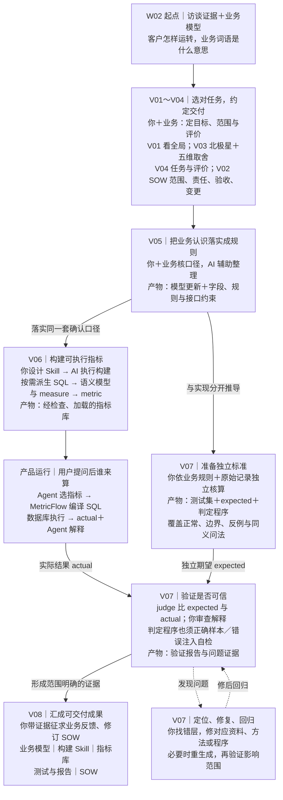
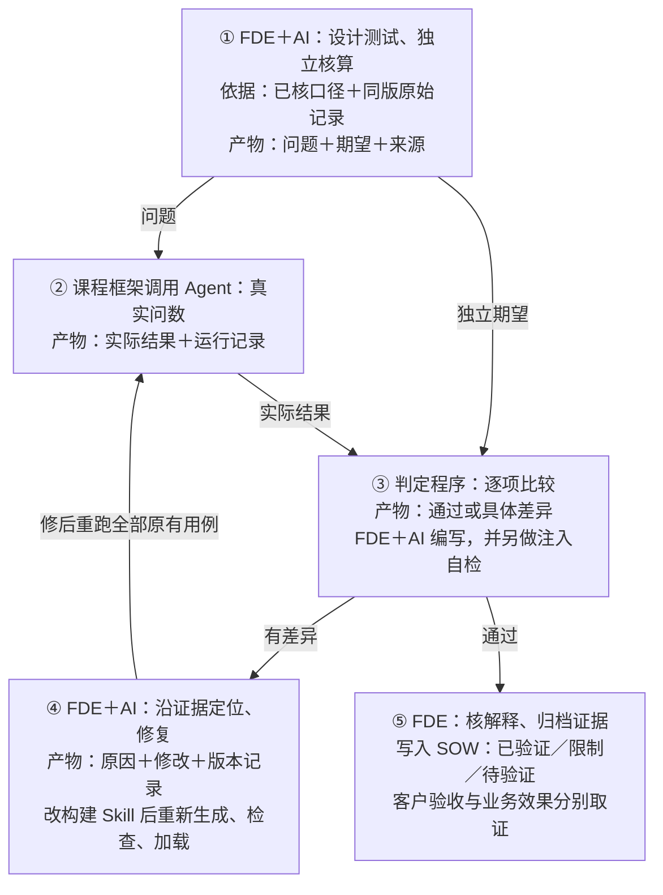
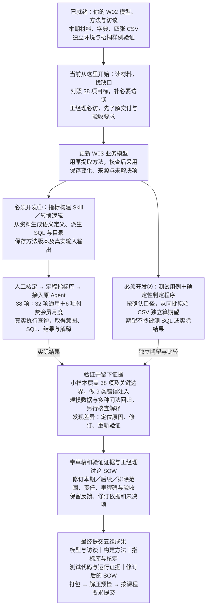
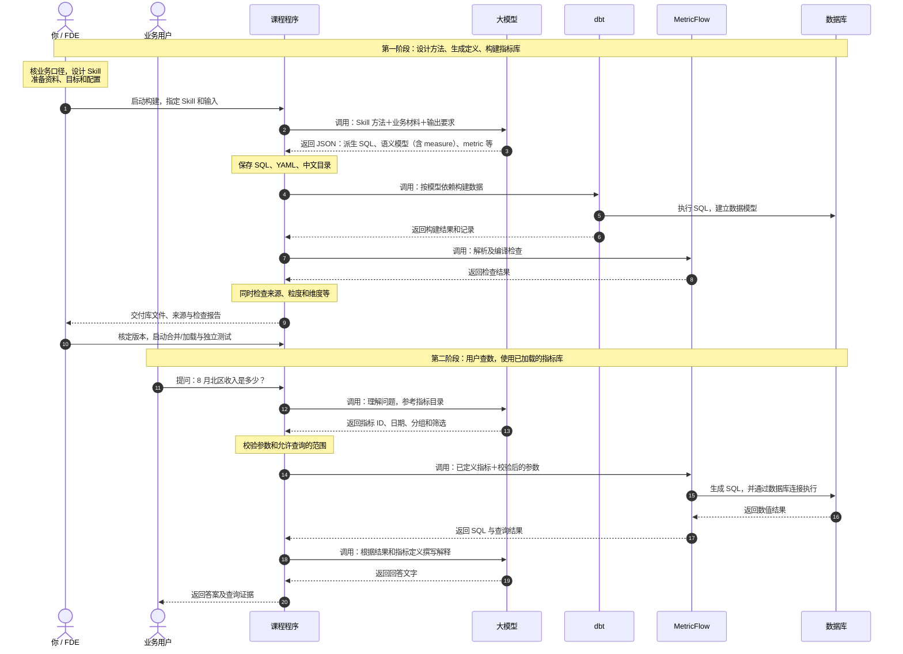
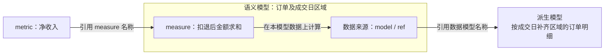
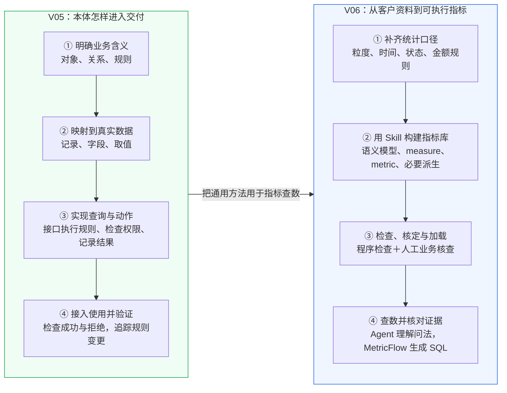
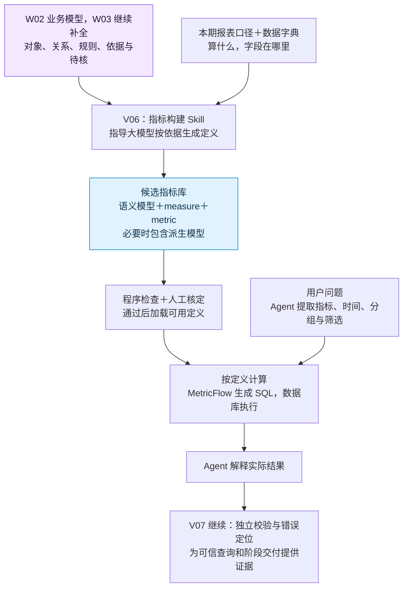

# W03 学习笔记

**指标分批推进（2026-11-08，当前）：** 本人要求按批次推进，替代逐指标停点。已建[38项状态登记](实操工程/docs/w03/指标核对与测试登记.md)和[测试集设计](实操工程/docs/w03/指标模型测试集设计.md)，按金额5、订单数7、去重/件数4、均值比率8、注册首购5、普通月内3、付费月报6分7批。38项都有测试场景，现有净销售额8题真实通过；新增53条为设计，未冻结数值期望或运行，规模仍0/38。

**下一批：B1订单金额。** 一次核定并准备实付、退款、原价、优惠4项，连同净销售额组成5指标批次；独立算期望后批量构建/验证，并回归净额原8题。每批汇报一次结果，仅真实业务缺口或取舍交本人；不再逐指标询问是否继续。业务批次和工程依赖闭合范围分开，不直接拼接冲突语义模型。以下为历史记录。

**概念速查：测试设计与可执行测试集。** 设计先说清问题、规则和想抓的错误；可执行测试还必须有独立原数据算出的期望、来源和版本。未核指标可以先设计，但未知期望不能写成0或null。多指标同题能减少重复调用，仍要核每列数值、单位与全部分组；比率须先核分子分母再相除。记住“场景—独立期望—真实结果—解释”四层，状态分别登记。例子见B1-R01及测试指南，属于导师方法说明，不是新增业务事实。

**首项指标实操（2026-11-08，历史）：** 净销售额 `net_sales_cents` 已实际构建并在small合成数据执行8题，查询条件、结构和数值8/8通过，6份成功解释及2份非成功理由全部独立复核通过；Skill v0.1.2、当前build-v3/library-v2与完整解释独立审查见[结果速览](实操工程/artifacts/w03/net-sales-first-20261108/结果速览.md)。原单位错误及首轮5项解释缺陷记录保留，业务期望未改；W03 v0.5正文、W02基线未变。这是1项/38项目标的小样本验证，不代表规模回归、38项完成或已提交。

**接下来：** 看懂首项100300分＝1003.00元及paid全退单贡献0，再接实付金额 `payment_cents`，复用当前构建和独立核对方式。当前产品聊天绑定尚未切换；导师执行不记为本人独立掌握。以下为历史记录。

**本次概念速查：** 业务模型说明对象与规则；指标模型把某一统计选择映射成可执行的字段、粒度、聚合和单位。金额对上仍须核解释：paid全退单贡献0，不等于把它从paid集合排除；“有效购买”不能自动套到净销售额。使用时先冻结原CSV独立期望，再检查真实查询的条件/值/版本，最后逐句审回答；错误注入检验判定器会不会漏错。记住这三个检查层次即可，不必背命令。例子和来源见本次结果、订单日报、财务邮件及独立报告。

**建模收尾（2026-11-08，历史）：** W03 v0.5 业务模型工作版已保存，正文阶段收束；W02基线和历史失败保留。本轮5道原题＋2道控制真实复验，结构7/7、语义6/7；唯一合成控制回答错句另有已审导师副本，不改原分。完整状态与保存证据见[建模收尾结果](实操工程/artifacts/w03/model-closeout-20261108/收尾结果.md)。

**下一小步：** 接续已有净销售额材料初核，进入 `net_sales_cents` 的指标构建与独立核对，再按38项覆盖计划扩展。回答工具的范围表述风险单列，不自动重复全部模型测试或扩大维护Skill调优；本轮未构建或查询指标。以下停点保留为历史。

2026-11-08来源语义校准：已由三个独立Agent完成82道问答判据+3项正文检查的专项审查，6题判据/引用与正文一处精确化已复审通过。新增问答/API/指标查询均0，旧原生3/6不改分。见[本轮校准结果](实操工程/artifacts/w03/source-semantics-audit-20261108/审查结果.md)。

概念速查：校准预期不等于被测回答变正确；明确已知的角色规则、尚未取得的文件凭据、具体事项未知、明确未定分别记。引用路径必须说明所用版本；可见材料的范围决定能够引用到多细。后续只针对未解决的回答错误做有界验证，不重开通用维护Skill调优。以下为历史记录。


2026-11-08实操范围确认与引用复核：本人明确本期只推进业务模型正文、问答引用准确性，维护Skill调优暂停。实际六题3通过、U05/U01语义需修、P01格式失败；三份导师修订副本与未来U05预期静态审核通过，原成绩不变。见[本轮报告](实操工程/artifacts/w03/citation-alignment-20261108/验证结果.md)。

概念速查：消息编号和原句相符仍不等于转述准确。要区分“某角色不知道”与“公司尚未决定”，以及“有角色说明的业务规则”与“我方建模选择”。测试预期也须核原文，发现错误另存修订，不能迁就输出或回改历史。以下是历史学习与验证记录。


2026-11-08实操补充：本次局部回归5/6通过；U01为通过。 见[正文澄清与验证](实操工程/artifacts/w03/model-clarification-20261108/验证结果.md)。这是导师执行及独立审查，不登记为本人独立掌握。

概念速查：角色明确说“不是同一口径”和具体统计属性尚待核可以同时成立。保留前者，逐属性核后者，避免把所有属性一律判同或判异。对象名称可等义简写，但不能改变集合身份。完整问答、技术失败与补测分别计数；一次局部通过只证明已测范围。来源：本轮原访谈审查与新原答，不是新增客户事实。


2026-11-07修复实操补充：最新版本22题：21通过、1语义失败、0技术无答。 导师执行与独立审核见[修复结果](实操工程/artifacts/w03/answer-repair-20261107/修复结果.md)；不登记为本人独立掌握。

概念速查：证据状态要在转述中保留。未知不等于已不同，回答重复提问前提不等于独立证实；后续新增信息不能挂到前条消息。使用时每个判断记录直接依据与缺口，避免多次复述改变主体或限定。日期先判各条件再合并；例：计划已结束可以使整卡无效，但不能因此把尚未触发的提前终止条件判为不满足。需记住上述区分，具体消息号查原文即可。

针对性回归只证明本版已执行的范围：最新22题含16道原题和6控制，不能与旧版成绩拼成新82/82。来源为本次真实失败与独立复审，非新增青禾业务事实。


2026-11-07实操补充：概念速查新增“全套覆盖、原答通过与来源归属”；实操最新状态见[接续摘要](W03-学习会话接续.md)。下方11月5日学习安排保留为当时记录。

更新：2026-11-05。本人反馈建议答案较多，当前不继续概念练习，准备转入既有实操会话。导师判断已有基础可以开始边做边巩固，已核当前工程并将简短接续摘要放在《W03-学习会话接续.md》最前。复习首版与反馈保留，待巩固点随实操带入，不作为进入实操的前置考试；本轮没有正式开发、运行或跨会话发送。

**本人最新原话：** “我看了下，你给的建议答案。内容还是比较多的，当下我不继续练习了。 我在想，现在是不是可以煮呢逼实操了。” 按语境理解为准备实操，不要求澄清输入笔误。当前不再追问复习题；[接续摘要](W03-学习会话接续.md)包含最新状态和单项首步。“看了建议”不登记为逐条采纳或全部掌握。

**学习与实操会话分工（本人最新约定）：**

本人原话：“真正作业开始的时候，我有开一个实操的会话。我们复习完的时候，再转到实操会话。”

本会话负责课程理解、概念笔记、一个完整任务下的综合复习与反馈。正式青禾资料核定、模型更新、Skill/代码开发、构建运行与交付制作在既有实操会话进行；课堂模拟和导师示范继续明确标注。当前先做整周总复盘，不以“继续学习”自动启动正式操作。复习结束时再准备接续摘要，包含已学内容、已有作答证据、待巩固点、核对过的最新作业状态与建议首步；当前尚未转交，不创建新会话。

**本轮学习范围约定（优先于下方此前顺序）：**

本人原话：“V09实一些客户案例，不影响我们课程内容学习。看到V08，我们就算实吧课程范围内的东西学完了。”

按本人安排，V01～V07 承载核心概念与方法，V08《本周作业怎么做》负责作业路径和交付要求收尾；V08 完成后即可收束本轮核心课程学习、转向青禾作业实践，V09《把客户的业务问题变成可信的查询》留作可选案例拓展。此为本会话学习安排的调整，不改写官方课程目录或原推荐顺序。保留以前作答、待巩固项与实操证据边界；这条范围说明本身不作为新增 V08 播放完成或作业完成记录。下一步只做 V08/任务书对应的核心内容总复盘与作业清单衔接，不要求先看 V09，也不要求重复观看已看内容。本轮核对的是现有课程目录和最新版任务书，未新精读 V08 PDF。

## 概念速查（先理解用途，随看课补充）

### 2026-11-07 实操补讲：全套覆盖与来源归属

本轮在同版候选/提示上完成82道问答覆盖，71份完整原答通过、10份语义需修、1份格式失败；当前候选3项正文静态审查全部通过。覆盖表示每题已实际尝试并判读，不表示全部通过；正文有正确知识，也不保证每次回答都忠实转述。材料/访谈应用题与只读模型正文的题分轨，不能把给了答案来源后的表现算作正文独立记忆。

典型例子：U05/E01把访谈者01918先带入的“没人用”改成小林独立观察；A03把王经理访谈的费用结算知识错引到业务模型第5节。前者应同时读问题与回答，后者应逐条核来源确实含该断言。E03又将“来源可比”收紧为“必须同一来源”，说明不能为了表达谨慎而增加材料没有要求的条件；E05也不能因本周是W03就抹去有效W02访谈。

使用方法：看见“已、只、必须、没有、不同”等强断言，核它的对象、限定和直接出处；分别保留提问前提、角色新增信息、本次推导及建议。修正稿另存并复核，只证明该稿可用，不改原模型成绩。按题复核原答而非只看主要结论；无需背消息号。来源见[全套结果](实操工程/artifacts/w03/full-validation-20261107/结果速览.md)与各批独立评审。本段是导师补讲，不登记为本人独立掌握、客户确认或指标计算完成。

### 2026-11-07 实操补讲：待核、不同与未发生；可读与可接收

U01正确说明提效不能证明复购改善，却将80万“活跃会员”与120万“系统全量会员”的定义、范围、时点和来源全部断言不同。现有材料只给两位角色的不同说法，具体范围、时点与统计来源仍须分别核查；**需要比较不等于已证明不同**。同理，未取得某环节记录应标“待核”；只有肯定证据确认没有执行，才标“未发生”，不能用缺记录证明流程不存在。

F06的公开业务文字能理解，但JSON对象后多两个字符，课程框架拒绝接收。因此解释语义、返回格式与原生执行状态要分别检查；导师修正格式后能读入，不等于模型原答通过。原错误与核对稿分开保存，符合完整expected/actual/judge契约的要求。

本组7题5通过、1语义需修、1格式失败；导师核对稿均另经独立复核，原分保留。使用方法：审查“已、不同、没有、完成”等断言的证据强度，同时核返回格式；无需背消息号。来源见[本轮结果](实操工程/artifacts/w03/operations-qa-20261107/结果速览.md)及独立原答评审。属于导师实操补讲，不记为本人独立掌握或客户确认。

### 2026-11-07 实操补讲：主结论正确仍要核完整解释

B05能正确区分零净额、零分母未定义、覆盖外未知并换算分/元，却在额外解释中把净销售额说成了人均消费、有效订单均额的分母。02财务邮件明确它是分子，分母分别为购买会员数与有效订单数。因此完整原答仍需修订；导师另存核对稿通过，不回改模型成绩。

用法：核每一项公式的分子、分母、单位及适用范围，也审回答额外增加的说明；不能只勾选预期关键词。记住“主问题、附加解释、出处一起验”。来源为02财务邮件与[本轮原答及独立复核](实操工程/artifacts/w03/basic-semantics-qa-20261107/结果速览.md)。这是导师补讲和实际验证记录，不登记本人独立掌握。


### 2026-11-07 实操补讲：资格状态与报表纳入

**含义与例子：** 资格是按业务范围和判定日检查的账户状态；本期付费月报购买人数还要求同一账户当月有有效购买。人工情境中，8月31日才生效且8月10日已有有效购买的账户纳入；8月31日计划到期、无其他卡的账户不纳入。有资格但只有全退订单或无订单，也不纳入购买人数。

**易混点与用法：** 先分清普通会员周报和付费月报，再核各自分子、分母、时期与范围。不能给普通复购率自动追加付费过滤，也不能以购买时点替代04邮件规定的月底资格。模型正文说明资格业务规则，03/04原材料提供报表选择，两类依据配合使用。

**记忆要求与来源：** 记住“何时有资格”和“统计谁的什么行为”分开核。依据03会员周报、04统计邮件、陈姐日期规则及[7题实际应用验证](实操工程/artifacts/w03/monthly-application-qa-20261107/结果速览.md)。这是导师补讲与实际测试记录，7题是带指定材料应用通过，不登记本人独立掌握或已执行指标查询。


### 2026-11-07 实操补充：原始成绩与核对工作稿

**含义与用法：** 保留模型实际生成的错误及评分，另存经审核的修订稿供后续工作使用；修订稿的正确不反推模型原答通过。青禾本轮DQ10把提前终止单项误填为“否”，导师Agent单格改为“是”并经独立复核，但原始回归仍11/12。检查器发现错、Agent修稿、本人采纳和客户确认是不同证据。

**易混点与记忆要求：** “资料足够可纠正”不等于“生成工具已经稳定”；记住“原答记成绩，修稿记作者及审核”。来源为[本次原答与独立复核](实操工程/artifacts/w03/source-bound-template-qa-20261107/结果速览.md)，不是老师原话或本人独立掌握记录。下一步推进其他受影响用例，同时保留未解决的生成答复缺陷。


### 2026-11-07 实操补讲：自洽、正确与解释审查

**含义与易混点：** 自洽是答案内部的条件、区间和结论不矛盾；正确还要与原始题设和独立业务规则相符。条件、区间、结论一起写错，也可能表面自洽。最终数值或有效／无效正确，不代表解释和引用都正确。

**青禾实操例：** DQ12是人工构造测试，非客户真实卡记录。旧输出判“5月19日尚未生效”正确，却把提前终止于8月15日的卡综合有效区间写到8月20日。本次新输出已把区间改对，仍错挂产品范围的邮件来源，因此完整回答仍未通过。具体分层结果见[本轮实测](实操工程/artifacts/w03/date-consistency-qa-20261107/结果速览.md)。

**用法与记忆要求：** 先从来源独立算条件与区间，再核原输出，最后逐句审出处；检查器要用正确例、错误例和“机器判不了但全文错误”的例子检验。记住“结论、解释、出处分开验”，不用背脚本。来源：陈姐MSG-03886/03888/03890、本期字典与统计邮件、2026-11-07冻结测试及独立评审。此为导师补讲和Agent实际执行记录，不登记本人独立掌握或课堂原话。


### 2026-11-05：课堂内容与沙盘依据分开，撤下重复教学题

本人提醒：“核净销售额这个好像是我们课堂时的案例。你要先分析一下，把课堂和内容和我们沙盘的内容要区分清楚。” 导师核到净销售额确在正式 38 项目标中，定义来自青禾指定订单日报／财务邮件／字典；9 份工程材料与原客户材料、发行 ZIP 一致。课堂练习也使用了该指标，但练习中的两周、一名 FDE、月报 4 小时、甲乙店金额及试跑结论均为导师假设，不能转成沙盘依据。梧桐 130 元只证明环境样例范围。

导师推进纠正：已明确的退款归期由材料核查留证，无需再让本人答题才能继续；原问题和未作答状态保留，不补记采纳。下一项参与是 W03 沙盘真实缺口：向小林核实本期付费资格的卡产品纳入范围，原文依据、影响与首问已存[访谈核查记录](实操工程/docs/w03/interview_notes.md#2026-11-05-来源边界复核与下一步当前)。这是备问，尚未发送、取得答复或更新模型。

### 2026-11-05：正式实操的五组成果与协作分工

后续本人提出更新后仍需验证业务模型。导师赞成将证据核查、少量固定问题对照和旧事实回查放在候选采用前，详见[第一阶段验证建议](实操工程/开始这里.md#第一阶段补充更新后验证业务模型2026-11-05-导师建议)。理解会用：内容有据和实际使用不失真分开核；先按源材料定预期，再看输出，不能以模型的回答自行证明模型正确。关键事实追溯、未知边界与回归是通过依据；问答通过不等于指标算对。方案由导师提出，尚未运行或登记本人逐项采纳。

本人请求：“你先帮我捋一下我们这次的作业要做什么？然后你准备怎么辅助我完成作业？用一张图给我说明一下作业内容和我要做什么”。[作业与分工总图](实操工程/开始这里.md#本周作业与我们的分工2026-11-05-导师导览)已保存到原实操入口，按任务书的五组交付物串起业务模型、构建方法、指标库、独立验证和 SOW。

理解会用：本人参与缺口、业务口径、采用和范围判断，并完成本人访谈；导师协助来源核查、拟稿、方法／代码与实际执行，保留分工及证据。独立期望须先于对应测试运行确定；SOW 前期就讨论范围、责任、验收，后期结合真实证据与王经理反馈修订。知道五组成果各证明什么即可，文件名用时查；不能把样例成功、导师初核或程序通过等同于本人完成或客户验收。

这是实操会话的导师导览，不是新增复习题或本人采纳记录。当前仍停在净销售额材料／字段初核后的本人审核，没有新增模型、指标构建、测试或客户访谈。来源为任务书第 1～4 节及当前工程核查记录。

### 2026-11-05：首版综合评阅——SOW 与证据支持的承诺边界

本人请求：“我写了一版本，你看下”。已读取实际四部分作答和疑问，原文完整保存在[本人首版快照](W03-整周综合复习-青禾运营月报阶段评审-本人首版-20261105.md)，反馈见[作答文档第四节](W03-整周综合复习-青禾运营月报阶段评审.md)。没有代改本人答案。

本人疑问原话：“Sow是什么我有点忘了，内容有什么结构我也有点忘了。 现有证据允许承诺到哪里我也有点说不准，”。

**本轮已有作答证据：** A 优先、补月报流程与耗时基线、以效率观察价值、不保证复购改善；能串起业务模型/Skill/定义/Agent/MetricFlow，并提出同步设计测试；能识别分店值错、反对单改 SQL 即交付、修前评影响、核修复版本及回归留证；记得目标、验收、责任、进度、结算和变更。

**待巩固，不能写成已掌握：** 4 小时自述只支持价值假设；A 不自动包含复购原因诊断；B 的“带条件推进”需区分调研与开发，明确筛选规则/字段/权限/复核执行前提，不能自动扩成运营推荐；C 缺授权不等于没需求或没价值。本轮没有明确指出 judge 缺陷及无据推促销效果，也未列五组交付物。诊断不能机械猜层，修 expected 需独立业务依据，回归证据只能支持覆盖范围。导师补充已记，未登记本人采纳。

| 概念 | 含义与例子 | 易混点 | 怎样使用／记忆要求 | 来源 |
| --- | --- | --- | --- | --- |
| SOW（Statement of Work，工作说明书） | 把阶段工作写成可履行、可检查的约定；本题可拟约定在获准样本内交付 A 的查询与验证证据 | 可以先写计划和验收要求；写好了不等于已实现、已验收或已获客户批准 | 记住为什么做、做哪些、谁配合、何时交什么、怎样验、变化怎样处理；填写时沿现有六节模板 | 当前课程 SOW 模板；导师释义 |
| 未来目标、当前证据、待确认条件 | 目标：逐店正确；现状：甲乙结果不符；条件：支持范围、责任、工期及验收安排待共同明确 | 有测试失败仍可约定修复/验证工作，但不能将失败写成通过；缺条件的效果幅度不能无条件保证 | 每个承诺对应范围、责任/依赖、验收依据；已验证结论另附实际报告。三者区别要记住 | V02/V07/V08 既有复盘、任务书与测试指南；导师归纳 |
| 同范围同质量的效率比较 | 记录原月报与试用后同类任务的人工总耗时，含复核/修正；节省率＝（原耗时－新耗时）÷原耗时 | 4 小时是自述基线候选，单次查询耗时不能直接替代完整月报时间；算对不等于业务效率已提升 | 先定义任务范围、数据量和质量要求，记录可比较的实际过程；比例可查，不必死记数值 | 既有 V02/V03 复盘；本轮导师补充 |

**课程模板原名：** 背景与优先级判断；本期、后续与排除范围；客户和交付方责任及依赖；里程碑、验收依据和代表性证据；客户反馈、未决事项及变更处理；采用参考状态的说明。第六节是课程参考采用说明，前五节便于回忆阶段约定。

**本题证据小例（导师示范）：** 可以拟约定在获准样本和确认规则内完成 A 的构建、逐店独立核对与交付，明确工期/责任后推进；当前 6/4 与 8/2 不符，查询未通过，judge 只比合计不合格，促销结论缺依据。B/C 的后续进入条件写明；未验证生产适配、具体提效比例或复购改善，不作为现有能力或无条件结果承诺。

**下一学习步：** 用 A 巩固 SOW 中目标、证据和条件的写法，不要求重写全文；正式作业仍留实操会话。此轮仅有纸面评阅，无实际业务测试、访谈或客户验收。

来源：[SOW 模板](实操工程/templates/w03/documents/sow.md)、[测试指南 §5～10](实操工程/docs/w03/test-guide.md)、[任务书](W03%20材料包/05_作业任务书.md)。本轮只读核这些资料，未把模拟题设并入正式客户事实。

### 2026-11-05：W03 整周知识总图——从业务期待到有证据的交付

本人原话：“你先用一张图，把我这一周学到的东西串起来”。下图为导师按现有课程来源与任务书归纳的知识关系图，按交付逻辑排列，不是播放顺序、本人掌握率或正式作业完成图。

**整周主线：选值得做的事 → 讲清业务含义 → 落成计算定义 → 独立证明可信 → 形成可履行的约定。**



**怎样使用这张图：** 从上往下读，用左右两路分清“怎样实现”与“凭什么判对”。先能解释每段谁做、拿什么输入、留下什么成果；具体术语再查下方概念卡。先看图理解，不立即追加作答或开始正式核定。

**记忆重点与易混点：**

- V03 的北极星帮助明确成功方向；五维取舍原词为价值、可行性、速度、风险、被采纳的可能性。V04 的 ChipNeMo 是任务与评价的方法案例，不能移作青禾事实。
- 业务模型说明业务含义和约束；语义模型把计算需要的粒度、维度、关系与 measure 等形式化。派生 SQL 按需准备事实数据，metric 将 measure 等组织成可查询的业务指标。图中箭头表示定义依赖，不要求每项指标都先造派生表。
- 你设计和迭代构建 Skill，AI 按它生成指标库；运行时 Agent 选择指标，MetricFlow 编译查询，数据库执行。构建方法、构建产物、运行调用各有职责；课程已有标准 Agent 和运行框架，两项主要开发为构建 Skill／必要转换逻辑、测试用例与确定性判定代码。
- 两路使用同一套确认口径和相应的同批原始记录，但 expected 独立推导，不能复制 actual。AI 可以辅助写用例、核算脚本和判定程序，业务标准及其独立性仍须人审。judge 除值外还要按契约检查状态、版本、意图、单位、分组等；解释正确性另审。
- 发现差异先区分资料/口径、构建方法、库版本与加载、查询意图、expected 或 judge 的问题；按原因修对应层。并非每次都重生成指标库；修后按影响检查，阶段交付前完成约定范围的整体回归，不能承诺覆盖之外绝无问题。
- SOW 早期约定范围、配合与验收原则，后期用验证证据和真实业务反馈修订。计算正确、解释忠实、业务方验收与业务效果是不同层次，报告通过不自动等于后面三项。

**贯穿例子（导师教学串联，不新增客户事实）：** 要回答“某月各门店净销售额”，先定本期支持什么问题，再确认净额、时间与门店归属；生成指标定义并执行查询，同时独立核算相同期望，检查分组和解释。证据仅支持相应范围的查数能力，不能直接证明促销有效或复购改善。

**来源：** [课程索引](W03-课程索引与陪学备忘.md)、[官方课件与已核阅读范围](导师备课/来源/W03-官方课件-20261102/README.md)、[作业任务书](W03%20材料包/05_作业任务书.md)、[测试指南](实操工程/docs/w03/test-guide.md)。本轮复用已核材料，不新增完整视频观看/逐字稿研读声明；V01/V02 沿用目录、任务书及既有复盘来源。

**学习停点：** 已提供导师总图；尚无本人对总图的新作答或整周复习完成证据。下一步仍是理解这张图，再围绕一个完整青禾任务综合复习；正式作业和接续摘要在约定阶段处理。

### 2026-11-05：整周综合复习第一轮——青禾运营月报阶段评审（待本人作答）

本人原话：“好，我们开始复习”。本轮沿总图给一个完整案例、一次整体作答，再综合反馈；不逐句拆题、不要求代码或正式交付文档。建议约 15～20 分钟，可翻总图，不确定处记“待确认”。

**最新填写安排：** 本人随后说“你给我一个文档，我在文档中慢慢写。” 已创建[独立作答文档](W03-整周综合复习-青禾运营月报阶段评审.md)，包含下方完整题设和四部分作答区。允许分次填写，无时限或字数要求；此前时长只作历史建议，不催促作答。文档尚无本人答案，收到完成反馈后读取实际内容，保留原答再评阅。

**来源和范围：** 方法依据 V01～V08 已核课程资料、任务书与测试指南，以及 W01 访谈/适配复盘。下列资源、客户表达、金额、权限和测试结果均为导师为练习设置的假设，不是本人取得的青禾访谈、系统实跑或老师标准答案。三项候选也不替代正式作业的 38 项要求。

**教学背景：** 你负责青禾一个两周的试点，只有一名 FDE。小林说现有运营月报每次约花 4 小时，但各环节耗时尚未测量。负责人希望先看到可用成果，也关心后续复购能否改善。

| 候选任务 | 本题已知条件 |
| --- | --- |
| A：按月份、成交门店查询净销售额，辅助月报 | 口径和订单字段已有说明；本轮脱敏样本使用已获准，尚未验证生产适配 |
| B：按条件筛选会员名单，供运营复核 | 筛选条件、字段覆盖、名单访问权限、复核与后续执行责任尚未确认 |
| C：自动给会员发券 | 发券接口、预算、执行授权尚未确认 |

本题净销售额规则已经确认：只算已支付订单，实付减退款，按原订单月份和成交门店归属。产品已有 Agent、MetricFlow 和数据库查询链路；你负责业务依据、构建方法、指标核定、验证与阶段约定。

**教学试跑证据：**

1. 针对同一月份、同批原始订单、相同口径，财务独立核算甲店 6 万元、乙店 4 万元；Agent 返回甲店 8 万元、乙店 2 万元。数值均为元，无需本轮重算原始记录。
2. 当前判定程序只比较两店合计，因均为 10 万元而显示通过。现有记录只有这一个月份的一种问法。
3. Agent 解释：“甲店收入更高，说明甲店促销更有效。”没有提供活动、前期或对照证据。
4. 同事建议：“直接改这份生成的 SQL，再跑通这个问题，就能交付了。”现有证据尚未定位具体错误层，不能预定根因为 SQL、Skill 或其他某一层。

**整体作答任务：** 作为 FDE，给项目组一份简短的阶段推进意见，用下面四段串起来，不需填长表或背定义。

1. **本期做什么：** A/B/C 如何安排、关键理由是什么？选择一个能观察本阶段价值的指标，说明怎样取得基线和效果证据；尚缺条件如何影响承诺？
2. **怎样做出来：** 从业务模型到一次查数，说明 Skill、派生/语义模型、measure、metric、Agent、MetricFlow 怎样交接，谁设计、谁执行、留下什么。可以引用总图，不需写实现代码。
3. **怎样证明可信：** 评价上述试跑证据和同事建议；你会怎样定位、修复、补验证与回归？考虑判定程序本身、真实查询和解释三个对象，不能凭合计预定全链路已通过。
4. **怎样约定交付：** SOW 中要写清哪些范围、配合、验收和变更条件？当前证据允许承诺到哪里，五组成果分别留下什么？

**评阅方式：** 收到完整回答后保留本人原文，先评主线能否连通，再区分本人已经提出的判断、需要修正之处和导师补充；只针对真实缺口追问。尚未收到作答，不预记通过或掌握。复习结束后才整理实操接续，不执行正式构建、测试、访谈或跨会话转交。

### 2026-11-05：V08 作业对照——五组成果怎样连起来

本人原话：“好，我们继续学习”。导师通览 V08 官方 PDF 全部 11 页，并放大核第 3、4、5、7、9、10 页；与最新任务书、当前正式模板和起点文件交叉核对。此为导师备课和状态盘点，不据此登记本人新观看、独立开发或提交。

**本课定位：** 把前面学习变成可执行的作业路线。主线为承接起点/梧桐样例 → 材料缺口与补访 → 更新业务模型 → 开发构建方法并生成核定库 → 独立测试/规模与多问法/解释核查 → 带证据修订 SOW 与提交。材料已有规则不逐项重问，未写明的业务事实不凭常识补；先从少量依赖完整的指标跑通方法，再扩到全部 38 项。

| 五组成果 | 与已学内容的关系／成品应证明什么 | 2026-11-05 本轮核到的现状与缺口 |
| --- | --- | --- |
| W03 业务模型及来源/变化/访谈记录 | W02 与 V05：业务认识有据，新规则真正进入模型 | 当前模型为已采纳 W02 v0.4 起点；W03 实质更新与本人新访谈仍未完成，现有 W02 导出不算本期新取证 |
| 指标构建 Skill 与构建记录 | V06：从资料生成定义的方法，可检查、可迭代 | 正式 `customer/w03/build-metrics/SKILL.md` 仍为 UNIMPLEMENTED；需要实际开发并保留输入输出 |
| 38 项指标库及核定说明 | V05/V06：方法生成的 SQL、语义/指标定义供 Agent 使用，采用范围有依据 | 正式 `artifacts/w03/library/` 未创建；`metric_decisions.md` 仍为模板，32 通用＋6 付费月度待完成 |
| 测试集、判定和验证报告 | V07：独立期望、真实执行、judge 自检、解释核查和回归 | 正式 tests.json 为 []，judge 抛 STUDENT_JUDGE_REQUIRED，正式汇总报告未创建；已有梧桐样例仅作环境证据 |
| SOW 与反馈修订依据 | V02～V04 与 V07：范围、责任、里程碑、验收、限制及客户反馈有据 | 正式 sow.md 仅六节标题；课程要求本人带草稿/证据向王经理征求相关意见并据此修订，不能靠学习示例代替 |

本机环境与梧桐样例链路在 11-04 已验证，当前不需要重新初始化工程。11-04 核验报告内的 v0.3 是同步前历史；当前起点据现用模型和 model_changes 为 v0.4。后续提取/维护方法回放与学习辅助 Skill 均另有用途，不等于上述正式指标构建 Skill 或青禾测试已开发。本轮只读核状态，没有 apply、模型调用、数据加载或业务查询。

**老师提供与本人负责：** 课程提供标准 Agent/自然语言问数内核、运行及构建测试框架、原样数据接入、梧桐例子和客户资料；两项主要开发为“指标构建 Skill／必要转换逻辑”及“测试用例＋确定性判定代码”。本人还需做材料核查、模型更新、指标核定、解释审查和 SOW 反馈修订。无需另造查数引擎、解析器或网页。项目内 fde-test-design 与 fde-gap-review 是学习/辅助方法，不能当正式两项开发已完成的证据。

**先看一条实际材料能沉淀什么：净销售额口径摘要（导师示范，未写入正式核定表）。**

| 要说明的内容 | 本期青禾材料已经提供的依据 |
| --- | --- |
| 统计对象 | paid 状态订单，取消单不计 |
| 计算方式 | 实付减退款后合计；不能只合计实付 |
| 时间归属 | 按原订单下单日期归属，退款不按现金退款发生日另归期 |
| 单位与范围 | 底层整数分、展示元需换算；数据为课程合成集，覆盖 `[2024-09-01, 2026-09-01)`，Asia/Shanghai |

依据：[订单日报净销售额](实操工程/materials/w03/01_订单日报说明.md)、[财务邮件](实操工程/materials/w03/02_财务邮件.md)、[数据字典](实操工程/materials/w03/05_数据字典.md)、[材料说明](实操工程/materials/w03/00_材料说明.md)。这是青禾本期课程材料事实，与梧桐方法样例区分；不是实际生产验证。旧模型中的退款/字段待核不能盖过本期已明确来源，但也不能未审查就宣称模型已完成更新。这份摘要只核上述方面，不宣称全部 38 项或所有支持维度无缺口。

**取得信息、写与检查：** 先对照目标目录找到单项任务，读业务说明获得口径，读字典获得字段含义与粒度，再对照旧模型标明新增/冲突/未知；每个结论留原文来源，只有影响当前任务的真实缺口才进入原访谈核查表。材料存在或文档有标题不代表已完成；Skill 是方法、指标库是方法产物、报告是实际执行证据，各自检查。

**当时拟议下一步（已由后续分工调整）：** 曾建议沿净销售额做字段与粒度映射走读。本人随后明确先在学习会话完成复习，正式作业转既有实操会话；当前应先做整周综合复盘，该建议只保留为实操接续候选，不在本会话自动推进。

来源：[V08 官方课件](导师备课/来源/W03-官方课件-20261102/W03-V08_本周作业怎么做.pdf)第 3～10 页、[任务书](W03%20材料包/05_作业任务书.md)第 1～4 节。记忆要求：**业务模型说明业务，Skill 沉淀生成方法，指标库供查询，测试提供证据，SOW 约定交付。**

### 2026-11-05：V07 收束——从验证链路到 SOW 中的范围与证据

本人原话：“好，那我们继续。”。本轮将前面的完整案例收束，不追加逐句问答或要求重写旧题。导师重新核任务书第 4、9～12 步及 SOW 六节模板；未修改正式 `docs/w03/sow.md` 或向客户发送内容。

**先看要沉淀的材料（梧桐教学草案，尚非已执行验收记录）：**

| 条目 | 写法示范 |
| --- | --- |
| 本期能力 | 在约定数据版本、覆盖期和口径下，按成交门店查询扣退后收入 |
| 验收依据 | 对同版原始记录独立核算；真实查询核状态、锁定版本、意图、单位、分组和金额，另核解释。7 月预期 60/40 元、8 月 80/50 元，不能只比合计；补澄清/不支持及同义问法，判定程序做错误注入与正向对照，修复后回归 |
| 代表性证据 | 问句及期望来源、实际结果、判定自检、解释核查、失败修订与回归报告；保留版本和运行记录，实际形成后再引用 |
| 限制与待验证 | 门店成交收入不直接代表会员归属贡献；金额差不证明增长或促销效果。单指标小样本不能代替其他指标、规模数据或客户使用验证 |
| 当前状态 | 本表仅为导师草案示范；没有本轮运行报告或客户验收记录，不写“已验收” |

**整条线及角色：** 已确认业务口径 → FDE/AI 准备有来源的独立期望与有区分力的测试 → 课程框架调用 Agent 真实查数 → 已自检的 judge 比结构化结果，FDE 核解释 → 按证据定位，修输入/Skill/加载/期望或判定的实际问题，必要时重生成检查加载并全量回归 → FDE 将已验证范围、限制、未决与证据链接写入 SOW，按约定由相应责任人核验确认。AI 可协助整理和编码；事实依据、运行证据和客户确认各自保留，不能相互代替。

**三个概念：**

| 概念 | 含义与用途 | 易混点 |
| --- | --- | --- |
| 验收依据 | 事先说明该能力怎样检查、什么条件算满足，用于形成可核验约定 | 可在范围讨论和实现前形成，不等全部开发完成才写 |
| 验证证据 | 某个实际版本在某些条件下的问句、期望、结果、判定、解释与回归记录，用于支持结论 | 测试计划、导师示例和未运行用例不是已通过的证据；旧版报告不自动覆盖新版 |
| 验收确认 | 由约定的责任人依据范围与证据作出的确认，用于记录交付状态 | 机器通过、王经理的角色意见、合同批准及业务收益分别取证 |

**SOW 的位置：** V02 教阶段约定，V06 教把业务规则做成可执行定义，V07 教怎样建立独立证据支持能力边界。SOW 草稿可以先写范围、依赖、责任和验收方式，实测后补报告并据反馈修订；不把所有测试代码塞进正文，也不将 SOW 误解为开发完才开始写的文件。

**真实 W03 要求不被单例替代：** 任务书要求全部 38 项的小样本逐例核对、规模数据与更多问法、独立期望和确定性判定及自检、解释核查、失败修订回归。SOW 使用既有六节模板，相关条款链接代表性报告/聊天记录；带相关段落、证据摘要和具体待核问题与王经理普通访谈，按实际反馈修订同一稿并保留未决。任务书不要求得到王经理对整份 SOW 的批准，意见不记为合同批准；没有要求新增汇报材料。当前只是教学解释，没有代做访谈或正式交付。

**记忆要求：知道正确答案从哪里来，能证明系统实际做对，清楚证据支持到哪里。** 保留此前待巩固项：正常场景的区分力、judge 正向对照、已核口径约束解释、持平不等于活动无效，后续实践再检验，不一并登记掌握。

来源：[任务书第 4、9～12 步与提交要求](W03%20材料包/05_作业任务书.md)、[SOW 模板](实操工程/templates/w03/documents/sow.md)、[测试指南](实操工程/docs/w03/test-guide.md)。此前导师曾按目录所记顺序建议接 V09；该学习安排已被上方本人的范围调整取代。官方目录保留，当前用 V08/任务书收尾核心学习，V09 可选，不作为实操前提。V08《本周作业怎么做》（11:55）的具体观看状态沿已有记录，不要求重复观看已看内容。

### 2026-11-05：解释忠实性——查对数以后，还要讲对意思

本人原话：“好，那我们继续”。接续同义问法讨论，学习输出解释层的检查，仍用课堂梧桐案例；下方输出均为导师教学假设，不是本轮 Agent 实际运行。

**含义：** 解释忠实性是文字说明与用户问题、实际执行范围、已确认口径及返回结果一致，并保留证据的限制。数字或结构化判定通过，不能替代文字核查；不同措辞可以同样正确，无须与参考答案逐字相同。

**先看要留下的核查记录结构：** 问题及版本/trace → 已核结果 → 原解释 → 核查结论与具体问题 → 修正/待补证据。查询结果正确、解释忠实、客户确认及业务效果分别记录，不能只留一个总的“通过”。

**课堂依据：** 测试指南 §10 说明，成功后的解释模型收到问题、客户与数据上下文、去掉 SQL 的结构化结果和选中指标的目录定义，没有收到实际 SQL。实操核查需同时读 `result.json` 与 `answer-trace.json`，并按需对照执行定义与原始依据；不能仅凭解释声称的计算方式证明执行逻辑正确。

| 核查项 | 看什么 | 本例容易出现的偏差 |
| --- | --- | --- |
| 客户、时间、范围 | 当前客户、覆盖期、查询期间、实际筛选和分组 | 把成交门店说成会员归属门店，或声称未执行的筛选 |
| 口径、数字、单位 | paid 订单、实付减退款、按原订单日期归月；分转元是否正确 | 把扣退后收入说成利润；6000 分说成 6000 元 |
| 结论与依据 | 哪些是直接结果，哪些是派生计算、比较、因果判断或建议 | 单月金额推出增长；没有促销与效果评估证据却断言活动有效 |
| 失败与限制 | clarify/unsupported/error 是否被如实说明，0/null/无覆盖是否区分 | 未查到或不支持被写成“没有收入” |

上表前两项与失败处理直接对应指南；对增长/因果外推的检查是导师据“解释忠实、业务效果另证”作的教学延伸，不新增青禾事实。记忆要求：**查了谁、哪段时间、按什么口径，说明就忠实对应；超出结果的结论另找证据。**

**本轮完整评审任务（本人已作答，反馈见下）：**

假设问题是“2026 年 7 月，按成交门店统计扣退后收入”，已按同版原始记录独立核算，并假设结构化意图、单位、分组与金额均通过判定：W01=6000 分（60 元），W02=4000 分（40 元）。本次证据只包含该月结果，没有前期比较或促销效果证据。AI 给出如下假设解释：

> 2026 年 7 月，归属 W01 的会员贡献了 60 元收入，归属 W02 的会员贡献了 40 元。W01 比 W02 增长更快，说明 W01 的促销活动效果更好。

请作为 FDE 用一段话整体评审：哪些信息有依据、哪些表述需要改，以及现有证据下怎样给客户一个可靠的回答。无需代码或新文档；本轮只评审解释，不重新计算全部订单。本人已给整体评审，可靠回答由导师补示范，不登记为本人独立改写。

来源：[测试指南 §10](实操工程/docs/w03/test-guide.md#answer-review)；金额依据沿下文梧桐原始样本。当前未运行实际查询、判定或解释模型；本题通过也不等于客户验收或 W03 作业完成。

**本人原回答（完整保留）：**

> 在收入贡献方面，证明7月份W01 比 W02 多。涉及到增长是你都更快，还要对比门店原本的收入体量大小。也许W01体量大，在6月份也是60元的收入，相当于是活动没有效果。另外，这只是会员归属的情况，也有可能在客户是W01的会员，跑到W02消费了，我们需要先对照按会员归属的收入参数是否具备比较的有效性。所以不能拿一个月的收入来对比出促销效果的好坏。

**导师整体反馈：** 本人已经识别当期水平不等于增长、不同基数影响增长比较，以及成交门店与会员归属门店不能直接替换；“不能拿一个月的收入判断促销效果好坏”的结论成立。两处需进一步校准：

1. **守住已核题设。** 本题已确认按成交门店统计，60/40 元也是该口径的独立期望；假设 AI 解释擅自改成会员归属。因此本题先纠正解释，不应将错误解释当成真实查询条件，再重新设定会员归属口径。跨店消费的提醒有价值，正说明两种分组不能互换。若在真实项目中执行口径尚未核清，再查意图、结果和执行证据；本题已把这一项给定。
2. **收入持平也不能证明活动无效。** 本人“6 月也为 60 元”是猜测，不是样本中的已知事实；即使有同口径证据证明 6、7 月均为 60 元，也只能得到环比增长为 0。判断活动效果还需要可信的无活动比较或其他效果评估，并考虑自然波动等因素。纯教学假设：若无活动时本来会降到 40 元，维持 60 元仍可能有帮助；这只用于说明推理边界，不是促销实际有效的证据。

| 判断层次 | 含义和本例 | 所需证据 |
| --- | --- | --- |
| 水平 | 7 月 W01=60、W02=40 元，W01 高 20 元 | 同期、同口径、同范围结果，本题已给定 |
| 变化 | 某店比前期增加多少或增长多少百分比；“增长更快”需先明确比较方法 | 可比前期与本期结果；不能用当期店间金额差直接代替 |
| 因果效果 | 活动使结果比无活动时改变多少 | 有可信比较依据的效果评估；单纯前后差异也不自动归因活动 |

该三层表为导师通用推理补充，不是本课新增交付物。记忆要求：**金额高不等于增长快；增长或持平都不能单独证明活动效果；解释必须服从已核查询口径。**

**导师示范的可靠回答（非本人独立完成或已采纳文本）：**

> 按成交门店统计，2026 年 7 月扣退后收入为：W01 60 元，W02 40 元，W01 高 20 元。该结果反映本月收入水平；现有证据不足以判断哪家门店增长更快，或哪家促销活动更有效。

本题已作答并反馈，不要求重写；同口径、因果判断与解释纠正的补充留待后续应用验证。下一学习步收束 V07“独立标准—实跑—判定自检—定位回归—解释核查—证据范围”，连接 SOW 中已验证/限制/待验证的表达，不自动转工程或登记客户验收。

### 2026-11-05：判定程序也要测试——拦错与放对都要有证据

本人原话：“好，我们继续复习”。接续上一轮整体反馈，以同一梧桐案例学习，不转工程开发。

**含义与分工：** `expected` 是有来源的独立期望；`actual` 是被测结果；`judge` 按事先约定的规则比较二者，输出通过/失败及具体差异。W03 运行时 judge 只比较，不再次问数、不调用 LLM；AI 可协助编写与测试比较程序，FDE 核对规则、独立期望和自检记录。

**完整教学例：** 2026 年 7 月按成交门店统计扣退后收入，独立期望 W01=6000 分、W02=4000 分。若实际为 10000/0 分，合计仍为 10000 分；只比合计的 judge 会错误放行。改用按门店键逐组核对，同时检查缺组、多组、重复组，才能发现这类差异。下面仅是自检设计示范，不是本轮运行或 Agent 实际错误：

| 交给 judge 的比较输入 | 应判结果 | 检查目的 |
| --- | --- | --- |
| 原始正确结果，其余字段也吻合 | 通过 | 能接受正确答案，避免“一律失败”也通过拦错自检 |
| 只把两行顺序调换，门店与金额配对不变 | 通过 | 按分组键对齐，不按行号或整段 JSON 字符串比较 |
| 分组金额错为 W01=10000、W02=0 分，总额不变 | 失败，列出具体组的金额差异 | 抓住“只比总额”的漏判；这是一个分组金额错误场景，严格单字段自检另将 W02=4000 改为 5000 |
| 在正确结果副本中重复追加 W02 行 | 失败，指出重复组 | 不能转字典时覆盖重复行，丢掉错误证据 |
| 数字不变，只把查询月份改错 | 失败，指出时间差异 | 数字吻合不代表查询意图正确 |
| 正确数字保留，状态从 ok 改为 error | 失败，指出状态差异 | 先核状态，不能用残留数字冒充成功 |

**怎样做：** 实操时从已与独立期望核对过的真实结果制作深拷贝，原件只读保留；每个副本尽量只改一项，记录改动前后、应有判定、实际判定和差异。注入是人为构造比较输入，不是假装 Agent 犯过这个错误，也不能覆盖真实运行记录。上表选取关键机制帮助理解，不替代指南十项注入及数值边界等完整要求。

**三个概念及易混点：** 错误注入＝有意改坏结果副本来检验 judge；正向对照＝正确或契约允许的等价结果仍应通过；按键对齐＝先识别同一门店再比值，而非先后位置。这里检查“错误结果应被拒”与前轮业务查询因缺信息而应澄清是两层测试，不要混为同一个状态。行顺序可变以本课契约为依据；有明确排名顺序的其他任务需按其契约检查。

**产物与边界：** 形成 judge 自检记录（输入来源/副本改动/应判/实判/差异/程序版本），之后仍需真实 Agent 测试和回归报告。judge 自检通过只支持已检比较规则的可信度，不能证明指标库、Agent 或客户验收已通过。具体应比项为状态、锁定版本、意图、单位、列、行和数值；代码、SQL 文本无需逐字相同，解释文本另核。

**记忆要求：拦得住错，放得过对；自检裁判以后，还要实测系统。** 这是导师助记，不是老师原句。来源：课程[测试指南 §5～6](实操工程/docs/w03/test-guide.md)，金额来源沿下节梧桐原始记录。

**本轮整体评审题（本人已作答）：** 假设同事说：“我把十份结果故意改错，判定程序全部判失败，所以这套指标查数功能可以交付了。”请以 FDE 身份用一段话评价这份证据，说明目前能证明什么，以及还要补哪些验证。不要求写代码或另建文档；本轮没有实际判定自检或真实问数执行。

**本人原回答：**

> 这个场景只是在测试结果端做了错误边界的测试，但是在一开始的输入端的调整还未验证，不代表系统在其他测试边界就能完成。

**导师整体反馈：** 本人已口头指出“结果端注入检查不能代替真实系统验证”，也没有把十个错误输入全被拒推成可交付。更准确地称为 judge 的错误注入自检；当前证据最多说明这十个错误比较输入没有被放过，不能据此证明全部比较规则正确。

- 判定程序自身尚缺正向对照：原始正确结果应通过，本课允许的仅行重排结果也应通过。否则“一律判失败”的程序也能拒绝十个错误输入；这一点未在本人原答中提出，属于导师补充，尚未验证其独立应用。
- 系统层还需真实提交问题，运行“理解 → 查询 → 解释 → 判定”，按独立期望核对。例如 7 月按成交门店查询应得到 W01=6000、W02=4000 分；未给期间且上下文也没有时应澄清。不是只改输入文本即算验证，要保留实际输出、数据/库版本和对照结果，再按已有范围回归。
- 两层自检/实测分别取证，不能凭其中一层代替另一层，更不能直接登记客户验收或交付。

**记忆补充：错误不放过，正确不误拦；裁判自检与系统实测分别证明。** 原有来源沿测试指南 §5～6。不要求重写本题；下一学习步为“结构化判定通过后，如何核查回答解释是否忠实”，仍在同一梧桐案例中复盘，尚未进入该步练习或执行。

**本人对“输入端”的进一步澄清（原文）：**

> 我这边想到的是同一种意思，换着集中问答的语句来和AI对话，看他是否能回答正确。

**导师据此修正理解：** 本人明确提出的是同义问法测试，而非已经形成全部输入边界设计。此前关于真实系统完整验证的内容属于导师扩展，原回答保留，不回写成本人当时已提出。当前是自然讨论，不追加练习任务。

**同义问法测试概念卡：** 同一已确认业务问题改用不同说法，检查 Agent 是否稳定理解并完成同一任务。导师沿梧桐样例设计两种候选问法：“2026 年 7 月，按成交门店统计扣退后收入。”“把 2026 年 7 月各成交门店的扣退后收入分别列出来。”固定数据版本与上下文，预先确认两问等价；都应指向同一指标、期间 `[2026-07-01, 2026-08-01)`、成交门店分组及相同筛选条件，逐一对照独立期望 W01=6000、W02=4000 分。不是仅让两个回答互相比，避免两个都错却一致；文字措辞可不同。

**使用与易混点：** 保留每种实际问句、上下文、意图与结果，才能定位哪种表达触发误解。若删掉“成交”只说“门店”，且没有已确认默认规则，就不一定同义，应按歧义场景处理；若测连续追问，应另保留对话上下文，不能把上下文变化造成的差异都归因措辞。多问法增加语言表达覆盖，同一问题改写十种并不等于覆盖十个业务规则或边界。它测试真实 Agent 的理解与问数链路，与结果副本的 judge 自检互补。

**记忆要求：意思不变，问法可变；意图和独立答案都要核。** 含义与契约依据课程[测试指南 §4、5.2、9](实操工程/docs/w03/test-guide.md)，示例问句为导师改写，未运行。本人有同义问法测试的口头设计思路；具体核对项为导师补充，未登记实际稳定性或独立用例完成。说明后接原计划的回答解释核查，不要求重写前题。

### 2026-11-05：完整案例复盘——测试通过究竟证明了什么

本人原话：“好。那我们继续复习”。接续三条批注，以完整案例带学，不拆成多轮单句问答。本轮目标是判断一组测试是否足以支持某项能力的交付结论。

**案例来源与角色：** 使用课程梧桐材料和原始样本，导师安排“FDE 评审按成交门店统计扣退后收入的验证证据”作为教学任务；不是青禾新增要求、客户实际访谈或本轮运行。规则为 paid、实付减退款、按原订单日期归月；问句明确“成交门店”，不能擅自为含糊的“门店”设默认含义。

先看独立核算形成的对照（单位元；正式样例底层单位为分）：

| 时段 | 按成交门店：W01／W02 | 错用会员归属门店：W01／W02 | 对本项错误的区分力 |
| --- | --- | --- | --- |
| 2026 年 8 月 | 80／50 | 80／50 | 无，两种算法结果碰巧相同 |
| 2026 年 7 月 | 60／40 | 100／0 | 有，能暴露门店角色关联错误 |

7 月推导：WO4 在 W01，扣退后 6000 分；WO5 在 W02，扣退后 4000 分，两单会员 W1 均归属 W01；WO6 扣退后为 0。因此两种算法总额都为 100 元，必须核分组，不能只核合计。8 月 WO1 为 W1 在 W01 的 8000 分，WO2 为 W2 在 W02 的 5000 分，两人的归属门店恰与成交门店相同。

**导师带学主线：**

1. 先定验证对象和来源，再写完整问题及独立期望，保留数据版本与核算依据。8 月可测本月金额，7 月补门店角色区分；多条同义问句不能弥补样本缺少区分力。
2. 在同一需求上补边界：无期间且上下文也未给出，期望澄清；问 2026 年 9 月，超出样例 manifest 的覆盖终点 `[2024-09-01, 2026-09-01)`，期望不支持。两项为依据契约设计的教学候选，未运行。身份/权限如属于实际项目范围，再从真实授权规则单独设计，不能据梧桐样例声称已验证。
3. 假设实际 7 月返回 W01=100 元、W02=0 元，记录为“与独立分组期望不同”。这只是教学假设，不能直接断言哪层错；先查意图选择的门店角色，再查实际加载库与生成定义、业务输入和构建方法，同时排除期望/判定错误。
4. 若核实生成关联方法错，修对应 Skill，重生成依赖完整的产物，检查、加载，并回归所有原有用例；若只是加载错库则换正确库。judge 另做分组缺失/重复/数值等注入及正向自检，不能把注入当真实问数。
5. 保存规则→用例→数据/库/方法版本→报告/trace→修订与回归的对应关系。只有 8 月吻合时，可记录该样本的验证范围，不能据此宣称门店角色已验证、客户已验收或业务效果改善；SOW 区分已验证、限制与待验证。

概念记忆：**区分力＝数据能让目标错误显现；通过结论只覆盖实际验证的范围。** 不追求用例数量，先解释“这条用例能抓住什么错误”。来源：[测试指南 §4、8～9](实操工程/docs/w03/test-guide.md)、[orders.csv](实操工程/examples/w03/data/orders.csv)、[members.csv](实操工程/examples/w03/data/members.csv)、[样例 manifest](实操工程/examples/w03/data/manifest.json)。

**整体复盘任务（本人已作答，见下）：** 假设交付前只有 8 月测试通过，请以 FDE 身份用一段话说明：这时能给出什么结论、还缺哪些关键证据、怎样补测试，以及发现门店分组错误后如何修复并验证。采用一次完整作答、导师整体反馈；不要求新增长文档。讲解中的示意报告不算实际执行。

**本人原回答（原文保留）：**

> 系统在8月份的场景下，测试通过。检查逆向的用例是否完整，进行不同月份的对照。若发现用例不通过，按设计规范，一层层往上排查问题点，然后评估影响范围，按评估判断是否调整测试用例，再进行修复和验证，最终验证要进行一次全量回归，保证其他功能不受此次的修改，产生新的错误。

**导师整体反馈（不是本人原答或已采纳修订）：** 已能口头连起“限定 8 月场景 → 补覆盖 → 定位 → 评估影响 → 修复验证 → 全量回归”，并主动想到逆向用例。还需把以下判断落得更具体：

| 本人表述 | 导师补充及理由 |
| --- | --- |
| 检查逆向用例，进行不同月份对照 | 正常业务也需要有区分力。7 月跨店消费是合法正常场景，能够暴露门店关系错误，不属于拒绝/异常用例。不同月份分别对照各自的独立期望，不能互相当正确答案；7 月应按同版原始记录算出 W01=60、W02=40 元，且核分组，不能只核合计 100 元。缺期间和覆盖外属于另需补的澄清/不支持边界。 |
| 一层层往上排查 | 用固定版本的失败记录核问题/意图、业务输入、实际加载库、SQL/原始记录，同时排除期望和 judge 错误。按证据定位，无须机械遍历所有层，也不能先假定一定是 Skill 错。 |
| 评估后判断是否调整测试用例 | 补缺失用例有必要；改原预期则需要原始业务/数据证据证明期望确错，或经确认的需求变更。保留旧值、理由和版本。若系统错，保留独立期望去修系统，不能为通过而把 60/40 改成实际的 100/0。本人原话是条件判断，不据此认定其有迁就结果的意图。 |
| 最终全量回归，保证其他功能不产生新错 | 全量回归方向正确；结论应是“在当前已建立/约定的回归范围内，未发现新增错误”，不能保证所有未覆盖场景绝无缺陷。W03 最终回归全部既有用例并纳入新补的用例，保存首次失败和修复后的新报告。 |

**导师示范的完整判断：** 当前仅能确认该版本在 8 月已测条件下通过，尚不足以证明成交门店关系已正确实现或支持完整交付。补入 7 月跨店消费案例，按同版原始记录独立核分组金额，并补缺时间/覆盖外边界；出现差异先留证定位，核系统、期望和判定各自依据。若构建方法错，修对应输入/Skill，重生成受影响且依赖完整的产物，检查并重新加载；若仅加载或 judge 错则修相应环节。最后回归既有与新增用例，记录已验证范围、限制与证据。本段为导师代拟，不登记本人采纳或独立完成。

**概念速记：** 正常场景也要“测得出错”；每个月和自己的独立答案比；补用例与改期望分开；全量回归有覆盖边界。记住这些判断即可，不要求背文件名。来源：课程[测试指南 §4、8～9](实操工程/docs/w03/test-guide.md)，本例数据来源沿上表。

**本轮状态与下一步：** 整体作答已完成、已给反馈；掌握证据限于上述口头流程，区分力与标准变更的补充待后续应用验证，不登记全课独立掌握或工程通过。不要求重复重写；下一学习步沿同一梧桐案例复习“判定程序也要测试”，检查只比较合计的 judge 是否会漏掉分组错误，尚未进入该步作答或执行。

### 2026-11-05：把独立验证放进研发流程

<details>
<summary>本人三个批注原文</summary>

选中“独立标准”后的批注：

> 这个怎么做？在研发之前，测试先行？先准备好符合项目需求的测试集、测试用例、测试数据，然后再去研发？那在什么阶段进行测试先行？我们是先建立业务模型之后，充分调研后才开始准备sow的，但是sow貌似就需要包含测试集。然后可追溯这个事情，我在想，是不是一个工具？能快速介入测试的工具。

选中“修正后重新生成”后的批注：

> 我怎么知道哪些程序要重新生成？生成后的回归是全量的，还是？

选中“先明确必须包含的事实、不能违反的约束和评价标准”后的批注：

> 反向用例和逆向标准，是我思维的半个误区，脑袋瓜总是想着正向流程和正向的分支，比较少思考逆向的，并且可能值关注正向内容，对一些基础的，可能会没思考到位，比如登陆校验、角色校验、操作权限等

</details>

**总判断（导师解释）：** 独立性说的是判定依据从哪里来，测试先行说的是何时形成样例/测试；二者相关但不能等同。面向每项已明确的能力，在实现前约定正确行为和关键反例，再逐步补齐可执行测试、数据与证据。不必等整个业务模型“彻底完成”才想验证，也不要求整个项目全部测试写完才允许探索和实现。原型与调研可以用于发现需求；未知项保留为未知，不制造承诺。

#### 测试、业务模型和 SOW 怎样衔接

下表为导师对通用项目协作的建议；W03 的明确要求见表后。

| 阶段 | 测试相关工作 | SOW/范围约定成熟度 |
| --- | --- | --- |
| 调研与建模 | 问清目标、规则、关键成功/拒绝样例及数据来源；暴露未决项 | 可记录本期候选范围、依赖、风险和验收思路，不等全部调研结束才谈验收 |
| 阶段范围形成 | 将已确认需求写成可核验的验收条件、代表性样例；确定数据责任和判定方法 | 形成对应阶段的范围、成果、责任、里程碑及验收依据；未定项说明影响与处理方式 |
| 每项功能实现前 | 针对本项准备正常、边界、拒绝及失败样例，独立期望和测试数据；能自动化的逐步写成测试 | 引用这项能力的验收条件和测试清单版本，不要求把全部测试代码塞入正文 |
| 实现与集成迭代 | 小步开发、运行、排错、回归；新发现的合法边界补入用例；标准变化有依据及版本 | 变更影响范围和验收时，更新对应约定与记录，不能单方面降低标准迁就结果 |
| 交付核验 | 按约定版本执行完整验收测试，保留期望、实际、判定与解释核查 | 引用实际报告，区分已验证、限制、待验证和客户验收 |

W03 任务书第 4 步明确可先向王经理了解阶段交付、验收和双方责任，不必等 SOW 初稿；第 12 步带草稿、代表性查询/校验证据讨论并修订。SOW 模板要求“里程碑、验收依据和代表性证据”，并链接报告/聊天记录；任务书没有要求把全部 tests.json、测试数据和判定代码塞入 SOW 正文。正式用例和报告另有提交路径。课程把带证据的 SOW 修订放后面，不应理解成真实项目必须先做完整系统才讨论范围。

这与验收测试先行的思路相近：业务、开发和测试视角在相应功能实现前共同明确验收样例。TDD 更侧重代码层小循环，不能据此推导老师要求全项目一次性严格 TDD。概念补充来源：[Agile Alliance ATDD](https://agilealliance.org/glossary/atdd/)、[TDD](https://agilealliance.org/glossary/tdd/)。这是外部工程方法对照，不是老师新增术语要求。

#### 可追溯先是一条证据关系，工具承载它

需要连通两种关系：需求/业务规则如何对应测试，某次执行实际用了什么并得到什么。导师示意链：**规则及来源版本 → 用例 ID/独立期望 → 数据、Skill、库和 judge 版本 → 本次运行 ID/trace → 实际结果与差异 → 修订与回归记录**。这条关系并非安装工具后自动完整。

课程已有测试入口、报告和运行记录：`actual.trace_id` 对应本轮 `traces/<trace_id>/`，含实际结果与理解/解释记录；构建保留 `input.json`、`skill_used.md` 和 trace。仍要维护规则来源、独立核算与用例的关系，且 `expected_source` 不会复制到汇总报告，要连原测试集一起保存。版本库、测试运行器和追踪工具分别帮助保存改动、执行检查、记录过程，不能替代业务期望。当前先用现有框架，不因理解“追溯”而新增工具安装或声称一键接入已完成。

#### 哪些要重新生成，哪些要回归

先按已确认的修改点追依赖：**业务规则/输入或 Skill → 派生 SQL/语义模型/measure → 引用它的 metric/目录 → 查询与测试**。这些依赖有结构上的包含/ref/引用关系，不必把每个箭头当成一次单独生成调用。核 `input.json`、实际库的 ref/指标引用和前后差异；AI 可以列影响清单，证据支持后再采用。

| 真正改动 | 应采取的动作 |
| --- | --- |
| 业务输入或指标构建方法错误 | 重新生成受影响且依赖闭合的批次，检查、合并和重新加载；共用模型/通用规则变化或影响不明时扩大范围，必要时重建整库 |
| 指标库正确但加载错版本 | 加载正确版本，核绑定并回归；无需为此改业务口径或生成方法 |
| 判定代码错误 | 修 judge，重做注入及正向自检，再回归；指标库没有变化时无需重生成 |
| 独立期望算错 | 用业务依据修订期望，保留旧值与原因，重新验证；不能用 actual 倒填 |
| 只有数据快照改变、定义保持适用 | 重载/核查新数据，按新数据独立计算期望并验证；先确认变化没有触及定义或覆盖限制 |

课程小批次生成必须依赖闭合，程序不会自动补选目标；同名完整语义模型/SQL/输入哈希不一致会导致合并冲突，不能认为改一个指标就一定只生成一个文件。调整构建方法不等于重写整个 Agent、测试框架或所有应用代码。

**重生成范围不等于回归范围。** W03 指南明确要求修后回归所有原有用例，包括其他指标、分组、状态、同义问法及已纳入的规模数据；局部试跑可以定位原因，不能替代最终回归。在通用大型项目，开发中可先跑影响范围内的快速测试，发布/验收时按既定基线与风险执行规定的回归集；影响不清或共享基础组件变化时扩大范围。风险选择是工程建议，不用于豁免 W03 明确要求。“全量”指当前项目已建立/约定的回归范围，不是全公司所有系统或无限输入。

#### 补齐异常与权限思维

本人已识别自己容易只想到成功路径；此为自我观察，不推定实际代码已有漏洞。把“不允许发生什么、失败后应留下什么状态”也写成需求，便于固定复查，无须另发明一套没有依据的“逆向标准”。

导师建议固定问：**谁，在什么状态下，对哪份资源，做什么，允许/拒绝后应留下什么结果？** 登录核身份；授权还看角色、动作、资源归属/数据范围及上下文。同角色不一定能访问同一份数据。

以下统一用“店长只允许查询本店会员月报”的**教学假设**，不补写成青禾已确认范围：

| 场景 | 候选期望 |
| --- | --- |
| 已登录且有权限的 A 店店长查 A 店 | 允许；结果仅含 A 店，数值按独立依据核对 |
| 未登录或会话失效 | 拒绝并引导重新认证，不泄露报表内容；具体状态码依接口契约 |
| 已登录但没有报表权限 | 拒绝；登录成功不等于业务操作获准 |
| A 店店长请求 B 店数据 | 拒绝或依明确业务约定限制范围，不能直接泄露 B 店；具体契约先确认 |
| 绕过页面直接调用报表接口 | 仍按后端身份和权限规则判断，隐藏按钮不等于权限控制 |
| 查询服务失败 | 按失败返回，不伪装成业务为零；错误信息不得暴露报表内容 |

按实际任务再查空值、边界、缺信息、依赖失败；涉及写操作时加入重复提交、并发、部分失败与回滚/补偿，不给只读任务机械增加不存在的副作用。拒绝案例同时核“拒绝发生了”与“不该发生的事没有发生”，如无越权数据返回；写操作还核没有越权写入或重复执行。

这类身份、授权、资源范围检查属于横跨业务分支的前置约束，正向、边界、拒绝与失败恢复要一起审。OWASP 建议默认拒绝、每次请求检查权限，并为授权逻辑建立单元和集成测试；本轮只以官方指南对照教学，不进行安全扫描。[OWASP 授权指南](https://cheatsheetseries.owasp.org/cheatsheets/Authorization_Cheat_Sheet.html)

记忆要求：**每项能力先定可验标准；规则、用例和运行证据连起来；按依赖决定重建、按约定决定回归；同时写允许和拒绝。** JSON、具体工具接入和所有测试实现可由 AI 辅助，当前保留为复盘方法。课程来源：[任务书第 4、9～12 步](W03%20材料包/05_作业任务书.md)、[测试指南 §7～9](实操工程/docs/w03/test-guide.md)、[构建指南 §7](实操工程/docs/w03/skill-guide.md)。本轮未新增正式测试、SOW 修订、Skill 修改或运行结果。

### V07 看后复盘：一张图、六句话、一个完整案例

#### 老师的方法理念与跨场景迁移

本人原话：

> 那课程老师的理念是什么？我看老师的这套逻辑，不仅仅是可以应用在验证指标查数方面？

**课程直接依据：** V07 第 42 页明确说明换场景仍适用的三条原则；第 43 页点名第五周圈人群、第七周建评估集、第八周调用业务接口。此处周次指 W05/W07/W08，不是本周 V05/V07/V08 视频。

| 老师明确的原则（据课件转述） | 导师解释：在研发中怎样使用 |
| --- | --- |
| 期望独立于被测系统，运行前定好并写来源 | 先根据需求、业务规则和原始证据明确什么算对；生成结果不能反过来充当唯一正确依据 |
| 可拆成字段的输出用程序确定性比较；自由文本另核；判定程序也做注入检验 | 数值、状态、集合、时间和约束尽量自动检查；语义、完整性、解释忠实度用清楚的标准另审，不能把所有任务变成逐字匹配 |
| AI 生成配置或定义出错，回查方法与输入，修改后重新生成 | 从失败证据判断缺规则、输入错还是生成方法错，修能影响后续生成的原因，再验证；其他类型软件的修复按自身事实定位，不把所有问题归到提示词 |

**导师对这节课理念的归纳（不是老师原话，也不代表对全部课程理念的完整定义）：让 AI 参与生产，用独立标准与可追溯证据控制质量，再把错误反馈用于改进方法。** 主线是“明确什么算对 → 生成/执行 → 独立验证 → 按证据改进 → 回归 → 说明能力边界”。机器通过、业务确认与真实效果分别取证。

迁移时保留方法，替换对象、依据和判定方式。以下为导师示意，不是后续课程已研读内容或本人完成记录：

| 任务 | 独立依据与期望 | 怎样验证 |
| --- | --- | --- |
| 会员圈选 | 已确认的入选/排除规则、同版样本中独立标注的人员 | 比成员集合、漏选、多选和边界；不能只比人数相同 |
| AI 辅助实现业务接口 | 接口契约、业务状态变化及权限规则 | 检查输入输出、异常和实际状态变化；返回“成功”不足以证明动作完成 |
| 访谈提取或知识问答 | 原始访谈/文档中可追溯的事实、待核项与评价标准 | 结构字段自动检查，关键事实、遗漏、无依据推断与解释忠实度另核；合理措辞不同不判错误 |

适用边界：开放文本不一定有唯一标准答案，但仍可事先说明应覆盖的事实、不能违背的约束和评价尺度；涉及主观质量时保留人工判断或适当的专家评价。W03 运行时 judge 不调 LLM 是本课数值/结构化判定要求，不能由此推导所有开放任务都必须逐字段精确相等。

**记忆要求：记住三问——什么算对？凭什么证明？错了应改哪里？** 这支持此前将方法提炼成 Skill 的方向；Skill v0.1 已有通用流程与 W03 适配，本轮只扩展学习解释，未新增安装、工程修改或行为测试。来源：[V07 官方课件第 42～43 页](导师备课/来源/W03-官方课件-20261102/W03-V07_独立校验与错误定位.pdf)，两页本轮已放大核对。

#### 此前看后复盘与速记

本人原话：

> 我已经学了V07的内容了。 但是老师讲的知识点还是很多，有点记不住。你怎么样能帮助我记住老师教的？关键知识点，还有逻辑图你给我弄下。

**当前状态：V07 已看完，开始看后复盘。** 下方历史导读里的“尚未观看/看完”保留为当时状态。此次不登记独立掌握或新运行。

本课解决的问题：**怎样拿到独立、可复核的证据，判断指标查数是否正确，并在出错后找到原因。** 与 V06 的联系：V06 从口径生成可执行定义，V07 用独立期望验证它们及问数链路。

**导师速记句（不是老师原话）：独立出题，实跑比较；裁判也测，沿链找错；修后全回归，证据定范围。**



图中 AI 可辅助整理、核算和编写代码；W03 的 judge 执行时只做确定性比较，不调用大模型或重新查询。期望或 judge 本身也可能错，需按证据核查；有业务依据证明期望错误时才修订并记录版本。图是导师按课堂主线整理，不是本人已完成的操作图。

**先记住这六句话：**

| 记忆句 | 实际要会的判断 |
| --- | --- |
| 用例要有题、有答案、有依据 | 测试集由问题、事先确定的期望及可复核来源组成；一条问句还不是完整用例 |
| 出题要能抓住错误 | 选让正确与错误算法结果不同的数据；每个指标有覆盖，再补门槛、退款、关联、时间等相关边界，多换问法不等于多覆盖规则 |
| 比较要看全，数字放最后 | 状态 → 版本 → 意图 → 单位 → 表格结构 → 数值；版本只比较明确锁定项，表格结构落实到列与分组行；非 ok 不比较成功数值 |
| 裁判也要测 | 错误副本应被拒，正确结果应通过，合法的行序变化也应通过；开跑自比只证明接口能运行 |
| 出错沿链查，别急着改答案 | 固定比较条件，查意图、实际加载库、业务模型/材料、构建 Skill；同时核原始结果、期望来源和判定逻辑 |
| 修后全回归，结论有边界 | 修改方法后重新生成/检查/加载，原来通过的也重跑；机器通过、解释忠实、客户验收、业务效果分别判断 |

来源：V07 PDF 第 3～6、16、26、28、37、41 页；配套指南第 1、2、4～6、8～10 节。六句是导师助记归纳，不增加课程要求。

**同一梧桐案例串联（导师教学推演，未在本轮执行）：**

1. 业务要查“2026 年 8 月扣退后收入”。按收款说明，只计 paid、扣退款、按原订单日期归月。原始记录 WO1=10000−2000，WO2=5000，WO3 取消不计，独立期望为 **13000 分（130 元）**；时间是 `[2026-08-01, 2026-09-01)`。
2. 把问题、结构化期望及上述来源形成用例。这个月确有退款，因此能暴露“漏扣退款”的实现；数据若完全没有退款，错误算法也可能碰巧通过。
3. 假设 Agent 返回 15000 分，judge 报数值差异。沿记录核对：若意图正确、加载版本正确，而实际 SQL 只加实付，没有减退款，再对照材料与生成定义定位。不能只凭差值就断言原因，也不能把期望改成 15000。
4. 若材料已写清而生成方法遗漏，修构建 Skill，重新生成、检查、加载后真实问数，并重跑原有所有用例。若期望来源算错或 judge 漏比，修对应层并保留依据；重新比较旧输出不冒充新问数。
5. judge 自检时，可把一个正确结果副本的单位从 cents 改成 yuan、数字保持 13000，应该拒绝；原件应通过。解释另核“13000 分是否正确表述为 130 元”。最后保留已验证范围，不能从金额查对推导经营改善。

原始依据：[梧桐收款说明](实操工程/examples/w03/materials/report.md)、[orders.csv](实操工程/examples/w03/data/orders.csv)、[样例测试集](实操工程/examples/w03/tests.json)。假设输出、修改和回归步骤为教学推演，不混入已有环境实测记录或青禾事实。

<details>
<summary>用时查：术语、容易混淆的细节与来源</summary>

| 概念 | 含义与使用方式 | 例子／易混点 | 记忆要求与来源 |
| --- | --- | --- | --- |
| 独立期望 expected | 运行前从已核业务定义和原始数据取得对照答案；客户已核样本、小表手算、独立审核程序均可 | 另写 SQL 或换 AI 仍可能重复同一口径误解；审核程序不调用被测 SQL/指标库 | 会说出依据与校准方法；PDF 4～5 页、指南 §2 |
| 用例区分力 | 数据和问法能让目标错误暴露 | 成交门店与会员归属门店不同的记录才能检验角色关联；总数相同仍可能分组错 | 会解释“这条能抓什么错”；PDF 6～10 页、指南 §4 |
| 状态与零值 | ok 是成功；clarify 需要澄清；unsupported 超出能力/范围；error 是执行失败 | 已知 0、零分母 null、无覆盖和失败不能混同 | 必须理解；字段拼写可查；PDF 12 页、指南 §3.3 |
| 半开区间 | 包含 start，不包含 end | 8 月截止写 9 月 1 日；数字碰巧相同也不能放过错日期 | 必须会用；指南 §3.2 |
| 确定性判定 judge | 固定规则比较 expected 和 actual，输出 passed 与 differences | 整数金额相差 1 分须拒绝；小数容差事先声明；按键对齐行，不比 SQL 外观 | 会说明六类检查；代码与容差数值查指南 §5 |
| 错误注入 | 改正确结果的副本，验证判定器能否指出错误 | 改日期、单位、版本、数值或漏组；不把人为注入写成模型真实犯错 | 会设计负向、正向、无关变化三类；PDF 24～27 页、指南 §6 |
| 运行追踪 trace | 保存实际输入、理解、SQL、结果及解释供排错 | 用 trace_id 找 result/intent-trace/answer-trace；早期失败时后续文件可能没有 | 会找证据，不背文件全部字段；指南 §7～8 |
| 回归 regression | 修改后重跑已建立的测试，检查修复与原有能力 | 不能只跑刚失败的一条；修改 Skill 后应重建并真实问数 | 必须记住；PDF 37 页、指南 §9 |
| 测试证据与验收 | 测试证据支持范围判断，业务验收另有确认过程 | SOW 分已验证、限制、待验证；通过率不直接证明业务收益 | 必须区分；PDF 39～41 页、指南 §10 |

</details>

**怎样帮助记住（导师安排，不是额外作业）：**

- 今天先沿图讲清一个完整案例，能说出每步的依据、动作、产物即可；命令、JSON 完整字段和容差常数留在指南/Skill 中查。
- 下一次开始学习时，用约 3～5 分钟先凭记忆复述“期望怎么来、裁判怎么查、失败怎么修”，再看图补缺口；不要求现在逐句作答，也不登记尚未发生的复习。
- 阶段复习再用一个完整业务任务验证迁移，只补实际薄弱项。测试设计 Skill 辅助执行流程；本人重点掌握是否有来源、是否独立、是否能抓错的判断。

当前唯一下一步：先理解本页主线及梧桐案例，再整体交流最模糊的一段；不立即新增视频或工程任务。来源总入口：[V07 官方课件](导师备课/来源/W03-官方课件-20261102/W03-V07_独立校验与错误定位.pdf)、[测试指南](实操工程/docs/w03/test-guide.md)。

### W03 作业全景：把青禾口径变成能查、能验证的交付

2026-11-04，本人要求“你画一张图来说明我本周的作业”。下图依据任务书 v0.3，按交付关系合并展示原 12 步，不新增任务。环境与梧桐样例验证已完成；下面的青禾业务开发、访谈和交付仍待推进。原 W02 提交与本工作区 v0.3 起点保留，修订采纳范围另按接续记录核对。



使用方法：沿主线找当前停点，再区分“业务依据、生成方法、实际结果、独立期望、交付证据”。两项开发需要本人形成和核查方法，导师可以协助；课程已有 Agent、加载和测试框架，无需另建查数引擎。图中的两条分支表示职责及输入关系，不要求机械同时开发。记忆要求：能解释每段接收什么、产生什么、怎样证明正确，不背命令。

下一工程小步只做净销售额的来源与缺口判断，记录在原 `interview_notes.md`。本图是导师概括，未登记本人独立掌握、青禾开发完成或客户验收。来源：[任务书 v0.3](W03%20材料包/05_作业任务书.md)；实际工程状态见[环境核验](实操工程/setup/20261104-readiness/README.md)。

### V07 导读与 Skill 沉淀（历史记录，现已登记看完）

#### 将课堂方法提炼为测试设计 Skill

本人原话：

> 关于V07老师讲的这些内容，我觉得应该提炼出来，后续我会让AI辅助创建测试用例。理论上，这也是一个skill，我觉得老师讲的这些内容，在我们的研发模式之下，可以创建符合我们模式的skill

导师回应：可以把课堂方法转成可复用的 AI 工作流程。结合本会话，当前对“我们的模式”的理解是：FDE 提供/确认业务依据，AI 辅助整理覆盖、起草用例与代码，FDE 核关键规则和独立期望，工程按确定性程序比较并留证。此为协作设计，不代替本人掌握方法或业务方确认。

已建立 [fde-test-design / SKILL.md](学习工具/fde-test-design/SKILL.md) v0.1 草案和 [W03 适配与教学示例](学习工具/fde-test-design/references/w03-adapter.md)。流程为“识别对象与依据 → 按目标错误选例 → 独立准备期望 → 生成/审核 → 按请求衔接判定与回归”；给一条完整梧桐候选，展示如何由规则、原始记录和错误假设形成测试。案例事实来自课程，通用化流程与文件组织为导师提炼。

关键区分：本 Skill 辅助设计测试，不是 V06 的指标构建 Skill，也不是运行时 judge。未知期望保留为缺口，不冒充 null；AI 草稿、采用、真实执行和通过分别记录。正式用例继续适配课程格式，工程已初始化，不因新增学习工具重复初始化。

本次完成：Skill 命名/frontmatter/占位检查通过；引用的本地文件均存在，教学 JSON 可解析。尚未用新的完整任务检验覆盖质量、期望正确性、迁移能力和人工返工量，不声称已证明有效或提效。未安装到全局自动发现目录、未改正式客户测试或判定代码。后续先继续 V07，结合完整任务试用和修订；不要求现在阅读全部草案或追加作业。

**2026-11-04 内容核对补充。** 本人原话：“v07 貌似在教我们怎么建立测试集？”理解正确。已通览官方 PDF 43 页缩略图并放大核第 1、3、6 页：第 1 页列出“独立构建测试集 → 写判定程序 → 出错定位 → 修改后回归”，最后把证据写进 SOW；第 3 页明确用例由问题和期望组成，并写明来源；第 6 页要求每项指标至少被一条用例测到，新增用例按想捕获的错误选择。

测试集是有组织的一组用例，每条先确定“问什么、应该得到什么、根据什么”，选择能区分正确和错误算法的数据。沿课堂梧桐 7 月例，跨单累计、扣退款、恰好达到门槛共同支持大额会员数期望为 1；这来自原始记录独立核算，不是本轮新运行。判定还要核状态、版本、意图、单位、表格结构和数值，用错误注入检查判定程序，修复后重跑原有用例。

导师归纳：V06 侧重把业务口径实现成指标，V07 侧重建立独立依据检验结果。记忆要求是会说明“怎样选题、答案怎样独立得出、怎样判定并定位”，不只会写问句。当前先学 V07 方法，前轮 GitHub 工具留作可选补强；自然观察不转强制练习，尚无本人明确看完反馈。下方“PDF 未精读”是此前记录，本次只完成总览和上述重点页核对。来源：[V07 官方课件](导师备课/来源/W03-官方课件-20261102/W03-V07_独立校验与错误定位.pdf)及[测试指南](实操工程/docs/w03/test-guide.md)。

本人原话：

> 好。那我们继续往下学习

**本段目的：** 在看课前看见要形成的验证记录，把已理解的 Skill 有效性验证接到具体用例与判定。依据课程配套《测试与判定编写指南》与梧桐现成用例作导师导读；V07 PDF 本轮未精读，不能登记为视频已看或看后复盘完成。

最终记录的样子，先用人能读的形式表示课程已有用例：

| 项目 | 7 月大额会员数用例内容 |
| --- | --- |
| 问题 question | 2026 年 7 月梧桐书店月内大额会员数是多少？ |
| 独立期望 expected | 成功查询 ok；指标 monthly_large_buyer_count；不分组、无额外筛选；结果 1，单位 count（人数） |
| 时间 | start=2026-07-01，end=2026-08-01，包含开始日、不包含结束日，覆盖整个 7 月 |
| 依据 expected_source | 原始记录 W1：6000＋(5000−1000)=10000 分，应计入；W2：12000−12000=0 分，不计；总计 1 人 |
| 实际 actual | 待实际运行后由 Agent 查询结果提供；不能现在填写成已返回 1 |
| 判定 comparison | 待真实比较，记录通过与否以及具体差异，不因已有期望就登记通过 |

| 概念 | 含义与使用方式 | 易混点／记忆要求 |
| --- | --- | --- |
| 测试用例 test case | 一次明确业务问题、事先确定的期望和可复核依据；用稳定 ID 追踪 | 一条用例不只是问句或孤立数字；必须会说明范围、规则和来源 |
| expected（期望） | 由确认口径与同版原始记录在运行前独立得出 | 不能从本轮实际结果复制；会核对象、时间、过滤、单位和数字 |
| actual（实际） | 被测 Agent 实际完成意图识别与查询后返回的结果 | 教学模拟值和已运行结果分别记录；必须能指出对应运行和版本 |
| judge（判定程序） | 按预先写好的确定性规则比较 expected 与 actual，输出 passed 和 differences | 只比较、不另问大模型或再查一遍；语义解释另作人工核对，判定器自身也要自检 |
| 半开时间区间 | start 含、end 不含；7 月以 8 月 1 日为排他终点 | end 写成 7 月 31 日会漏掉 31 日；不能因当前数据刚好无当天订单而接受错误范围 |

**导师示意反例，未执行：** 若实际 end=2026-07-31，数字仍为 1，它查询的是 7 月 1～30 日。即使本例没有 7 月 31 日订单、数字恰巧相同，judge 仍应因 `intent.end` 与期望的 2026-08-01 不同而拒绝。示意差异为“intent.end：期望 2026-08-01，实际 2026-07-31”；不能写成真实运行报告。

本课配套指南的比较顺序为：状态 → 明确锁定的版本 → 意图（指标、时间、分组、筛选）→ 单位 → 列 → 行 → 数值。非 ok 状态不进入成功结果的数值比较；SQL 文本不要求逐字相同。当前只理解各层用途，完整比较与分组/空值规则待看课后结合案例展开。

分工：FDE 独立准备期望和判定方法；课程测试框架按问句调用真实问数链路并收集 actual，再调用 judge 比较并保存结果；人工另核解释是否忠实。默认客户判定模板未实现，梧桐样例判定只覆盖单指标单行，不能算本人的完整测试能力。

唯一下一学习步：V07《独立校验与错误定位》，30:24。带三个关注点看课：独立期望怎样取得；判定应比较哪些内容并怎样自检；失败后怎样找到对应层、修订并回归。看完先用一份完整测试记录串联复盘，再按实际缺口安排练习，不逐句发题或提前代写客户判定程序。

来源：[配套测试指南第 1、2、3、5、6、8、9、10 节](实操工程/docs/w03/test-guide.md)、[梧桐 tests.json](实操工程/examples/w03/tests.json)、[课程目录](W03-课程索引与陪学备忘.md)。当前为导师导读，未运行测试、修改工程或登记本人独立掌握。

#### AI 能否帮助生成测试任务

本人原话：

> 我在想，我在验证的时候，是否可以让AI帮我生成合适的测试任务？

**回应与用途：可以。** 按本人的自然思考先交流，不转成强制作答或自动开发。导师建议用当前 Codex 协助从已确认业务资料、模型、字段字典和数据覆盖中列规则、找反例、设计问法、检查覆盖、起草测试文件及判定代码。AI 输出为候选，采用与通过要分开记录；这是基于课程验证要求的协作建议，不是老师新增的“必须另建测试 Skill”。

每条候选用例应说明：**测哪个对象/环节、覆盖哪条有来源的规则、想抓什么错误、输入条件与真实问法、期望及推导依据、现有数据是否覆盖、待核项**。先检验覆盖内容，不能用大量同义问句代替业务边界覆盖。样本不足时注明缺什么；另拟合成小样例必须标明教学/单元测试用途，保留正式数据与基线，不把虚构样本当客户事实或课程规模数据。

| 本例候选测试任务 | 想发现什么问题 | 期望依据／边界 |
| --- | --- | --- |
| 查询 2026 年 7 月月内大额会员数 | 跨单累计、门槛相等、扣退款是否落实 | 课程独立核算为 1 人，原始记录 W1=10000 分、W2=0；一条用例同时覆盖这些规则，不虚增为多条已通过测试 |
| 查询 2026 年 8 月同指标 | 是否将覆盖内已知零误当无数据或运行失败 | 课程独立期望 ok、0 人，两个会员均未到门槛 |
| 无时间、且对话上下文也未提供时间 | 是否擅自选月份 | 按课程查询规则应澄清；是预期设计，不声称已经运行 |
| 只查半个月的月内大额会员数 | 是否忽略仅整月限制 | 按课程查询规则应 unsupported；是预期设计，不声称已在现成三条 tests.json 中 |

设计时区分层次：修改业务材料/模型的缺口或门槛以验证构建 Skill，需要重新生成；改问法测已加载库主要验证意图/查询链；改结果副本测 judge 是判定程序自检。AI 需要标清测试对象，不能用一个环节的通过替其他环节作证明。

**AI 与独立期望的关系：** AI 可以起草 expected、列逐条计算明细、编写独立审核程序；FDE 需核材料来源、口径适用性、数据版本及计算过程，先用小样本手算校准关键边界，再用审核过的独立程序核较大数据。独立程序不能导入被测指标库或调用被测 SQL；期望不能从本轮 actual 倒填。换模型或换会话有助于多角度检查，但本身不保证独立，仍可能沿用同一错误解释。也不要求所有正式数据都靠人逐笔手算。

可采用协作顺序：FDE 提供已确认依据和范围 → AI 提出覆盖表与候选用例、期望草稿 → FDE 核实关键规则与独立计算、保留未知 → 固化 tests.json 和判定代码 → 真实运行收集 actual → 确定性 judge 比较，人工另核解释。AI 可协助编写 judge，但课程运行时 judge 只按固定逻辑比较，不调用大模型；正确输入、错误注入和必要顺序变化要单独自检。

记忆要求：**AI 可以辅助出题、核算和写代码；正确性要由有来源、可复核、独立于被测实现的证据支持。** 当前不登记本人测试设计完成、采用候选或验证通过。后续仍观看 V07，再用完整任务复盘并安排相关实践。

来源：[课程测试指南第 1、2、4、6 节](实操工程/docs/w03/test-guide.md)、[梧桐现成用例](实操工程/examples/w03/tests.json)。AI 协作方式、候选用例字段组织及交叉审查边界为导师解释；独立期望、判定职责、注入自检及正式数据边界来自配套指南。本轮没有生成正式客户测试集或运行模型。

#### GitHub 测试工具与 Skill 选型（2026-11-04）

本人原话：

> 我觉得，帮我写测试用例，是不是也有一些比较好的skill？github有没有比较好的工具？

**概念区分：** 测试设计 Skill 是指导 AI 怎样分析规则、组织用例及检查遗漏的方法；测试框架负责组织执行、比较和报告。一个项目可以同时提供两者。生成很多问句不等于覆盖了关键业务规则；自动生成的“标准答案”也仍需核实。

以下核过维护方仓库/文档；与 W03 的匹配判断属于导师建议，不是教师指定工具或本机实测结论。

| 工具／Skill | 已核能力 | 对当前学习的用途与边界 |
| --- | --- | --- |
| [DeepEval 的 deepeval Skill](https://github.com/confident-ai/deepeval/blob/main/skills/deepeval/SKILL.md) ＋ [Synthesizer](https://deepeval.com/docs/synthesizer-generate-from-docs) | 仓库提供指导 AI 建立评测流程的 Skill；Synthesizer 可从文档构造上下文并生成测试样例 | 最接近“依据资料辅助出题”；借鉴生成候选集的方法。数值期望需依原始数据与确认口径另核；其默认评测流程不能直接代替课程判定 |
| [promptfoo](https://github.com/promptfoo/promptfoo) | 批量测试提示词/模型/Agent，比较结果；[断言](https://www.promptfoo.dev/docs/configuration/expected-outputs/)支持相等、JSON 结构及自定义 Python/JavaScript 等检查 | 后续适合将不同 Skill 版本通过同一构建入口和测试集作对照；需接入被测流程、固定条件，不能只比较提示词文本就声称验证了完整构建 |
| [Superpowers 的 test-driven-development Skill](https://github.com/obra/superpowers/blob/main/skills/test-driven-development/SKILL.md) | 指导先写会失败的测试，再写实现、跑通和整理代码 | 适合辅助开发独立核算或 judge 程序，例如验证错日期、单位和数值会被拒绝；不能自动判断客户口径是否正确 |

**同一案例怎样用：** 对课堂梧桐月内大额会员数，AI 候选设计应覆盖“正好 10000 分、扣退款后未达标、跨单累计、缺少时间、仅查半个月”等不同规则；FDE 逐项核来源、可用数据及独立期望，再转成课程 `tests.json`，由课程框架取 actual、确定性 `judge.py` 比较。这里是方法示意，没有生成或运行新用例；合成边界样本与正式客户数据分开。

**当前选择：** 优先了解 DeepEval 的出题方法；W03 实操继续以课程现成测试框架为主，必要时将“规则来源 → 覆盖表 → 候选用例 → 独立期望 → 审核”整理成轻量测试设计 Skill。它可调用工具，但无需为了写第一组用例先引入完整新框架。promptfoo 留作后续批量回归的技术补强，TDD Skill 在实际写判定代码时再选用。

记忆要求：记住“谁帮助出题、谁负责运行、谁提供判定依据”三种职责，不要求背工具命令。当前仅阅读和选型；未安装任何第三方 Skill/依赖、未检查其本机兼容性或执行效果，未改变课程工程、正式数据及提交基线。

#### 关键作业的工具分工（2026-11-04 实操会话补充）

本人原话：“在几个关键的作业中，有什么工具能辅助我把作业做好？”以下为按任务匹配的导师建议，不增加作业要求，也不登记本人已采用、开发完成或工具效果已验证。

建议主线使用 Codex＋课程工具＋Python/pytest。工程已经有可用依赖和运行入口；本轮实核 pytest 9.1.1、DuckDB 1.5.5、dbt-core 1.12.5、dbt-metricflow 0.15.0 已安装。另核到项目内 [fde-test-design](学习工具/fde-test-design/SKILL.md) v0.1 草案，优先在适合的任务上试用，当前未全局安装，行为效果尚未验证。

| 关键作业 | 建议工具 | 实际帮助与保留的判断 |
| --- | --- | --- |
| 材料缺口与模型更新 | Codex＋原 W02 提取工作流 | 对照目标、材料与旧模型，起草有来源的缺口、审查候选及版本差异；本人核业务事实与采用范围，原访谈及未决保留 |
| 指标构建 Skill | Codex＋课程 build 与三项检查 | 协助编写六段方法、核输出契约、分析生成错误；课程工具真实生成并检查粒度、维度和编译，业务含义仍需核定 |
| 测试设计与独立期望 | 项目 fde-test-design 草案＋Python 原始 CSV 核算＋关键小样本手算 | 从“要抓什么错误”选例，说明来源与区分力；独立核算不读取被测 SQL/指标库，人工校准后再处理规模数据 |
| 判定程序开发 | Codex＋pytest | 按相同接口批量测试正确与错误输入，检查日期、单位、漏组、null/0、整数差 1 等；这是测试裁判，不代替 Agent 真实问数 |
| 问数与回归 | 课程 test＋自己的 judge | 取得真实 actual、与已冻结 expected 比较、保存报告；解释另核查，改构建方法后重新生成/加载并回归 |
| SOW 与提交 | Codex＋课程 SOW 模板＋真实证据＋check | 对齐范围、责任、里程碑、验收及报告链接，整理实际客户反馈；AI 草稿不等于王经理意见，预检不等于课程通过 |

pytest 的参数化可对同一测试函数提供多组输入，适合组织判定自检，见[官方文档](https://docs.pytest.org/en/stable/how-to/parametrize.html)。不要求本人手工写完所有代码；AI 可以协助实现，本人要能解释判定依据并核查关键反例。

可选补强的采用时机：

- [Superpowers TDD](https://github.com/obra/superpowers/blob/main/skills/test-driven-development/SKILL.md)：写 judge 时可借鉴“先写失败测试，再实现并跑通”的方法；本轮未安装或采用整套流程。
- [DeepEval Synthesizer](https://deepeval.com/docs/synthesizer-generate-from-docs)：维护方支持从文档生成测试样例，适合今后需要较多候选问法时评估。它生成的 expected_output 不能直接充当青禾数值真值；当前已有项目测试设计草案，先检验其效果。采用外部包前另核适配与依赖，不直接更动课程锁定环境。
- [promptfoo](https://www.promptfoo.dev/docs/configuration/guide/)：已有多个 Skill/提示词版本需要批量比较时再接入，支持[自定义断言](https://www.promptfoo.dev/docs/configuration/expected-outputs/)。必须接到实际构建/运行流程，保持资料、数据、期望一致；不能只比较提示词文本就声称生成质量提高。当前工程的 evals/README.md 和默认配置属于 W01，不能直接算作 W03 的 38 项验证。

记忆要点：**测试设计 Skill 帮助想清楚“测什么”，pytest 检查“判定代码是否可靠”，课程 test 负责“真实问数并比较”。** 三者不同。下一次实际试用可在净销售额口径核清后进行：先让 fde-test-design 提出一组有来源的候选、核独立期望，再实现和运行；本轮没有生成正式用例、安装工具或启动新测试。

### V05＋V06 带学复习：先看完整任务，再沿流程理解概念

**学习方式与接续：** 先由导师展示一个完整例子，再解释概念用途和应掌握的判断；真实文件只作为依据。本人已强调学习与复习优先，不将“继续学习”解释为要求推进工程实施。以下保留 V05/V06 概念、Skill 设计与评价讲解，最新停点为上方 V07 导读；独立实作与综合应用仍待后续检验。

#### V06 有没有教怎样设计 Skill：课件定位与学习缺口

本人原话：

> 我们V06，有教我们怎么设计这个skill吗？

**结论：有。** 本轮重新目视核对官方 PDF 第 54、56、57、60、62、63 页（页码含封面）。确认依据如下，视频逐字稿仍未取得，不虚构视频分钟位置。

| 已核课件页 | 老师具体教了什么 | 本人需要学会什么 |
| --- | --- | --- |
| 54 | Skill 的六段要求，第六段负责从业务模型推导语义模型与派生模型 | 知道完整方法需覆盖哪些工作，而不只写生成 SQL |
| 56 | 写推导方法；按业务对象与关系表达；先判粒度、需要时派生 | 把可复用的判断步骤写清，具体客户事实从输入取得 |
| 57 | 展示样例 Skill 原文：对象、关系、属性怎样映射到模型、实体键、维度，缺关系时留未决 | 看懂一段实际 Skill 如何指导模型落实业务认识 |
| 60 | 声明一行含义，规则粒度不匹配时先派生，先汇总再关联以防放大 | 知道什么时候需要多阶段数据准备及如何把要求写进 Skill |
| 62～63 | 从月内大额会员数原始规则，落到会员月 SQL、实体和 measure | 连起业务依据、方法选择和具体生成物 |

配套[构建 Skill 编写指南](实操工程/docs/w03/skill-guide.md)第 2 节进一步说明六段的目的、通用规则、写到什么程度、常见错误及样例原文；[梧桐完整 Skill](实操工程/examples/w03/build-metrics/SKILL.md)是可走读载体。前面导师给的精简方法片段基于课件/指南归纳，不是老师逐字原文，也不是本人已写完的 Skill。

当前学习区分：本人已能串联主干概念；导师已讲六段及局部方法示意；完整地从材料推导、组织并检查一份 Skill 尚未带学走完。前轮建议转 V07 先顺延，下一步以现成梧桐 Skill 为载体，逐段联系“解决什么问题→依据在哪里→为什么这样写→产物与检查”，保持完整案例和导师带学。不是要求本人现在从零写整份青禾方法或新增课程作业。

来源：[V06 官方课件](导师备课/来源/W03-官方课件-20261102/W03-V06_从客户资料到可执行指标.pdf)及[阅读范围记录](导师备课/来源/W03-官方课件-20261102/README.md)。本轮只复核和记笔记，没有构建或测试执行。

#### 生成以后怎样检查：三项检查与独立业务校验

本人原话：

> 好的。我理解了，那我们继续往下学习

此反馈对应前一段业务模型、Skill、问数 AI 与 MetricFlow 主干关系；本段仍为导师讲解，不据此登记检查设计、独立实现或整个 W03 已掌握。

先看产物：本包梧桐 library 已附 dimension_check.json、grain_check.json、metricflow_check.json，三份均为 passed=true。它们属于课程提供的样例记录，本轮只读取，未重新运行。

| 检查与含义 | 在月内大额会员数中的例子 | 易混点／怎样使用 | 记忆要求 |
| --- | --- | --- | --- |
| 维度覆盖检查 dimension_check | 核所需维度是否能通过真实语义关系查询；本例会员月模型可沿会员关系查 member__tier（会员等级） | 查看具体指标的可达维度及未决；某目标有明确未决可满足报告条件，但不等于该维度实际能查。报告整体 available 不代表每个指标都支持其中所有维度 | 记“想按什么分组，关系能否到达” |
| 粒度与关联检查 grain_check | 声明每会员每月一行，核相应键无空无重；核主实体/唯一连接目标及外键匹配 | 检查声明粒度是否满足数据约束，不替 FDE 判断这个业务应该选哪种粒度；键都正确仍可能漏规则 | 记“一行是什么，键和连接是否满足约束” |
| 原生指标检查 metricflow_check | 解析定义、运行原生验证器，逐指标编译 SQL 并由数据库 EXPLAIN | EXPLAIN 是分析执行计划，不等于按业务期望完成真实问数验证；语法及引用合法不证明公式符合业务 | 记“定义能否解析，SQL能否编译并分析计划” |

课程要求三项均通过才在构建输出顶层提供可加载库，加载时还会重查；失败候选和报告要保留。报告中“未执行”不是“通过”。构建还有输入、来源及 dbt 等环节，不能认为只检查这三件事；本段重点是课内三项报告的含义与共同边界。

**同一业务任务的正确依据：** 7 月 W1 两单扣退后为 60＋40＝100 元，达到含等于的门槛；W2 实付 120 元全退，净额为 0，因此期望为 1 人。该期望从同批原始记录按已确认口径独立核算，不从生成结果倒填。

**课程样例的错误注入记录（非本人执行）：**

| 生成实现的错误 | 为什么结构检查仍可能通过 | 7 月错误结果与独立核对 |
| --- | --- | --- |
| 用单笔最大净额代替月度净额累计 | 字段、语法、会员月键及关系仍可合法 | W1 最大一单只有 60 元、W2 为 0，得到 0 人；应为 1 人 |
| 累计实付但不扣退款 | 对存在的字段求和仍可编译和运行 | W1 实付 110 元、W2 实付 120 元，都被计入，得到 2 人；应为 1 人 |

课堂走读记录说明这两种错误通过结构检查，但被独立期望 1 检出；重复主键、错误外键、缺渠道维度等另外的错误则被构建拦下。这里只复述资料明确范围，不声明本轮已做故障注入或客户验收。

方法：先确认实际使用的口径、样本和版本，再把意图、SQL、结果、单位及解释与独立依据核对；不修改期望去迎合结果。若确认方法遗漏，修 Skill 并重新生成；若缺业务事实，补有来源的输入；新一轮保留版本和回归证据。一次样例相符只证明该用例覆盖的范围。

本段要掌握：三项检查各自检查什么；结构通过与业务正确的差别；独立期望为什么必须来自原始记录和确认口径。下一学习步建议 V07《独立校验与错误定位》（30:24）：关注期望怎样取得、判定程序比较什么、失败怎样定位。看完围绕同一任务整体复盘；课程尚未登记开始或看完。

来源：[工具契约“发布前的三项检查”](实操工程/docs/w03/contract.md)、[梧桐走读第 4、6 节](实操工程/docs/w03/wutong-walkthrough.md)、[维度报告](实操工程/examples/w03/library/dimension_check.json)、[粒度报告](实操工程/examples/w03/library/grain_check.json)、[原生指标报告](实操工程/examples/w03/library/metricflow_check.json)、[课程目录](W03-课程索引与陪学备忘.md)。

#### 本人复述：维护业务模型、用 Skill 生成定义，以及 AI 怎样理解用户

本人连续原话（保留原措辞；首条以随后补全的完整消息为准）：

> 好，那就是我们要梳理好measure、metric、语义模型、派生模型，到时候给MetricFlow使用。然后我们可以创建一个skill来帮我们按流程梳理measure、metric、语义模型、派生模型 是吧

> 除此之外，我们还要维护要业务模型，因为语义模型要依据业务模型的业务背景才能准确实现，是吧？

> 还有AI需要业务模型，才能更好的理解使用者说了什么。

**导师反馈：** 已能口头串联“业务依据→方法→计算定义→引擎使用”，并认识到业务模型需要维护。业务模型记录对象、关系、规则和未决，构建还需要报表口径、实际字段字典和目标；业务模型本身不保证实现正确。Skill 是指导构建模型的可复用方法，模型据输入生成候选，FDE 审查并独立验证。派生 SQL 由 dbt 在数据库中构建数据模型，本工程默认视图；MetricFlow 使用已加载的语义/指标定义查询这些数据，四种产物的使用方式有区别。

**业务知识怎样进入 AI：以本课实现为准。**

| 阶段 | AI 实际取得什么 | 对本例的作用 |
| --- | --- | --- |
| 构建阶段 | Skill 全文，以及业务模型、材料、目标、接入结构与契约等输入 | 把“月内累计、扣退款、含等于”等业务含义落实为目录、语义/指标定义和必要派生 SQL |
| 问数理解阶段 | 问题与近期对话、客户范围、数据上下文、指标目录、可用维度和筛选值 | 将“7 月大额会员有几个”匹配为月内大额会员数 metric 及对应时间参数 |
| 结果解释阶段 | 用户问题、客户/数据上下文、查询结果（不含 SQL）、被选指标的目录定义 | 根据实际结果解释采用的指标和边界；不能把解释当 SQL 审计 |

当前 W03 查询入口 `MetricsAgent.ask` 没有把整份 `business_model.md` 直接送进问数调用。相关业务知识通过构建后的目录及定义进入查询链路；必须核实所需内容确实已落实并加载。不能由“有业务模型”推断每次对话都自动看见最新模型，也不能把本实现的间接使用推广为所有 Agent 的统一方式。

维护方法：业务规则改变，更新有来源的材料/业务模型，重新生成、检查、加载并回归；生成推导方法有误，修 Skill 后重跑；问法匹配有误，检查目录/别名/可用范围和意图识别环节。模型文件修改不会自动同步运行中的库。记忆要求：会区分“业务含义、生成方法、问数上下文、计算定义”，语法和具体输入字段可查。

来源：[构建指南第 1 节](实操工程/docs/w03/skill-guide.md)、[工具契约](实操工程/docs/w03/contract.md)、[问数与解释实现](实操工程/platform/fde_product/metrics/agent.py)、[dbt 构建与查询实现](实操工程/platform/fde_product/metrics/engine.py)。当前证据是本人概念复述；阶段间接使用等细节由导师补充，独立编写、运行与业务验证仍未完成。本轮不创建客户 Skill。

#### 补充：为什么需要 metric、measure，由谁使用

本人原话：

> 为什么需要metric、measure？是否面给metricFlow使用？

**直接回答：** 在本课锁定的 MetricFlow 0.213.0 及 semantic_models/measures 格式下，两者都是计算引擎使用的定义。measure 写在语义模型里，描述在该模型的数据上怎样计算并聚合；metric 定义可查询指标，可引用 measure 或组合其他 metric。查数时程序给 MetricFlow 的是 metric ID、时间、分组和筛选等参数，measure 通过已加载定义的引用被使用，不是用户另传一份公式。

| 概念 | 含义与样例 | 易混点／用法 | 记忆要求 |
| --- | --- | --- | --- |
| measure（度量） | 数据模型上的聚合计算定义；本例会员月金额达门槛记 1，否则 0，再 sum | 在语义模型内，与数据模型、实体、时间等配合；它本身不执行 SQL，也不是已经算出的数字 | 能指出行级表达式与聚合 |
| metric（指标） | 对外可查询的指标定义；月内大额会员数是引用上述 measure 的 simple metric | metric 不只是中文别名；样例 return_ratio 是两个 metric 的比值，另有计算组合规则 | 理解 simple 与 ratio 的依赖差别 |
| MetricFlow | 依据已加载语义/指标定义及查询参数，规划聚合、关联和分组，生成 SQL，并通过数据库连接执行查询 | 不是大语言模型；具体数据计算发生在数据库，解释由 Agent 按实际结果生成 | 记住“读取定义＋接收查询→SQL→结果” |

分层的用途：把数据层聚合方式与查询指标定义分开，支持复用基础指标构成比例等指标，并让多次查询遵循同一套定义。查询时可在已支持的维度和条件内改变时间/分组，无需让 Agent 每次重新发明业务公式。定义错误仍可能稳定算错，分层不代替独立业务校验。

同例查询链：Agent 将“7 月月内大额会员数”识别为 metric ID 与 7 月范围 → 程序检查请求并调用 MetricFlow → MetricFlow 沿 metric 引用找到 measure、语义模型和所需数据，生成 SQL → 数据库计算 → 结果返回 Agent 解释。simple metric 在本例只引用一个 measure，二者内容看似接近；ratio 如退回占比则通过“退回金额 metric／到账总额 metric”表达计算，不能一概把 metric 当 measure 的改名。

来源：[本课指标库契约](实操工程/docs/w03/contract.md)、[梧桐定义](实操工程/examples/w03/library/metrics.yml)、[查询引擎实现](实操工程/platform/fde_product/metrics/engine.py)。本段是当前课程版本的导师解释，不推广为所有语义层版本的格式。本轮只读与记笔记，尚无本人复述或运行结果。

#### 梧桐样例：为什么先汇总，再判断是否达标

**用途与来源：** 导师带学示范，依据实操工程 `examples/w03/` 的既有教学样例；不是青禾口径、本人独立设计或本轮生成结果。只讨论 2026 年 7 月单个完整自然月。

业务问题：7 月有多少会员的月内扣退后收入达到 100 元（含等于）？材料规定只计 paid 订单，扣退后收入为实付减退款，按原订单日期归月，取消单不计。

| 原始订单 | 会员 | 实付（元） | 退款（元） | 扣退后（元） |
| --- | --- | --- | --- | --- |
| WO4 | W1 | 60 | 0 | 60 |
| WO5 | W1 | 50 | 10 | 40 |
| WO6 | W2 | 120 | 120 | 0 |

上表从 CSV 整数分换算为元以便讲解。W1 当月 60＋40＝100 元，W2 为 0 元，所以独立期望为 1 人。不能逐单判断是否达到 100 元：那样 W1 的两单均不达标，会漏掉 W1。也不能只看实付：那样可能误计全退的 W2。

| 概念／产物 | 在本例中的作用 | 怎样使用与易混点 | 记忆要求 |
| --- | --- | --- | --- |
| 粒度 | 原始订单一行一单；判断资格需要每会员每月一行 | 先问“一行代表什么”，再设计聚合；不是先看到金额字段就直接数订单 | 必须能解释为何改变粒度 |
| 派生 SQL／模型 | 过滤 paid，按 member_id 与订单月份汇总实付减退款，得到会员月金额 | 是从源数据计算出的数据结构；不是手填“W1＝100”的结果，也不强制每个指标都新增派生模型 | 理解输入、分组和输出，语法可查 |
| 语义模型 | 用 ref 指向上述派生模型，声明会员月主实体、会员关联、月份维度及默认时间 | 给计算引擎说明数据如何被查询；不等同 W02 的业务认识文档 | 记住数据来源、实体、时间与 measures 的位置 |
| measure | 对每个会员月判断 net_receipts_cents >= 10000，达标记 1，否则 0，再求和 | 在语义模型内定义；本例先汇总金额，再在此判断并计数，两次聚合各有用途 | 能解释行级表达式与聚合怎样配合 |
| metric | monthly_large_buyer_count 通过 type_params.measure 引用上述 measure | 提供查询指标；此处是 simple 类型，不能推广成所有 metric 都直接引用 measure | 理解引用，不要求背英文名字 |
| Skill 与配置 | Skill 规定如何从依据推导上述实现；build.json 指定材料、模型、Skill、目标等输入 | Skill 写可复用的方法，配置写入口；生成文件承载具体计算定义 | 会区分方法、输入清单、生成物 |
| 独立期望 | 从同批原始记录按口径算出 7 月为 1 人；tests.json 保存，judge 比较实际结果 | 正确数字还要配正确指标、时间、形状和单位；既有测试文件不是本轮测试通过证据 | 理解独立核算与程序检查的区别 |

责任链：FDE 与业务方确认口径和边界，FDE 借助 Codex 设计并审查生成方法；构建程序读取配置并调用模型生成候选；加载后 Agent 选择指标和查询参数，指标引擎将定义用于实际计算；FDE 依据独立测试判断正确性。本轮只核现成文件并教学，没有执行上述工程链。

来源：[业务说明](实操工程/examples/w03/materials/report.md)、[业务模型](实操工程/examples/w03/business_model.md)、[原始订单](实操工程/examples/w03/data/orders.csv)、[Skill 第六段](实操工程/examples/w03/build-metrics/SKILL.md)、[派生 SQL](实操工程/examples/w03/library/monthly_member_receipts.sql)、[语义与指标定义](实操工程/examples/w03/library/metrics.yml)、[测试依据](实操工程/examples/w03/tests.json)。既有 catalog 还声明 full_month_only；本例不扩展为跨多月去重人数。

本段要掌握：能解释为什么需要会员月粒度；能把“先汇总金额→判断门槛→数人数”对应到派生模型、measure 和 metric；能区分业务决定、工具生成与独立验证。当前为导师讲解，尚无本人复述或独立应用证据。

#### 从本例的设计判断到构建 Skill

**当前目的：** 把“人知道怎样从规则得到实现”写成模型可以遵循、FDE 可以审查和迭代的方法。本段是导师基于课程指南和样例整理的教学节选，不是本人完成的青禾 Skill，也不是完整可运行模板。

先看方法片段是什么样：

> 遇到“某期间累计达到门槛的对象数”，先从输入资料核对统计对象、期间、金额构成、门槛及是否包含边界，保留依据。对照字典确认实际字段和计量单位。
>
> 若原始行是交易明细，而条件作用于对象在期间内的累计值，先按已确认口径生成对象与期间粒度的派生模型，再对累计值判断是否达标并计数。
>
> 为派生结果声明语义模型、实体、时间及 measure，用 metric 引用相应定义；核对依赖和规定的输出格式。
>
> 必要依据缺失或冲突时，将受影响目标列为未决，说明缺什么、影响什么、向谁核实什么；不自行决定业务规则。

这个片段体现指南要求的四要素：**何时使用、核对什么、怎样落实到输出、缺依据时怎么办。** 含有触发条件和处理步骤，才便于检查模型是否遵循了方法。

**事实与方法：** 梧桐材料提供“自然月、paid、实付减退款、按原订单日期、10000 分含等于、仅整月”等具体事实；Skill 规定去哪里找依据、怎样判断粒度及生成实现。生成定义中出现 10000 是落实材料规则；通用方法不应把 10000 当所有客户的默认门槛。如果后来经有权业务方确认改为 200 元且包含边界不变，更新有来源的业务输入，方法仍可复用，但需要重新生成并验证。此处变更为导师假设，不是梧桐实际新事实。

| 课程六段 | 要指导模型完成什么 | 在本例中的应用／易错点 |
| --- | --- | --- |
| 一、目标与输入 | 识别本批目标及不同材料职责 | 从报表读口径、业务模型读对象关系、字典读字段单位；不能仅凭“大额会员”名称猜规则 |
| 二、候选及依据 | 凑齐定义要素并保留来源，冲突不丢 | 月份、退款、门槛、含等于均需依据；引文存在不等于足以支持全部公式 |
| 三、字段与计算转换 | 在确认粒度上映射实际字段、条件和聚合 | 实付减退款；整数分与元对应；达到门槛后计数，不能只算订单数 |
| 四、依赖与输出协议 | 核对引用、目录、限制和返回格式 | 本例 metric 指向已定义 measure，模型引用可用；只支持整月要写入查询策略；模型按契约返回 JSON |
| 五、未决、冲突与修订 | 缺事实时明确停止相关目标的定义，保留缺口 | 假设没有门槛或含等于说明，先核适用依据；确实缺失则列未决，不默认补值（实际梧桐资料已给齐） |
| 六、语义模型与派生模型 | 决定行粒度、实体关联、维度及多阶段计算 | 从订单行生成会员月行，再定义语义模型和 measure，防止逐单判断漏掉 W1 |

**六段是方法组织，不是六个 Agent 或六次固定调用。** 本课程 build 读取配置指定的 Skill 全文作为构建调用的 system 消息，把业务模型、材料、目标等作为 user 消息；模型返回约定 JSON，框架落盘为 YAML/SQL 等候选并执行构建检查。本轮未调用该流程。通用 Skill 概念的其他实现可能不同，此处以课程工程为准。

补充概念：**输出协议**规定程序接收哪些字段和格式，语法可查；**依赖闭合**要求本次定义所需的指标依赖完整，不能只写一个找不到的引用；**未决 unresolved**是有明确原因的待确认事项，不等同运行报错，也不等同已完成交付。程序不会替 FDE 自动联系业务方补问。

怎样检查方法：用本例核对是否先累计再判断、扣除退款、包含 100 元边界；再看生成物是否落实，结合独立期望验证。生成错了先定位原因，方法遗漏修 Skill，业务事实缺失补有来源的输入，然后在新一轮生成中验证；不能只改一次 SQL 就声称方法已修好。

记忆要求：必须会区分事实与方法，会说出“何时用、核什么、输出到哪里、缺依据怎么办”；六段名称理解职责即可，JSON/YAML 字段语法查契约。会解释完整例子的设计判断后再安排实际编写，不因本人同意继续判定已掌握。

来源：[课程构建指南第 1、2、6、7 节](实操工程/docs/w03/skill-guide.md)、[梧桐样例 Skill](实操工程/examples/w03/build-metrics/SKILL.md)。指南内容与本段导师归纳、假设变更分开；课程 PDF 第 54、56 页六段摘要仍见下方原笔记。

**2026-11-04 完整设计走读（补充在原节，便于连续复习）**

本人原话：

> 好，那你继续教我

本轮目的：理解一份构建 Skill 怎样从业务任务和易错点设计出来。以下正文是导师根据课程样例作的教学改写，省略部分原生格式和命名细则，不是老师逐字原文或可直接提交的完整客户 Skill。完整工程样例仍以上方链接为准。

先看六段正文的样子：

```text
一、目标与输入
按目标 ID 逐项处理。业务模型用于核对象与关系，报表说明用于核口径，字段字典用于核字段与单位；不根据名称自行补规则。

二、候选及依据
为每个目标核对统计对象、时间、粒度、计入与排除条件、金额构成、门槛及边界、单位；保存足以支持定义的来源原文，分歧未确认前不擅自选择。

三、字段与计算转换
在已确认的粒度上映射实际字段；逐项核对计入项、扣减项、条件和单位，选择符合统计对象的聚合方式。需要先加工数据时，按第六段生成派生模型。

四、依赖与输出协议
检查所有引用完整、名称一致；simple 引用 measure，ratio 引用指标。按材料设置查询限制，已定义指标与目录一致，按课程契约只返回约定 JSON。

五、未决、冲突与修订
必要事实缺失或冲突时，将受影响目标列为未决，说明缺什么、影响什么以及需向相应负责人核实的问题；该目标不同时进入可查询定义。

六、语义模型与派生模型
先声明每份数据一行代表什么，再设计实体、关联、时间、维度和聚合。条件作用于对象在期间的累计值时，先整理到相应粒度，再判断并计数；核真实键、关联方向和维度可达性，按需生成 SQL。
```

**怎样设计出上面的要求：先还原人工判断，再找易错点，最后把检查要求写成可复用方法。** 下面用同一个指标逐段对照，不要求另填一张交付表。

| 段落 | 本例依据与 FDE 判断 | 为什么这样写／预防什么 | 到哪里检查落实 |
| --- | --- | --- | --- |
| 一、目标与输入 | targets 给月内大额会员数；业务模型说订单一行一单且归属于会员；report 给业务规则；字典给实际字段和整数分 | 防止仅看“大额会员”就补出付费卡资格等材料未要求的规则；即使存在 cards 表也不代表该指标要用它 | 本轮输入是否包括正确材料，生成定义是否增添了无依据条件 |
| 二、候选及依据 | report 明确自然月、paid、实付减退款、原订单日期、10000 分含等于、仅整月查询 | 防漏退款、时间归属、边界；引用应支持具体规则，不只看是否有一段来源文字 | 生成目录的 sources、采用的业务模型原文，以及定义与这些依据的一致性 |
| 三、字段与计算转换 | 字典中的 paid_cents/refund_cents/ordered_at/status 可映射到口径；派生净额单位为分 | 防字段拼错、分元混用、把人数写成订单数、遗漏扣减；本例判断阈值为 10000 分 | 派生 SQL 是否按 paid 和原订单月份累计实付减退款；measure 是否在会员月行上按边界条件取 1/0 再 sum |
| 四、依赖与输出协议 | 本例 simple metric 需引用真实存在的 measure；语义模型 ref 指向可用数据模型；材料仅支持整月 | 防引用名称断开、未决也能查、限制仅写在说明中；JSON 是本课构建模型返回格式，YAML/SQL 由框架落盘 | response 形状、metric→measure→所属语义模型→数据模型的引用，catalog 与 query_policy.full_month_only |
| 五、未决、冲突与修订 | 实际样例事实已给齐；假设缺少门槛或退款处理且其他输入也不能补足，则不能定计算式 | 防模型凭经验把缺口补成事实；这是讲处理缺口的方法，不声称现有梧桐材料真的缺这些规则 | 受影响目标进入 unresolved 且说明具体缺口，不同时进入 metrics/catalog；FDE 核实缺口是否真实 |
| 六、语义模型与派生模型 | 门槛作用于会员一个月的累计金额，而源表是订单行 | 防止逐单判断漏掉 W1，或同一会员重复计数；先整理到会员月，再定义聚合 | 派生 SQL 分组、真实组合键、语义模型主实体与 member 外键、月份维度及 measure；结合结构检查与独立结果 |

六段是文档组织。实际设计必须先弄清第六段的粒度，再决定第三段的表达式；缺口判断也贯穿全程，不能把标题顺序理解为模型必须先写公式再考虑粒度。设计顺序由判断依赖决定。

本例生成物应可追踪为：`monthly_member_receipts.sql` 形成每会员每月净额 → 同名语义模型引用它 → `monthly_large_buyer_count_measure` 在该粒度上判断 >=10000 分并求和 → `monthly_large_buyer_count` 作为 simple 指标引用 measure。目录保存业务名称、单位、来源和仅整月限制。以上为现成样例定义，非本轮生成。

**怎样验证这份方法有效：** 先审查生成物是否落实规则，再核自动检查和独立用例。7 月独立期望 1 人，同时覆盖跨订单累计、恰好到门槛、全额退款三个关键条件；8 月独立期望 0 验证覆盖内无人达标的已知零。仍需更多输入、问法和边界测试才能扩大结论，不把一个正确答案解释为整个方法可靠。

若7月得到0，只能先记差异，不能仅凭数字决定原因；检查实际意图、版本、SQL 等。假如确认把累计写成单笔最大值，则把“先累计再判定”的要求补强到第六/三段，按新目录重新生成并验证。若确认只是业务事实缺失，补有来源的输入；网络或框架失败另查对应层，不随意改业务规则。判定依据保持独立，不把期望改成错误输出。

需要记住的设计能力：能从一条业务规则指出对应的数据判断，写出有触发条件、有依据、有输出位置和缺口处理的方法；能指出每条方法怎样在生成物及测试中验证。六段标题、具体字段名和 JSON 形状可查资料。本轮完整走读由导师提供，尚无本人新作答、采用确认或独立编写成果。

**2026-11-04 验证有用与有效果：评价 Skill 的方法**

本人原话：

> 好的。那这个skill，后续怎么验证是否有用，有效果

先明确评价对象：某个固定 Skill 版本，读取指定业务输入和模型配置，实际生成的一版指标库。直接加载课程已提供的库，只能验证所加载库在相应用例上的表现；要验证自己的 Skill，必须保留它实际参与生成的记录。单个失败需定位到业务输入、生成方法、加载版本、问数理解、执行环境或判定逻辑，不能直接全部归因于 Skill。

**课程已有的验证路径：** 先从原始记录和确认口径独立确定期望并冻结用例 → 保存 Skill、实际输入与调用配置 → 用新目录实际构建并审查来源/定义/三项检查 → 加载本次生成库 → 用测试框架让 Agent 真正问数 → 确定性判定程序比较结构化期望与实际，解释另作人工复核 → 定位差异、修正对应输入/方法/判定，再重新生成、加载和回归。不能手改生成 SQL 后把改善归为 Skill 已有效。

测试期望不从被测结果倒填；独立审核程序不导入被测指标库或调用被测 SQL。判定要比状态、已锁版本、指标/日期/分组/筛选、单位、列行及数值，不只比一个数字。判定器本身也要用正确输入和单项错误注入自检；保留真实结果原件，合成副本不是模型真实犯错。

| 验证场景 | 应见到的行为／证据 | 来源与适用范围 |
| --- | --- | --- |
| 梧桐 7 月月内大额会员数 | 独立期望 1 人：W1 跨单累计恰好达门槛，W2 全额退款不计；同时查实际意图与单位 | 课程已有 tests.json，用于验证这几项规则；本轮未运行 |
| 梧桐 8 月同指标 | 独立期望 0 人，状态为 ok；不能因数字为零就当程序失败或无数据 | 课程已有 tests.json，本轮未运行 |
| 仅查半个月 | 按既有仅整月限制拒绝，预期 unsupported；不擅自返回半个月的统计数 | 课程测试指南给出的边界设计，不声称已在三条现成 tests.json 中或已通过 |
| 教学输入故意缺门槛 | 所有送入构建模型的材料/业务模型都缺少该必要事实且无其他依据时，列指标未决并具体解释，不默认补 100 元 | 导师建议的受控教学变体；需在独立副本移除所有重复依据，不能只删 report 而留 business_model 的门槛，也不能当客户新事实 |
| 教学规则把门槛改为 200 元，含等于不变 | 同一 Skill 应依据新材料重新生成相应定义；在原 7 月数据下独立期望为 0 人 | 导师建议的复用验证，需一致更新副本中相关来源和模型、另存版本及独立期望；不更改原样例、青禾基线或事实 |

最后两项检验构建方法如何处理不同输入，须重新构建；换问句测试则主要验证目录与问数链路，二者不能混为同一种 Skill 泛化证据。门槛变更是导师假设，不是实际梧桐新规则。原始正式数据和已提交基线保留。

**进一步评价方法可靠性（导师补充建议，不新增课程硬性门槛）：**

- 同一输入、相同模型与参数下，在新目录重复若干次构建，每次评估它生成的库；记录全部尝试、生成失败、错误定义和正确未决，不只挑成功的一次。反复查询同一个已冻结库，不能证明构建生成的稳定性。
- 留出未用于修改 Skill 的案例/数据版本作评估，独立准备期望，检查方法能否适用于新输入。修改方法后回归旧用例，避免修好新问题却破坏旧规则。测试范围决定结论范围，不从梧桐个别用例推断青禾全部指标或生产效果。
- 为评价改进幅度，固定材料、目标、数据、独立期望、模型和参数，比较旧版与新版 Skill，仅改变被评价因素；可记录结构通过次数、业务用例通过数/总数、关键口径错误与无依据规则数，并逐项审查关键失败。没有课程统一的“达到某百分比就通过”，也不人为设定通用阈值。

**效果中的人工效率（导师补充建议）：** 和原手工方法或旧版 Skill 在相同任务、范围和质量要求下比较，记录最终达到同等质量所需的材料整理、构建、审核、返工与回归总时间，以及人工投入、模型调用成本。只计生成耗时容易漏掉审核/纠错成本。质量未达到标准时不能凭更快就声称整体提效；客户采纳、业务收益和正式验收另需真实证据。

预期评价记录的形状（教学示意，不新增必交文档）：`Skill 版本＋输入/数据版本＋模型参数＋构建记录＋测试覆盖＋实际差异/未决＋修订原因＋回归结果＋人工时间/成本`。目前均未产生本人的实测结果，不填写虚构通过率或节省时间。

概念与记忆：**独立期望**是运行前从原始事实获得的参照；**回归**是修订后重验原有用例；**留出案例**是不参与本轮方法调整的评估输入；**对照**是在条件可比时判断相对改进。必须理解各证据支持什么判断，指标阈值与重复次数按实际范围约定，不要求背固定数字。

来源：[构建指南第 7、9、10 节](实操工程/docs/w03/skill-guide.md)、[测试与判定指南第 1、2、4、5、6、8、9、10 节](实操工程/docs/w03/test-guide.md)、[梧桐现成测试](实操工程/examples/w03/tests.json)。课程原有要求和导师补充评估建议已分开；此处是 V07 的学习衔接，不声称已精读 V07 课件或本人已完成测试。

**本人要求：** 开始联合复习，过程需带着理解课堂概念和定义。采用一个贯穿案例，按完整工作环节讲解，阶段综合练习另行给完整题面；不把每个术语机械变成一道零碎题。

**本次复习任务（导师组织，沿用课堂梧桐例）：** 让运营能查询 8 月各区域收入，按成交日的区域归属，并能说明口径和依据；规则变化时能追踪实现、验证结果。需要看见的产物是业务口径/模型、数据映射、指标库与查询入口，以及验证证据。课堂样例帮助理解，之后再迁移到青禾；不将梧桐规则写成青禾事实。

| 完整环节 | 随案例解释的概念 | 当前 |
| --- | --- | --- |
| 1. 明确业务含义 | 对象与实例、属性、关系、规则；本体与业务模型、适用范围和来源 | 导师首轮讲解已进行，本人同意继续；不等于独立掌握 |
| 2. 落到数据与计算 | 映射、粒度、主外实体/键、维度、语义模型、measure、metric、派生模型；时间与关联放大 | 已由导师讲解，当前用梧桐月内大额会员数串联理解；未判定本人掌握 |
| 3. 构建并供用户使用 | Skill、依赖、YAML/JSON/SQL、目录、查询策略、构建/运行阶段、Agent/MetricFlow/dbt/DuckDB；V05 查询/动作/接口/权限 | 工具分工和 Skill 六段完整设计由导师讲解，已连到源材料、生成物及验证；本人独立编写与实际生成未开始 |
| 4. 判断结果可信度 | 程序检查、独立期望、意图/SQL/结果/解释、0/null/覆盖外、未决与四种状态；模型易用性/应用任务完成 | 三项检查及独立核算边界已由导师讲解；下一学习步建议 V07，系统测试与判定开发仍待推进 |
| 5. 追踪业务变化 | 定义/实现/采用版本/加载；变化样本、边界、保持项、拒绝样例与回归；语义层与 OSDK 的位置 | 待综合串联，OSDK 知道职责即可 |

#### 第 1 段：业务模型先把这笔订单为什么归北区讲清楚

**这一段的作用：** 先确定系统要遵守的业务含义，后续字段映射和计算才有依据。当前不要求背语法或编写 Skill。

先看要沉淀的口径片段（导师按课件归纳，非新交付或客户批准）：

> 查询指定 8 月符合条件的 paid 订单收入；金额按到账减退回，单位分；时间按原订单日期；分组按订单成交门店在成交日所属区域。门店改区后，不将历史订单一律重分到当前区域。

课堂例：S1 门店从 8 月 15 日起由北区划到南区；A1 在 S1 于 8 月 1 日成交，其收入为 8000 分。按本报表已确认的口径，A1 的 8000 分应归北区。这里只说明 A1 的归属，不将它当成整个月或整个区域的完整合计。

| 概念 | 含义与这个案例中的例子 | 易混点与使用方法 | 记忆要求／来源 |
| --- | --- | --- | --- |
| 业务对象／对象类型 | 任务中需要描述和关联的一类事物；如订单、门店 | 不把出现过的每个名词都建对象；按任务需要选择，说明它参与什么判断 | 能指出类型即可；V05 第 6–8、22 页，术语归纳 |
| 对象实例 | 某一条具体业务对象；订单 A1、门店 S1 | “订单”是类型，A1 是具体一单；实例与其标识字符串也不是同一个概念 | 会区分类与具体对象；V05 第 5、8 页，导师补充术语 |
| 属性 | 描述一个对象的特征或状态；A1 的成交日期为 8 月 1 日、收入为 8000 分 | 属性的业务含义不等于已找到数据库列；金额单位、时间含义仍需映射核实 | 会举例；V05 第 6、8–9 页 |
| 关系 | 描述对象怎样相连及其业务角色；A1 在 S1 成交，S1 在该成交日归北区 | 关系要说明角色；当前归属与成交日归属不同。需要历史判断时，要表达有效期间 | 必须会解释；V05 第 7、27–31 页 |
| 业务规则／本报表口径 | 决定如何判断、计算或允许操作的约定；本报表按成交日区域归属历史收入 | “有区域信息”不自动确定用今天还是历史区域；先确认报表和适用范围，再应用规则 | 能说明为何 A1 归北区；V05 第 27–32 页 |
| 本体思路与业务模型 | 本体思路组织对象、属性、关系与规则；本项目业务模型是保存这些业务认识及依据、边界和未知的载体 | 不将所有语境下的本体与业务模型强行等同，也不把它当大语言模型。将事实、候选、未决分开供后续实现使用 | 记住用途，学术定义不要求背诵；V05 第 2、6、22、38 页，导师归纳 |

系统只保留“当前 S1 属南区”时，可以按当前区域计算，但不足以回答本报表的历史归属。需要补“何时属于哪个区域”的有效期依据；这是业务理解和数据依据层的缺口，不能先用当前值代替历史事实。V06 会继续把有效期落实成关联条件并核重叠、缺失。

**怎样取得和检查这段内容：** 先核报表说明中的归属规则和适用范围，再核门店调整记录及有效日期；用 A1 检查能否说明历史归属。当前是课堂已给信息，实际客户项目不能只凭老师例子补事实。最终的模型和规则仍可能理解错，须回原材料及结果核查。

本段理解目标是能在同一笔 A1 上指出对象、属性、关系和规则怎样共同支持归属判断。后续才进入数据映射、粒度和语义模型；当前无本人答题或掌握结论。

#### 第 2 段前半：数据映射、粒度与语义模型

**这一段的作用：** 将“按成交日的区域归属”变成系统可检查的数据对应和计算结构。沿用 A1：S1、8 月 1 日、收入 8000 分；以下表名/列名与实现组织是导师示意，不宣称已生成工程产物。

先看需要对应的材料是什么样：

| 数据材料 | 记录示意 | 一行代表什么 |
| --- | --- | --- |
| 订单明细 | A1，成交门店 S1，成交日 8 月 1 日 | 一笔订单 |
| 门店区域历史 | S1，北区，在 8 月 15 日调整前有效；另一行是 S1，南区，从 8 月 15 日起有效 | 某门店的一段区域归属有效期间 |
| 正确匹配后的订单明细 | A1，S1，8 月 1 日，成交日区域北区，收入 8000 分 | 仍是一笔订单 |

**数据映射（mapping）：** 把业务对象、属性、关系、状态与单位对应到实际记录/字段/取值；本例可将 A1 对应 order_id、S1 对应 store_id、成交日对应 ordered_at。字段名只是示意，实际应由字典和样本确认。“成交日区域”需要沿门店与有效期关系取得，不是直接抄当前区域字段。使用时先核来源含义，再核字段与值；不能只凭名字相似判断。来源：V05 第 8–10、31 页；V06 第 15–17、35 页。记忆要求：知道每个业务词从哪里取，以及怎样取才符合规则。

**粒度（grain）：** 一行记录代表什么。订单明细是一单一行，区域历史是一门店一有效期间一行，区域月报是一月一区域一行。只说“都是门店相关表”不够；S1 在历史表可有多行，store_id 在这里并不唯一。

仅按门店号关联时，A1 可能同时匹配 S1 的北区行和南区行，导致订单重复、8000 分被重复带入，这就是关联放大。须同时检查“同一门店＋成交日在有效区间内”；本例合格订单应恰好匹配一个区域版本。匹配不到要查缺失，匹配多条要查区间重叠或重复，不能随意取一条或丢弃订单。来源：V05 第 31、35–37 页；V06 第 13–17、60–65 页。记忆要求：关联前后都能说明一行是什么，并核行数、键和金额。

**语义模型（semantic model，本课计算语境）：** 向指标引擎明确一份数据怎样被识别、关联和统计。本例一种示意实现先用派生 SQL 按成交日期匹配历史区域，整理成一行一订单，再对这份结果声明语义模型；不是仅声明 store 外键就让引擎自动猜出时间规则。

| 声明内容 | 本例示意 | 概念说明与易混点 |
| --- | --- | --- |
| 数据来源及粒度 | 已正确匹配成交日区域的订单明细，一行一单 | 引用原始或派生数据模型；语义声明不会自动修复实际重复行 |
| 主要实体标识 | order 由 order_id 标识 | primary 声明须有实际非空唯一性支持；不能把历史表中重复的 store_id 声明为唯一来掩盖问题 |
| 关联实体 | 门店标识及其业务角色 | foreign 等关系用于关联到相应对象；引用的目标和实际关系必须匹配。不是任意同名字段都能关联 |
| 时间维度 | ordered_at，即本规则使用的订单日期 | 时间列须符合业务计时点，不自动换成退款日或当前日期 |
| 分类维度 | 成交日所属区域 | 维度是用于分组/筛选的分析属性；先正确算出属性，再按它分组 |
| 计算项 measures | paid 行取到账减退回，否则取 0，再汇总 | 本课语义模型含计算项；具体与对外 metric 的区别在下一段展开 |

上述是便于理解的说明表，不是可直接加载的 YAML。语义模型与数据整理共同落实业务规则，规则可能分布在派生 SQL、语义声明、metric 定义和查询策略中。不是每个语义模型都必须派生，也不是一张物理表永远只能有一个语义模型。来源：V06 第 34–38、55–65 页及工程契约。记忆要求：能说出数据来源、一行是什么、标识/关联、按什么分组和时间统计、怎样计算；暂不要求写完整配置。

本例贯通：业务规则决定 A1 要取历史北区；映射找到订单及历史区域依据；按有效期关联并保持订单粒度；语义模型声明这份数据的分析含义。后续讲 measure、metric 与派生模型的分工，仍使用同一任务，不把本段讲解记成本人已掌握或完成运行。

#### 第 2 段后半：派生模型、measure 与 metric

**这一段的作用：** 明确指标库中各部分怎样配合，把“准备好数据”和“定义计算”连起来。继续梧桐历史区域收入任务，先看需要沉淀的样子（导师说明表，非已生成库或可直接加载配置）：

| 部分 | 本例要表达的内容 | 作用 |
| --- | --- | --- |
| 派生模型 | 用 SQL 将订单与成交日有效的区域记录匹配，得到一行一单、带历史区域的明细 | 准备计算所需的数据结果 |
| 语义模型 | 引用该明细，声明订单标识、关系、时间、区域维度及 measures | 说明这份数据怎样被识别、关联和统计 |
| measure | paid 行取实付减退款，否则取 0；按 SUM 聚合 | 定义行级计算及聚合方式 |
| metric | 定义可查询的净收入指标，simple 类型引用上述 measure | 提供有稳定 ID 和依赖关系的指标定义 |
| 中文目录 | 指标中文名、别名、单位、来源与查询限制 | 帮助 Agent 理解问法，并提供程序检查所需的范围信息 |

**派生模型（derived model）：** 用 SQL 从已有数据整理出后续需要的数据结果。可通过关联补属性、排序、筛选或按规则汇总；本例补成交日区域后仍保持订单粒度，不一定每次派生都改变粒度。若规则需要“每位会员每月累计消费”，则应先整理到会员×月粒度，再判断是否达标。不是新训练一个大模型，也不是每个指标都必须派生。本工程由 dbt 构建生成的派生数据模型；最终结构与数据正确性仍须验证。使用时先判断所需字段、关系和粒度是否已可用，再决定派生内容。记忆要求：能解释为什么需要这份中间数据，以及一行代表什么。来源：V06 第 55–63 页；历史区域的具体派生组织为导师示意，规则依据 V05 第 27–33 页、V06 第 15–17 页。

**measure（度量／计算项）：** 本课锁定语法下，声明在什么粒度上怎样计算、怎样聚合。可以拆成两件事：行级表达式（每行贡献什么）＋聚合方式（怎样汇总这些贡献）。本例为 paid 行贡献实付−退款，其他状态贡献 0，再求和；A1 贡献 8000 分，随后与同一查询范围内同组的其他贡献汇总。SUM 是求和，COUNT/COUNT DISTINCT/AVG 等表达不同含义，不能看到数字就随意替换。measure 通常写在语义模型内，是定义，不是当前已算出的结果。记忆要求：每次看一个 measure 都指出行级表达式、聚合、输入粒度，并核过滤/时间和关联是否符合口径。来源：V06 第 35–40 页、工程契约。

**metric（指标）：** 面向查询的指标定义，有稳定 ID、类型及依赖。simple 指标可直接引用一个 measure；ratio 指标在本课语法中引用分子和分母两个 metric ID，并不是直接引用原始字段或 measure ID。例如退款金额占比依赖“退款金额”和“实付金额”两个指标，按同一范围分别汇总后相除，零分母按约定处理；不能擅自改成逐单退款比例的平均。metric 不等于中文别名，也不等于某次查询返回的数值。单位与中文名称等同时在目录表达，不把目录当计算引擎。记忆要求：能区分 measure 的计算积木和 metric 的对外定义，知道比率还依赖其他指标。来源：V06 第 37–38、44 页、工程契约。

**指标定义、查询参数、结果分开：** “净收入”是一个指标定义；“8 月、按成交日区域分组”是这次查询的时间与分组参数；“北区合计多少分”是执行后的结果。通常不为 8 月北区、9 月南区各复制一套新公式，但必须核该指标实际允许的维度和范围。A1 的 8000 分只是该单贡献，不当成北区整月结果。

完整关系：原始数据 → 按需派生 → 语义模型声明（含 measures）→ metric 定义；查询时再带入日期、分组和筛选，由引擎依据定义执行。构建出定义不等于已执行或已算对，下一工作环节将讲 Skill 怎样生成这组产物、框架怎样检查与加载。来源：V06 第 28、34–38、41、49、51、61 页。当前为导师讲解，无本人独立作答或工程产物新增。

#### 补充：四者靠什么串联，由谁串联？

##### 优先看这一张：谁设计、谁调用、产出什么

本人反馈先前图把引用结构与执行流程混在一起，看不出环节和责任。以下按课程正常构建/查询路径画时序，向下是时间，实线箭头是发起调用/交付，虚线是返回结果；FDE 核定和独立测试是交付职责，不暗示产品已有自动人工审批门。图示是流程说明，不是本人的执行记录。



“课程程序”在第一阶段是 build/加载相关程序，在第二阶段是课程提供的 Agent/查询程序，统一放一列以突出调用者；程序不是大模型。查询解释调用的实际输入不含 SQL，SQL 另在运行证据中保留。细部失败分支、查询澄清/不支持和检查子进程未全部展开，图不承诺每次都进入数据库或返回成功。

| 谁在设计／落实 | 做什么 | 可检查产物 |
| --- | --- | --- |
| 业务负责人＋FDE | 核统计口径和范围，FDE 整理模型/材料与目标；未决保留 | 有来源的业务规则、目标、输入与未决 |
| FDE | 编写“怎样推导、引用、处理缺项和检查”的构建方法，配置输入路径和目标 | SKILL.md、build 配置、独立期望/核查安排 |
| 构建时的大模型 | 按方法提出具体派生 SQL、语义结构、measure 表达式、metric 依赖及引用名称 | 完整 JSON 候选定义，仍需核查 |
| 课程程序及工具 | 程序落盘并调用 dbt、检查器和 MetricFlow；dbt 在数据库建立数据模型；MetricFlow 编译指标查询 | SQL/YAML/目录、数据模型、构建与检查报告、已加载运行项目 |
| FDE | 审核生成定义，核定版本，并启动加载、独立查询验证及必要修订 | 核定记录、版本和测试证据；不以程序检查通过代替语义正确 |

四个被讨论的产物中，派生模型的 SQL、语义模型及其 measures、metric 定义在同一构建响应中生成；其中 measure 包含于语义模型，metric 按名引用 measure，语义模型通过 model/ref 引用原始或派生数据模型。**设计责任、自动生成、程序调用、计算执行要分开说清楚。** Skill 是指令文件，真正调用大模型的是课程程序；大模型返回定义，实际调用 dbt/MetricFlow 也由课程程序组织。

本轮静态核对：skill-guide.md 第 1 节；platform/fde_product/metrics/agent.py 的两次 call_json 与 query_worker；engine.py 的 dbt run、mf.explain/mf.query 及数据模型默认 view 配置。调用链已核，不表示本轮实际调用成功或已创建这些产物。

##### 辅助看引用结构（不表示执行者与工作顺序）

**核心关系：包含＋显式名称引用。** measure 是语义模型中的一部分；语义模型的 model 用 ref 指向原始或派生数据模型；simple metric 用 type_params.measure 引用 measure 名称。ratio 则引用两个 metric ID。不是四个互相对话的 Agent，也不是文件放到同一目录就自动建立正确关系。

沿前面的历史区域收入设计，示意如下。模型名称是导师为讲解拟的，不代表课包已有此派生实现：



语义模型还声明实体、维度及默认时间，图中为突出引用而省略；metric→measure 是名称引用，measure→数据来源表示其计算使用所属语义模型的数据，不是额外配置字段。假设派生数据模型名为 orders_with_region，语义模型可写 model: ref('orders_with_region')；假设其中 measure 名为 net_revenue_measure，simple metric 就按该名称引用。正式配置需全部必要字段和检查。

| 谁 | 具体负责什么 | 边界 |
| --- | --- | --- |
| FDE（本人）与相应业务确认人 | 核业务口径、输入范围和依据；本人编写/迭代构建 Skill，审核生成物并独立验证 | 业务事实不能由大模型自行批准；本周方法开发与判定仍是本人责任 |
| 构建时的大模型 | 按 Skill 与业务模型/材料/目标，生成包含 model_sql、semantic_models（内含 measures）、metrics 等内容的完整 JSON；名称和引用在此形成 | 本课该调用没有附带工具，不是模型自行操作文件或数据库；生成仍可能错 |
| 课程构建框架 | 读取配置和 Skill，组织模型调用，把返回内容落成 SQL、YAML、目录；调数据加载、dbt 和各项检查，保留输入/响应/失败/报告 | Skill 是方法文档，实际启动和执行调度由程序承担；结构检查不替业务判断 |
| dbt | 解析数据模型依赖，执行原始接入及派生模型构建，供后续计算使用 | 不决定客户的业务规则 |
| 查询 Agent 与运行程序 | Agent 根据目录把问题转成指标/时间/分组/筛选；程序核允许范围并调用查询引擎 | 用户自然语言不直接成为任意 SQL；Agent 不能凭问法随意改已定义公式 |
| MetricFlow 与数据库 | MetricFlow 沿 metric、measure、所属语义模型及关联取得计算定义并生成查询 SQL；数据库执行并返回结果，Agent 据结果解释 | MetricFlow 编译计算，实际数据计算由数据库执行；结果仍需独立核查 |

**框架如何使用 Skill（本课实现事实）：** build 读取 Skill 全文作为 system 消息，把业务模型、材料、目标、表结构等作为 user 消息；一次调用返回完整结构化 JSON，程序不按六个标题拆成六次调用。框架负责落盘后构建和检查。Skill 本身不是运行 SQL 的引擎。

**依赖闭合（概念补充）：** 每条引用都能找到对应且一致的定义，相关数据模型也有可用的上游。例如 metric 引用了 net_revenue_measure，而语义模型没有该名称，链条就断了；语义模型引用不存在的派生模型也一样。检查闭合之后，还要查引用对象、粒度、口径是否正确。记忆要求：会顺着名称追到数据和表达式，知道该修方法/输入还是实现，不要求背文件格式。

**当前真实课包可核例：** 样例 metrics.yml 的 monthly_member_receipts 语义模型通过 ref('monthly_member_receipts') 引用同名派生模型，内部定义 monthly_large_buyer_count_measure，monthly_large_buyer_count 指标引用该 measure。另一个 net_receipts_cents 指标引用订单模型中的 net_receipts_cents_measure，数据来源直接 ref('orders')；说明不是每个指标都需要派生。上述为读取课包事实，不是本轮生成或运行。

来源：[构建指南第 1 节](W03%20材料包/工程/fde-agent-w03/docs/w03/skill-guide.md)、[工程契约](W03%20材料包/工程/fde-agent-w03/docs/w03/contract.md)、[梧桐样例 metrics.yml](W03%20材料包/工程/fde-agent-w03/examples/w03/library/metrics.yml)，与 V06 第 28、34–38、54–63 页互相核对。当前停留在解释引用和分工，具体构建检查将在后续环节展开。

### V05＋V06 联合图解：让业务定义成为可执行能力（2026-11-04）

**导师归纳：V05 讲通用的交付方法，V06 将它具体用于指标查数。** V05 本身已经涉及数据、程序、接口、实际使用和验证；V06 不负责替 V05 补上所有执行，而是展开指标场景的一种具体实现。



图中是学习路线，不是本人已完成产物。W02 的业务模型作为业务依据贯穿两课；它既可以指导开发阶段生成程序，也可以在运行阶段供 Agent 参考。只看运行时是否读取 Markdown，不能判断业务模型有没有起作用。

| 复习视角 | V05 学什么 | V06 学什么 |
| --- | --- | --- |
| 核心问题 | 业务定义怎样被程序、数据和接口落实，用户能否完成任务？ | 业务口径怎样变成可重复使用的计算定义，让 Agent 按定义查数？ |
| 课堂主例 | 告警工单的待办/转派；梧桐历史收入的区域归属变更 | 梧桐收入、退款比率、月内大额会员；构建与查询链路、错误反例 |
| 需要看见的产物 | 数据映射、查询/动作实现、接口及使用入口、操作记录、变更与检验证据 | Skill、语义与指标定义、必要派生 SQL、目录与策略、检查记录、查询意图/SQL/结果 |
| 关键判断 | 业务关系是否用对；限制是否真的执行；变更影响是否传到运行版本与结果 | 粒度/关联/公式是否正确；生成物是否忠于来源；检查通过后业务口径是否仍可能错 |

#### 用同一条规则把两课连起来

**课堂梧桐例，非青禾事实：** S1 门店 8 月 15 日起从北区划到南区。报表已确认按成交日的区域统计历史收入；8 月 1 日的 A1 应归北区。

- **V05 的视角：** 明确“按成交日归属”及适用报表，给业务模型补带有效期的门店—区域关系；保留原有订单—成交门店关系。追踪受影响的区域关联实现，重新生成/部署或更新运行规则，核实际加载版本。用 A1 检验新旧区别、A2（变更当天）检验边界、A3（未变门店）检验保持项，月份/状态/退款规则也要回归。
- **V06 的视角：** 将含义落实成表、字段与计算：用订单的成交门店和成交日期匹配历史有效区间，检查缺失和重叠，防止订单丢失或重复；在本课定义结构中声明时间、区域维度及金额计算，按需派生后供 MetricFlow 使用。查询时核指标/日期/分组及 SQL、结果，再用原始记录独立核算。
- **串联后的检查：** A1 的 8000 分应从旧算法的南区归回北区。只检查 A2/A3，两个算法可能给出一样结果，不能证明变更正确；“新文件已生成”“已加载”“业务结果正确”分别取证。完整独立判定与错误定位继续在 V07 学。

#### V05 概念速查（按需要查，不要求一次背完）

以下为导师归纳；页码均为 V05 PDF 含封面的页码。航线/工单是课件基于公开方案作的简化推演，数据与权限前提为课程假设，不代表真实客户系统或青禾已有能力。

| 概念 | 含义与例子 | 易混点与使用方法 | 记忆要求／来源 |
| --- | --- | --- | --- |
| 本体／业务模型 | 围绕任务组织对象、关系、属性与规则；如工单、航线、人员及经办关系 | 不要求先建全公司完整模型；先找本任务需要的定义，再核依据和映射 | 理解用途；第 2、6、22、38 页 |
| 关系角色 | 同一个人员对象可通过不同关系参与任务；航线负责人和工单当前经办人不同 | “我的待办”须按当前经办人查，不能用航线负责人代替。按业务关系选择字段 | 必须会区分；第 7–10 页 |
| 数据映射 | 业务对象和属性对应实际记录、字段、取值及单位；林工对应 U-01，例中状态 0 表示待处理 | 字段同名不证明含义一致；核身份、状态是指令还是结果、分/元等 | 会说明怎样核对；第 8–9 页 |
| 查询与动作 | 查询返回信息；动作改变业务记录。查待办与转派是不同能力 | 转派只改经办人，待处理状态保留；还需记录原/新经办人和执行人 | 记住读与改的区别；第 10–18 页 |
| 执行前置条件、身份与权限 | 转派执行端读取当前记录，核待处理、接收人为有效员工、发起人有权 | 提示词不代替执行检查；发起人来自认证信息；经办关系也不等于查询权限 | 必须理解；第 10、12–15 页 |
| 接口及实际反馈 | 接口明确输入和返回，Agent/界面据执行结果反馈；成功后再查双方待办 | 按钮点击、请求发出、执行成功、列表更新是不同步骤；拒绝要返回原因，不冒称已办 | 理解并能查证据；第 16–19 页 |
| 业务语义层 | 按对象、关系和动作组织可调用接口，底层由数据、SQL或服务实现 | V05 的广义语义层可含动作；V06 的 MetricFlow 语义模型聚焦分析计算，两者层级和范围不同 | 理解范围；第 23 页，对照 V06 第 34–38 页 |
| OSDK（Ontology SDK） | 课件介绍：从应用所需的本体子集生成类型和函数，应用用接口调用运行服务 | 工具不自动完成数据准备或业务核验；课件指向 W05（第五周）后续练习，不是本周 V05 要求另做开发 | 知道用途即可；第 24 页，不作外部产品当前能力判断 |
| 构建时与运行时 | 定义可在开发/构建时进入 SQL或函数，也可在运行时被读取用于生成查询 | 运行时没读原文不表示模型没用；改规则要找到实际消费位置，核生成物与加载版本 | 必须理解；第 11、26、33 页 |
| 变更传播、采用版本与未决 | 规则变化需追踪定义、受影响实现、部署/加载及结果；记录适用范围、来源、采用版本 | 新邮件时间更晚不自动覆盖已确认规则；可能是另一报表，先核确认权限和范围。只改生成物可能下次被覆盖 | 必须会追踪；第 27–33、38 页 |
| 有区分力的验证与回归 | 样本覆盖变化项、边界、保持项，并检查本应拒绝的操作 | 结果相同可能是样本没覆盖变化；加载版本核对不能替代业务验证 | 会选样本，后续实操；第 19、34–37 页 |
| 模型易用性与应用任务完成 | 非建模者能理解对象关系，与用户能在专用界面完成任务是两个检查 | 专用页面可预选路径，应用好用不独立证明底层模型容易理解 | 理解差别；第 20–21 页 |

**两课共同要记住的追问：** 这条业务认识被哪段实现使用，在什么结果中体现；如果规则改了，怎样证明运行中的系统确实改对？语法和完整配置用时查，先理解这条因果链。

**来源：** [V05 官方课件](导师备课/来源/W03-官方课件-20261102/W03-V05_本体怎样进入交付.pdf)第 2–26、27–39 页；[V06 官方课件](导师备课/来源/W03-官方课件-20261102/W03-V06_从客户资料到可执行指标.pdf)第 15–17、28、34–38、54–72 页。V05 本轮通览 39 页并放大核对第 7、12–14、22–23、26、30、33、35、37–38 页，未取得视频逐字稿；V06 阅读范围沿既有记录。

### V06 概念卡：从客户资料到可执行指标（2026-11-04）

#### 先看全景：业务模型怎样进入指标计算

**导师概括：** FDE 学习围绕把客户问题变成有依据、能落地、可验证的交付。W02 先组织业务认识；W03 补齐本期口径、生成指标、验证结果并约定阶段交付；其中 V06 重点是“将业务含义落实为可执行的指标定义，让 Agent 按这些定义查数”。V07 再展开独立校验与错误定位。下图是课程方法示意，不是本人已运行成果。



图中业务模型与本期口径可能需要反复补齐；缺必要依据应留未决，不能硬生成。查询链路使用已加载定义和原始/派生数据；图中省略数据输入线以突出职责。检查通过仍需独立校验。

#### 业务模型与语义模型的区别

这里的“模型”都是对业务或数据的组织表达，不指训练出来的大语言模型。两者都可能供程序或 Agent 使用，不能简单分为“人看的”和“机器看的”。

| 对比 | W02 业务模型 | V06 语义模型（本课 MetricFlow 语境） |
| --- | --- | --- |
| 核心问题 | 这家公司怎样开展业务，这个词或规则是什么意思？ | 这些业务含义在数据里怎样表达、关联和汇总？ |
| 主要内容 | 对象、属性、关系、规则、流程与边界，附来源及未知 | 引用哪张原始/派生表、实体键、关联角色、维度、默认统计时间和 measures |
| 典型表达 | 订单关联会员；有效购买要按业务规则判断；退款处理尚待核 | 一行一订单，order_id 标识订单，member_id 关联账户，ordered_at 是统计时间；定义行级计算与聚合 |
| 本课产物 | business_model.md，作为业务依据并支持 Agent 理解 | metrics.yml 中的 semantic_models 部分；外层另有 metrics 定义，SQL 派生与中文目录分别承载相应内容 |
| 核查重点 | 是否忠于客户事实，是否混入假设，未知是否保留 | 字段、关系、粒度、时间、表达式是否正确落实业务含义 |

**关系与易混点：** 业务模型提供业务依据，语义模型把相关部分落实到数据计算。它们会并存、相互校对；不是把整个 business_model.md 换成 YAML。语义模型也不等于完整指标库，metric 定义、派生 SQL、中文目录及查询策略各有职责；一张物理表可以因不同业务关系角色对应多个语义模型。

**同一个青禾例子：计算 8 月净销售额。**

1. **本人 W02 v0.3 的真实状态：** 已把订单、会员及关系纳入模型，但字段映射、时间与退款取消处理仍有待核项。因此当时不能直接由这份业务模型推出完整收入算法。
2. **W03 新材料提供的规则：** C01/C02 明确本期测试范围内，paid 订单按实付减退款计算，按原订单下单日期归属，金额单位分；C05 给出一行一订单及对应字段。新增依据需更新到 W03 工作副本及相应定义，保留 W02 提交基线。
3. **语义模型层（导师表达示意，未生成或加载）：** 声明订单实体键 order_id、会员关联 member_id、统计时间 ordered_at、可分析的渠道等维度；measure 对 paid 行取 paid_cents−refund_cents，否则取 0，再求和。metric 将这一计算项暴露为可查询的“净销售额”；目录说明中文名和单位。这里只需原订单粒度，不必为这个简单指标额外派生月表。
4. **查询与核对：** Agent 将“8 月净销售额”转成已定义指标和 [08-01,09-01) 日期范围，由引擎按定义生成 SQL。若仅为解释计算而假设一笔 paid 订单实付 100 元、退款 20 元，它贡献 80 元（数据库值为 8000 分）；该假设不表示实际青禾订单或本轮运行结果。最后仍要按原始记录独立复核。

**记忆要求：** 先能用自己的话说明“业务模型讲清业务含义；语义模型把含义落实为数据计算”，并指出至少一个字段映射、关联或时间例子。字段语法按契约查，尚不要求默写。

**来源：** [本人 W02 v0.3](../W02/实操工程/docs/w02/business_model.md)第 2、4 节；[订单日报说明](W03%20材料包/客户材料/01_订单日报说明.md)、[财务邮件](W03%20材料包/客户材料/02_财务邮件.md)、[数据字典](W03%20材料包/客户材料/05_数据字典.md)；V06 官方 PDF 第 28、34–38、54–63、64–72 页及下方工程契约。课程地图与表格是导师归纳，未替客户新增规则。

#### 四个核心词与详细速查

**先看四个词，其他按需要查阅。** 下表为导师归纳，依据 [V06 官方课件](导师备课/来源/W03-官方课件-20261102/W03-V06_从客户资料到可执行指标.pdf)第 34–38、55–63 页；页码含封面。例子属于梧桐样例，不是青禾新增规则。

| 概念 | 含义与例子 | 易混点与用法 | 记忆要求 |
| --- | --- | --- | --- |
| 语义模型 semantic model | 把数据中的对象标识、关系、维度、统计时间和计算项声明清楚；例如订单模型声明订单标识、会员/门店关联、下单日期 | 不等于 W02 的业务模型，也不是每张表固定对应一个模型。先按业务关系和粒度决定怎样表达 | 记住：怎样理解、关联和统计这份数据 |
| measure（度量／计算项） | 本课语法中规定行级表达式及聚合方式；例：paid 订单取实付减退款，否则取 0，再求和 | 是计算积木；表达式与聚合都要对，行代表什么也要先明确 | 记住：每行怎么算，怎样汇总 |
| metric（指标） | 对外可查询的稳定指标 ID；simple 引用 measure，ratio 用两个指标作为分子分母 | measure 与 metric 不同；比率的两个总量相除，不自动等于逐行比率的平均 | 记住：用户最终查询哪个数 |
| 派生模型 derived model | 用 SQL 先整理出规则所需的数据形状；例如由订单行整理成“会员×月份”汇总 | 不是新增大模型，也不是所有指标都必须派生；当规则作用粒度与原表不同才决定怎样整理 | 记住：先把数据变成能正确计算的形状 |

**把四个词串起来：** 业务模型与材料明确含义 → 必要时生成派生模型 → 用语义模型声明对象/关系/粒度 → measure 计算与聚合 → metric 提供可查询指标。中文目录帮助 Agent 找到这些指标，但不代替计算定义。

<details>
<summary>展开查阅：数据、关联与时间术语</summary>

| 概念 | 含义与例子 | 易混点与怎样使用 | 记忆要求／来源 |
| --- | --- | --- | --- |
| 数据粒度 grain／grain_keys | 一行代表什么；订单表一行一单，月表一行一个会员一个月。grain_keys 列出实际唯一标识该粒度的列 | 卡、订单、会员不能互当计数单位；组合粒度须逐列检查，不能靠随意拼接掩盖空值或重复 | 必须会解释和检查；第 4、60–65 页、工程契约 |
| entity、primary、foreign | 本课实体声明承担对象标识和关联角色；订单模型的 order 为主实体，member/store 为外部对象关联 | 声明为 primary 不会自动让数据唯一。核主键非空唯一、外键能否匹配到正确对象 | 理解会核对；第 35、46–48、57 页 |
| dimension（维度）、分组与筛选 | 按什么属性看数；渠道可用于分组，也可用于只看某渠道的筛选；时间维度说明统计日期 | 日期范围、按月分组和渠道筛选是不同部分；有一列不等于每项指标都允许按它查 | 会区分用途；第 35、41、45、49 页 |
| 关系角色 | 同一业务对象通过不同关系进入计算；成交门店来自订单，归属门店来自会员 | 同一张 stores 表可声明不同角色的语义模型；两种门店口径不能因名称相似就混用 | 必须区分；第 58–59 页，梧桐示例 |
| 关联放大／fan-out | 一条订单匹配多条明细或卡记录，订单金额被重复带入 | 订单数用 DISTINCT 不会自动修复金额；SUM(DISTINCT 金额) 还会误删不同订单的相同金额。先核关系与粒度，再按规则整理、关联 | 必须能识别；第 13–14、48、60 页；fan-out 为导师补充术语 |
| 左关联 LEFT JOIN | 保留左侧记录，方便观察右侧缺失；匹配 0 条、1 条、多条各有不同含义 | 左关联仍可能重复金额；内关联可能掩盖无匹配订单。看匹配数、唯一性及关联前后总量 | 理解会检查；第 16–17、46–48 页 |
| 半开时间区间／历史有效区间 | 半开区间含开始、不含结束；8 月可写 [08-01,09-01)。历史门店地区按成交日匹配当时有效记录 | BETWEEN 含两端，但课包按日将结束日转换为 08-31 后生成 BETWEEN，是等价转换，不能看到 BETWEEN 就判错；历史区间要核空缺与重叠 | 时间边界要记牢；第 15–17、41–43 页 |

</details>

<details>
<summary>展开查阅：文件、工具与运行链路</summary>

| 概念 | 含义与例子 | 易混点与怎样使用 | 记忆要求／来源 |
| --- | --- | --- | --- |
| YAML／JSON／SQL | 分别在本课承担定义文件、结构化输入输出和数据库计算表达。构建调用返回结构化 JSON，由框架落盘 metrics.yml；派生逻辑是 SQL | 文件格式不决定业务正确；能解析、能运行仍可能算错。按课包契约填写，不混淆模型返回与落盘文件 | 知道职责，语法可查；第 26、31、34–38、61 页、工程契约 |
| 中文目录 catalog | 记录指标 ID、中文名、别名、单位、来源及查询策略，帮助 Agent 理解问法 | 改别名不会修改计算公式；有来源文字也需检查是否支持实际定义 | 理解会用；第 38、51 页 |
| 结构化意图 intent | 将问句拆成指标、日期范围、group_by 和 filters；例：8 月扣退后收入、无分组 | 理解错了，SQL 仍可能正常执行；先核意图，再核计算结果，不靠回答语气判断 | 会看四类内容；第 28、41、71 页 |
| MetricFlow | 本课采用的语义层/指标计算引擎，根据已定义指标及结构化请求生成 SQL | 不负责理解自然语言，也不调用大模型替客户定口径；同一环境中的定义和请求决定计算路径 | 理解职责；第 26、28–30 页 |
| dbt、DuckDB | 本工程中 dbt 组织并执行数据模型构建，DuckDB 承担数据存储与 SQL 执行；派生 SQL 先经 dbt 建出表，再供语义定义使用 | 都不替代业务定义，也不是大模型；区分模型构建失败与查询失败 | 知道分工；第 61 页；工程构建指南的 native_format 补充 DuckDB |
| 构建阶段与查询阶段 | 构建：资料→Skill 生成定义→程序检查/人工核查→加载。查询：问句→意图→程序校验→MetricFlow SQL→数据库→解释 | 查询时换月份通常换参数；业务公式变了要回到定义和构建，不能只改回答文案 | 两条流程必须记住；第 28–29、51 页 |
| query_policy（查询策略） | 由程序落实可查范围；如 full_month_only 限制完整自然月等条件 | 写在说明中不等于已执行；本课运行程序仅支持有限结构化条件，不能当成 MetricFlow 的通用能力上限 | 理解范围及拒绝原因；第 32、49 页、工程契约 |
| Skill（可复用构建方法） | 说明怎样找依据、翻译定义、处理依赖/缺项、推导语义模型与派生模型 | Skill 写推导方法，不把某客户最终 SQL/YAML 答案当通用方法；业务模型是输入，生成物仍需检查 | 核心原则要记住；第 53–61 页 |
| ref、依赖闭合 | ref 表达引用哪个数据模型；派生表、计算项和比率依赖的定义必须齐备 | 引用了不存在或不一致的模型，不能靠改中文名称修复。按模型依赖顺序构建、核版本 | 理解会查，不背完整语法；第 57、61、63 页、工程契约 |
| 上下文参考与生成约束 | 一种路线给模型文档/检索/已验证示例再生成查询；本课路线主要让模型选择已定义指标及参数 | few-shot 是提供少量示例，不保证采用相同口径；采用固定定义也仍要检查定义和请求 | 理解两种作用；第 18–30 页。平台例只作为课件当时说明，不作当前产品能力承诺 |

</details>

<details>
<summary>展开查阅：检查、未决与结果状态</summary>

| 概念 | 含义与例子 | 易混点与怎样使用 | 记忆要求／来源 |
| --- | --- | --- | --- |
| 三项自动检查 | dimension_check 检查维度可达/未决；grain_check 检查粒度与关联；metricflow_check 检查解析、编译及执行计划等结构可用性 | 通过不证明业务含义正确。维度可以明确未决，要逐项看 queryable/unresolved；不能把报告 passed 读成全部维度可查 | 记住各查什么及共同局限；第 64–68 页、工程契约 |
| unresolved（未决） | 材料缺少必要事实或冲突时，列目标、缺什么及原因 | 提示 Skill 不猜，仍可能生成看似合理的错定义；未决指标不进入可查询目录，构建未决不同于查询运行报错 | 理解会留缺口；第 54、57、68 页、构建指南第 6 节 |
| 0、null 与数据覆盖 | 覆盖内确实没有对应业务可为 0；本课零分母比率未定义返回 null；覆盖外无法据此计算 | null 不一律表示“没有记录”；覆盖外不能伪装 0。比率先分别汇总分子分母，再按定义相除 | 必须区分；第 8、44、49–50 页 |
| ok／clarify／unsupported／error | 正常结果／需要补充问题／超出已支持范围／执行错误 | 失败原因不同，下一动作也不同；澄清问法、确认范围、修执行错误不能混为“结果为零” | 会看状态再处理；第 51 页、工程契约 |
| 独立期望与有区分力的样本 | 不从被测结果抄答案；样本要让正确规则与常见错误算出不同结果 | ≥10000 与 >10000 在普通样本可能同值；恰好等于门槛的记录才暴露差异 | 必须会选样本；第 40、66、68、72 页 |
| 解释与执行证据 | 回答文字、结构化意图、SQL、原始结果分别提供不同证据 | 本课课件中的解释调用拿到结果和目录定义，没有 SQL；因此文案复述“达到”不能证明 SQL 用了 ≥ | 必须记牢；第 69–72 页。描述的是课件所示实现，不是所有 Agent |

</details>

**一个完整的梧桐例子（第 62–72 页）：** “月内大额会员数”指同一自然月 paid 订单的扣退后累计达到 10000 分（含等于）的会员数。原始订单是一单一行，先按会员×月汇总成派生模型；语义模型声明会员月主实体、会员关联及月份；measure 对累计金额 ≥10000 的行记 1 再求和；metric 对外提供指标，目录说明单位和整月限制。查询按已核意图执行后，再从原始订单独立核对：课件中 7 月 W1 两单扣退后合计 10000 分、W2 全退后为 0，所以计 1 人。这个门槛与结果只属于梧桐，不能搬成青禾付费资格或复购规则；本轮只研读，未运行工程。

**Skill 六段要求（老师，第 54 页）：** 目标与各类输入；找齐依据、引用原文；定义转为计算表达式；指标依赖与输出格式；依据不足、冲突与未决；从业务模型推导语义模型与派生模型。最后一段的三原则是写方法、按对象关系表达、先判粒度并按需派生（第 56 页）。

**记忆范围（导师建议）：** 先能说清四个核心词和两阶段流程，再理解粒度、关联、时间、检查边界；文件语法与命令用时查。不要求现在背全部表格。本课沿用课包锁定的 semantic_models＋measures 写法，查资料时不要混入其他代语法；本笔记不替外部软件最新版本作判断。

补充依据：[工程契约](W03%20材料包/工程/fde-agent-w03/docs/w03/contract.md)、[构建指南](W03%20材料包/工程/fde-agent-w03/docs/w03/skill-guide.md)。来源中“青禾删除规则实验”是老师演示，不是本人运行记录；来源、含义、示范及本人完成分别保留。

### 其他概念速查（跨课保留）

来源简称：T＝[任务书](W03%20材料包/05_作业任务书.md)；P＝[在线学习提示](https://u.geekbang.org/lesson/909?article=1028661)；C01–C08＝[客户材料目录](W03%20材料包/客户材料/00_材料说明.md)中的对应文档；G＝工程 docs/w03 中的[构建指南](W03%20材料包/工程/fde-agent-w03/docs/w03/skill-guide.md)、[测试指南](W03%20材料包/工程/fde-agent-w03/docs/w03/test-guide.md)。下列含义为导师归纳，不冒充老师逐字定义。

| 概念 | 含义 | 本周例子 | 易混点 | 怎样使用 | 记忆要求／来源 |
| --- | --- | --- | --- | --- | --- |
| 可恢复失败 | 模型没回答、对话与工具消息完整时，在原会话接着执行 | 新版网络/超时/429/5xx 可按 status.next 恢复，已给核查不丢 | 输出截断、格式错误、工具中断不能一律 resume；不是修改状态或跳过人审 | 先看实际状态、错误与下一步，保留失败；不要恢复历史未采用草稿 | 理解边界；11-01 新版工作流说明及 30 项离线测试 |
| 独立运行环境 | 为一个工程固定解释器与依赖集合 | W03 使用自己的 Python 3.11 环境，新增查数依赖不升级 W02 | 安装完成、配置存在与真实问数成功是不同状态 | 核环境路径、锁定版本和依赖；再用一次真实样例验证连接与查询 | 理解会检查；工程 README 与 10-31 环境准备记录 |
| 业务口径 | 一个业务词在特定范围、时点和规则下算什么 | 有效订单为 paid 且实付减退款大于零 | paid 不一定是有效购买，全退也可能 paid | 先找原文和适用范围，再映射字段与条件 | 记牢条件要完整；C01、C02 |
| 业务模型与指标定义 | 前者组织对象、关系、规则，后者规定一次统计怎样计算 | 账户可多卡属于对象关系；本期月末资格与分子分母属于月报选择 | 不把所有报表选择写成公司永久规则 | 通用业务事实进模型，报表特有选择进指标定义，并连回来源 | 理解会用；T 第 5–7 步、C04–C05 |
| 数据粒度 | 一行记录代表什么 | orders 一行一订单；cards 一行一卡；月度资格结果须账户×月份唯一 | 卡数、账户数、自然人数不同；关联可能把订单重复 | 聚合前声明行含义和唯一键，检查关联前后是否重复 | 必须会解释及检查；C05、G |
| 资格、等级与统计时点 | 是否符合资格、等级属性、在哪一天判断是不同问题 | 本期月报按月底资格，不按每笔订单当天资格 | 金卡等级、购卡金额不自动证明本期资格 | 核产品范围、有效期与终止端点，再应用指定统计时点 | 必须区分；C04–C05 |
| 指标构建 Skill | 把取证、映射、依赖、缺项处理和输出规则写成可重复执行的方法 | 从青禾材料和模型生成候选语义定义、SQL及来源 | Skill 是方法，客户事实是输入；贴最终答案不算方法开发 | 改方法或有据输入后重新生成，保留版本与失败 | 理解会改、会验证；T 第 6–8 步、G |
| 语义模型／派生模型 | 前者说明实体、维度和可聚合量；后者先计算出原表未直接提供的所需粒度 | 账户月度有效订单汇总供月内复购计算 | 不是把每张 CSV 机械改成 YAML；技术名不代替业务定义 | 先定对象和粒度，再决定要不要预计算；实际语法查契约 | 概念会用，语法可查；G、P 的 V06 导读 |
| 独立期望 | 不从本轮被测结果抄来的正确性依据 | 用同版小样本独立列账户及有效订单，再算预期 | 程序返回什么就填什么会形成自我证明 | 先记依据和审核方法，再比较；规模集需重新独立计算 | 必须记牢；T 第 9–11 步、G |
| 确定性判定与错误注入 | 用固定规则比较结构化结果，再故意改错检验判定是否可靠 | 把分当元、漏一组、null 改零必须拒绝 | 不是再问大模型一遍；SQL写法不同不必失败 | 比状态、版本、意图、单位、列行、数值；分组按键匹配 | 理解会实现；T 第 4 节、G、P |
| 0、null、不支持 | 已知为零、分母为零导致未定义、数据或能力不覆盖是不同状态 | 无有效订单的计数可为0；相应比率未定义；覆盖外不可算成0 | 缺行、空值、零和报错不可任意互换 | 在用例中明确状态、值和来源；解释另作人工检查 | 必须记牢；C02、T、G |
| 回归与版本一致性 | 修订后检查受影响与原来正确的行为，确保测的是要交的库 | 定稿库变化后重新加载，用对应数据重新测试 | 旧库测试通过不能证明新库通过；小样本答案不适用规模集 | 关联材料、方法、库、数据与运行版本，保留失败及耗时 | 理解会做；T 第 11 步、工程 README |
| SOW（工作说明书） | 把阶段交付、责任和验收约定写成可讨论、可履行的范围 | 指定测试范围的查数能力，双方配合和检查依据 | 查数正确、角色意见、合同批准和经营收益是四类证据 | 用真实验证支撑本期范围，写后续、排除、依赖、变更及未决 | 理解会写；T 第 12 步、P 的 V02–V04 导读 |
| 北极星指标 | 用一个核心指标描述场景的业务成功并指引行动 | 课堂例：满足筛选标准前提下完成一次用户筛选的人工总耗时 | 本课采用场景层面的定义，不自动等于公司营收或青禾复购率 | 核商业价值、可影响、可拆解归因，再记基线与观察条件 | 三条件要记住；V03 官方 PDF 第 2–7 页，详见下方概念卡 |
| 五维度比较 | 从价值、可行性、速度、风险、被采纳的可能性比较具体候选用例 | 比较自动合并去重与复核筛选辅助，决定先做、延后或放弃 | 速度指多久得到可检查结果；总分不能抵消关键条件缺失 | 将用例描述到相近粒度，逐维列事实与缺口，结合资源作取舍 | 五名称和用途要记住；V03 官方 PDF 第 16–28 页，详见下方概念卡 |

### V03 概念卡：北极星指标与五维度比较（2026-11-02 官方课件已核）

**主来源：** [V03 官方课件：选择本阶段值得做的事](导师备课/来源/W03-官方课件-20261102/W03-V03_选择本阶段值得做的事.pdf)。下列页码为 PDF 从封面起算的页码；老师原词、课堂假设与导师归纳分别注明。此前“未取得五维度原文”的记录是取材前停点，本节已补核，不再要求本人回忆原词来填空。

#### 1. 北极星指标：用什么衡量这个场景的业务成功

- **含义（老师，第 2 页）：** “最能反映一个场景业务成功、指引后续行动的核心指标。”在本课中，它用于描述候选业务方向，并帮助选择当前要改善什么。
- **课堂例子（第 2、8 页）：** 在满足活动筛选标准的前提下，完成一次用户筛选所需的人工总耗时。它把“改善用户运营”落到一个可观察的场景结果；筛选质量是前提，时间越短并不自动说明做得越好。该例属于课堂示范，未成为青禾已批准的指标或效果承诺。

老师要求检查的三个条件（第 3–5 页）：

| 条件原词 | 具体检查什么（导师转述） | 课堂例子 |
| --- | --- | --- |
| 与商业价值强相关 | 指标改善能否给客户带来实际价值，质量与成本是否一并考虑 | 在质量不降且原工作确实耗人的条件下，减少人工时间才有明确意义；成交额增加还要看活动成本 |
| 能够通过自身努力影响和改善 | 本期工作是否能改变主要影响因素 | 若负担来自反复导出和手工合并，工具可能改善；若主要耗时是本期不能改变的业务核验，改善空间有限 |
| 能够被有效拆解和归因 | 能否沿业务环节保留记录，判断改善来自哪里 | 筛选变快可能来自工具，也可能来自人员熟练；成交变化还受促销、季节等影响 |

- **怎样使用：** 先提出业务方向及候选指标，核上述三条件；依据商业价值、改善空间和归因条件与客户讨论，再选本期关注项。选定后记录同类任务基线，约定观察范围、必要记录与配合条件，再据实判断变化（第 6–7 页）。
- **易混点：** 一个重要数字不自动适合作为本期北极星指标；能影响它不代表其全部变化都来自本项目；预期改善幅度不自动成为交付保证。也不能仅因青禾关注复购，就替客户把复购率确定为本期北极星指标。
- **记忆要求：** 记住用途与三个条件，可简记“业务价值、能影响、可归因”；能结合一个场景说明。原始定义不要求逐字背诵。

补充来源边界：[Amplitude 的 North Star Framework](https://www.amplitude.com/books/north-star/about-north-star-framework)从产品为客户创造的价值解释北极星指标；本次课程笔记采用老师的场景定义与三条件。该公开来源仅作通用对照，不替代课程原文，也不提供本课的五维度。

#### 2. 五维度比较：多个候选用例中，本阶段先做谁

**含义（导师归纳）：** 用同一组问题比较候选用例的预期贡献与落地条件，决定做、延后、放弃，或先补调查。比较前应把用例描述到相近粒度：谁在什么环节使用、完成什么任务、怎样改善指标、判断依据是什么（第 16–17 页）。

五个名称以老师第 17 页为准，具体解释见第 17–24 页：

| 维度原词 | 要回答的问题 | 怎样取证/使用 | 易混点 |
| --- | --- | --- | --- |
| 价值 | 通过什么路径改善北极星指标，预计改善多少，依据是什么？ | 核当前基线、单次改善、任务频率与覆盖范围；本已统计月度总耗时的指标直接比总量，避免重复乘频次 | 功能多、AI 更复杂不等于价值大；预计收益仍需验证 |
| 可行性 | 现有产品、数据、权限和可投入资源，能否支持进入客户实际工作？ | 列已具备/待补条件、落实人和所需投入；核实际系统与流程，而非只看 Demo | 能演示不自动说明客户现场能用 |
| 速度 | 多久能拿到第一个可检查的结果？ | 时间估算含口径确认、数据准备、开发接入和试用安排，并看业务窗口 | 不是模型响应速度，也不只是写代码所需时间 |
| 风险 | 出错后会怎样，谁检查和处置，怎样限制影响？ | 看误合并、漏检等后果；明确检查责任、人工复核及范围限制 | 高收益不能抵消不可接受的后果 |
| 被采纳的可能性 | 管理者支持吗，实际使用者愿用吗，流程负责人允许调整吗？ | 核谁在哪个环节用、需改变哪些习惯和流程；检查真实试用意愿与配合 | 管理者说好不等于一线会用，也不等于已实际采纳 |

**怎样使用（第 24、27–28 页）：** 可以定性比较，也可说明理由后评分；按具体项目确定重视程度，不能只按总分排序。关键数据、权限等条件欠缺不能用其他高分抵消。做要说明当前投入和推进范围；延后要说明等待什么、何时重评；放弃要说明理由；依据不足先明确调查内容与投入。

**课堂完整例子（第 15、19–26 页，均为教学假设）：** A 为自动合并与去重，B 为复核筛选辅助。案例已假设权限、字段和规则可用，两者能独立试点，并可通过限定范围和人工复核控制所讨论的风险。B 预计每次省 25–35 分钟，A 预计省 15–20 分钟；但当前只有 5 人天，A 需 3 人天、反馈更早且更少改变习惯，B 需 5 人天并增加学习负担。课件在这些条件下先试 A，留下资源处理试用问题，并保留 B 待实际记录再评估。所有工时与节省值均不是青禾实测，也不是所有项目都应选 A 的规则。

**记忆要求：** 五个名称要记住，并能分别说出检查的问题。可用导师问句帮助记忆：“改善多少、能否落地、多久见结果、出错怎么办、谁愿意使用”。尤其记牢“速度”与“被采纳”含义，以及总分不能抵消关键缺项。

**两者怎样连起来（导师归纳，课件第 34 页四步主线）：** 先用北极星指标说明业务方向，再沿工作链找场景和具体用例，用五维度选择本期任务，最后把范围、责任、试用和检查安排写入 SOW。指标帮助明确改善方向；五维度帮助在当前条件下选择行动。

### V04 概念卡：任务、评测与交付约定（2026-11-03）

**来源：** [V04 官方课件](导师备课/来源/W03-官方课件-20261102/W03-V04_ChipNeMo的任务选择与评价.pdf)，页码从封面起算；[C03 案例卡](W03%20材料包/案例手册/C03_ChipNeMo.md)。下面的含义与用法为导师归纳。ChipNeMo 研究事实、老师从案例推导的交付方法、青禾迁移练习分别记录；公开研究没有提供可复原的 NVIDIA 内部 SOW 或事先约定的验收门槛。

| 概念 | 含义 | 课中例子 | 易混点 | 怎样使用 | 记忆要求／来源 |
| --- | --- | --- | --- | --- | --- |
| 总体目标与阶段范围 | 总体目标说明想改善什么；阶段范围限定这次具体帮助谁完成哪些任务 | 提高工程师效率是总体目标；本阶段开发和评估问答、EDA 脚本、缺陷摘要三类应用 | 评价三类应用不等于已证明效率提高，也不等于包办芯片设计 | 把使用者、输入、输出、进入的工作环节及排除项写清，再讨论投入和检查 | 必须会区分；第 2–8、18 页 |
| 领域适配 | 本案例利用内部文档和代码继续训练模型，使其更熟悉领域知识与任务 | 熟悉芯片设计资料和工具相关知识 | 继续训练不保证本次答案正确，也不同于每次回答前查文档；青禾本周不要求训练模型 | 判断知识准备发生在训练阶段还是本次回答阶段，分别确认资料与责任 | 概念会解释，训练细节本阶段不要求掌握；第 9 页、C03 |
| 回答时检索／RAG | 先找相关资料，再把资料交给模型作为本次生成回答的依据；RAG 即检索增强生成，为导师补充术语 | 问内部工具用法时检索对应设计资料 | 找到正确段落仍可能答错；回答正确也不能证明检索每次都可靠 | 检查资料覆盖、检索结果和回答是否忠于依据，分别定位问题 | 会与领域适配区分；第 9–10、20 页，RAG 英文扩展为导师解释 |
| EDA 与 Tcl | EDA 是电子设计自动化；Tcl 是案例中一种工具环境使用的脚本语言 | 研究支持两种工具环境，分别使用 Python 和 Tcl 生成脚本 | 会生成一种语言不代表支持所有 EDA 工具；输出代码不等于运行验证完成 | 交付时列工具、接口、语言、可接收任务、运行环境及工程师检查责任 | 知道是什么及范围意义即可，本周不用学习 Tcl 编程；第 11–14 页 |
| 评测条件与人工配合 | 分数是在给定样本、输入、辅助资料和检查方式下取得的 | 复杂脚本任务已给模型相关工具接口说明，并由工程师评价；工程师还需运行、检查、修正和反馈 | 有人工准备的资料，不能据此宣称系统自主找到接口并独立完成全流程 | 报分数同时列输入与辅助条件，把资料准备、环境和核查责任纳入约定 | 必须会辨认；第 13–14、19、21 页 |
| 留出评估集 | 为评估保留、与训练用途区分的样本集合，用来检查未用于训练的任务表现 | 40 条缺陷记录，对技术摘要、管理摘要、任务分派建议分别人工评价 | 留出不自动保证覆盖所有真实情况；40 是案例样本量，不是青禾验收数量 | 明确样本来源、用途及覆盖，让每类输出对应检查要求 | 理解用途，样本数字无需背诵；第 22 页、C03，定义为导师解释 |
| 任务评价与项目验收条件 | 评价方法说明怎样检查；验收还需约定检查范围、完成要求、检查责任及不符合要求时的处理 | 问答分检索与回答，脚本检查任务正确性，三类缺陷输出分别评分 | 论文结果不能倒写成事先约定的门槛；方法存在也不代表已验收 | 将检查方法落实到四项约定，明确组织检查及确认结果的人 | 四项要记住；第 20–23 页。四项为课程教学分析，非公开的 NVIDIA 内部条款 |
| 能力验证与实际效率改善 | 前者检查任务结果是否达到要求；后者观察实际工作在同等质量下是否减少总人工投入 | 脚本正确仍可能需要较多检查和修正；省时要计入这些投入及必要配合 | 生成更快、分数更高不自动证明工作更省时；也不能推定采用率或经营收益 | 比较可比任务的人工总耗时；若承诺改善，将使用安排、效果观察和责任纳入范围 | 必须区分并能设计证据；第 24 页，质量可比为导师补充 |

**三类应用怎样检查（第 20–22 页）：** 问答先看是否检索到相关知识，再人工评价回答；较简单 Python 任务自动评估，复杂脚本任务在已提供接口资料的条件下由工程师评价；缺陷记录的技术摘要、管理摘要和任务分派建议分别评价。不能把三种任务压成一个不说明含义的“准确率”。缺陷摘要帮助理解已有信息与提供分派建议，课程从 SOW 角度排除找原因、改设计和验证修复（第 17 页）；这属于教学范围分析，不是已公开合同。

**阶段主线（导师综合 V02～V04）：** 业务期待 → 选择场景成功指标 → 找出具体用例 → 用价值、可行性、速度、风险、被采纳的可能性作取舍 → 定义输入、输出和边界 → 安排配合与评价 → 写入可执行、可检查的阶段约定。V02 的解释沿用既有导读、任务书与复盘记录，本轮没有声称精读 V02 PDF。

**需记住的框架：** 北极星指标三条件、五维度名称及各自问题、验收四项、能力与效果的区别。**理解即可：** 领域适配与检索、EDA/Tcl、留出评估集。论文型号、训练参数、40 条样本等不作为本轮背诵要求；这是导师学习建议。

### 首版方案复盘：把价值、推进条件与证据连起来（2026-11-03）

以下是导师根据本人首版作答补充的概念辨析，完整原答及逐项反馈见[阶段复习作业第四部分](W03-V02-V04-阶段复习作业-青禾方案评审.md)。不表示本人已经独立应用通过。

| 概念 | 含义 | 本次例子 | 易混点 | 怎样使用 | 记忆要求／来源 |
| --- | --- | --- | --- | --- | --- |
| 业务目标与阶段贡献 | 当前工作可以通过信息、决策或流程改善支持最终业务目标 | A 支持统一口径与观察变化；B 可能减少整理核对、支持运营判断 | 不能直接提高复购不等于没有价值；业务方向重要也不保证本期一定查明原因或实现改善 | 画清任务到目标的作用路径，为每段找证据，限定本期承诺 | 必须会用；V03 第 2–7 页、C04/C08、W02 v0.3；导师迁移 |
| 阶段准入与承诺层级 | 进入调研、样本验证、试用、正式交付分别需要条件与确认 | B 的筛选规则、用途和流程未明确时，可以先提出有范围的调查，不直接承诺完整系统 | “以后再补”可能遗漏开始开发/试用的前置条件；条件未明不等于永远不能做 | 写清进入哪一步前，谁补什么、凭什么继续或调整 | 理解会写；V03 第 27–28 页、V04 第 14/19 页、项目 W01 复盘 |
| 在同一范围比较方案 | 候选方案应按本阶段环境、完成终点和实际依赖进行比较 | 不能让 A 承担全部生产清理，却给 C 假设券、接口、权限都现成 | 将功能代码难度当作整体可行性，或把 B 的长期效果观察与 C 的编码时间相比 | 先写共同范围，再列各自准备、开发、验证和配合条件；速度看首个可检查结果 | 必须会识别；V03 第 16–24 页，导师结合首版解释 |
| 使用频率与被采纳的可能性 | 频率影响价值估算；采纳还取决于真实需求、可用性、工作负担和流程支持 | 月报每月一次也可能是必需流程；B 预期省时仍需确认是否替代原工作 | 低频不自动等于低采纳；预期省时不自动等于高采纳 | 核管理者、使用者及流程负责人，观察实际试用和新增/减少的操作 | 要区分；V03 第 23 页、W02 小林 MSG-01925 的模型记录 |
| 产物与完成状态的证据 | 有一份材料与阶段已经达到要求，是不同命题 | 使用指南可作为交付物；内部验收还需对应版本的检查、缺陷和确认记录 | 指南写完不能推出测试通过；预计两周是计划，不是已约定或自然达标 | 将里程碑写成可检查状态，列证明状态的证据、责任和未通过处理 | 必须会写；V04 第 23 页、任务书及导师解释 |
| 数值、解释、使用与效果分层判断 | 不同结论各自需要证据，一层成立不能代替其他层 | E1 的 40% 与独立核算一致；无据的“已改善复购”解释仍有问题；E2 尚未证明自主使用或省时 | 暑期/春节差异用于业务变化归因，不能替代同月数值核查；单例也不证明全部范围通过 | 逐层写当前支持到哪里、缺什么和下一检查，业务效果再考虑环境与对照 | 必须记牢并应用；V04 第 20–24 页、E1/E2 导师模拟记录 |

### 导师研读与复盘补充的概念（10-31 起）

| 概念 | 含义与例子 | 易混点与用法 | 记忆要求／来源 |
| --- | --- | --- | --- |
| 中文目录与执行定义 | catalog 帮助把“扣退后收入”识别为指标 ID；YAML/SQL 决定实际怎样算 | 改中文说明不会自动修正计算；需同时核目录与实际加载定义 | 理解会用；契约及 builder/agent 源码 |
| dbt、MetricFlow、DuckDB | 本包中分别承担模型构建、按指标语义编译/查询、数据存储与 SQL 执行 | 不是三个大模型，也不替客户决定口径；知道失败在哪一环，语法查锁定版本 | 理解职责；契约、engine.py |
| 有区分力的测试 | 数据必须让正确与错误规则得出不同结果；梧桐7月累计与单笔最大值的人数不同 | 两种算法碰巧同值的样本不能验证算法选对；先想要抓什么错，再选记录和边界 | 必须会选例；测试指南第4节 |
| 指标未决与维度未决 | 指标未决不进目录且 merge 拒绝；维度检查可接受明确未决 | passed 不等于所有维度可查；逐项看 queryable/unresolved，未决仍需补事实 | 理解会用；构建指南第6节 |
| 精确比较与容差 | 整数金额/计数精确比，浮点比率按预定容差比；大金额差1分也要检出 | 统一相对容差会随数值增大而放过差额；拒绝布尔、字符串、非有限数冒充合法数值 | 必须会实现；测试指南第5节、本轮离线探针 |
| 评测条件 | 一个分数成立时使用的输入、辅助资料、样本和评价方法 | 人工给定正确上下文的测试，没有测出系统自行找到上下文的能力；引用分数要一并带条件 | 必须会辨认；下文 ChipNeMo 原论文核查，导师归纳 |
| 评分与成功比例 | 人工按程度给分，与逐例成功/失败后算占比，是不同量 | 看到百分号先查判定方式，不能把部分正确的平均评分当作完整任务成功率 | 必须区分；论文表 XV 及导师解释 |
| 分层验收 | 分别检查输入依据、转换、执行、解释与实际使用效果 | 例如数值正确但解释错，仍不能交给业务直接使用；针对每层确定证据与责任 | 理解会用；W03 测试指南、案例卡与导师迁移解释 |
| 交付物、里程碑与验收依据 | 交付物是产出；里程碑是阶段达到的状态；验收依据是检查该状态所用的规则与证据 | 例如指标库是产物，加载当前库并完成约定测试是阶段状态，逐例独立核查及解释记录支持判断；“开发几天”本身不能证明状态 | 会连接三者；任务书、SOW 模板及导师解释 |
| 前提、责任与变更 | 前提是工作成立所需条件，责任说明谁提供/确认/实施，变更记录原约定之外的新要求及影响 | 生产数据未接入就不能把合成库验证扩称生产交付；新增门店拆分要评估口径、数据、工作量与验证影响，再确认安排 | 理解会写；客户材料 C04/C07、任务书及导师示范 |
| 依赖延迟与验收改期 | 配合条件晚到对验收日期的影响，要结合受阻任务、先后依赖、当前进度和可调整安排判断 | 数据晚交一周不自动等于验收顺延一周；先核原约定与实际影响，提出安排，由有权确认的人按约定方式确认并留记录 | 会分析影响并提出有据方案；11-02 本人原答、导师补充，任务书与 SOW 模板 |
| 交付成本与持续服务成本 | 完成阶段成果需要调研、开发、验证、交接等投入；运行维护在适用服务范围与期限内另估 | 培训、调优、硬件等先判断是否在本期范围及谁承担，不能全部自动计入本期；成本条目需避免重复计费或重复估算 | 会沿完整任务列投入、界定周期和责任；11-02 本人成本原答与导师解释、T、C07/C08 |
| 成本、报价与付款条件 | 成本说明投入，报价说明向客户收取的价格，付款条件说明何时凭什么支付 | 调优是原约定内修正还是新增要求需先核范围；发生投入不自动代表达到约定付款节点，某阶段付款也不代表整个项目最终验收 | 核心区别要记住，具体节点/比例/期限按实际约定；V02 官方导读主题及导师迁移解释，并非老师逐字条款 |
| 验证证据与阶段验收确认 | 验证记录支持是否达到约定标准的判断，阶段验收单等材料记录约定范围内的验收结论 | 功能开发完成不等于已验证；签字材料需关联阶段范围、数据/库版本、结果及未决处理，并由约定有权确认的人按约定方式确认；是否触发付款按事先约定判断 | 会连起标准、证据、确认与付款；11-02 本人付款原答与导师补充、T/C04 的阶段边界 |
| 阶段优先级与范围选择 | 围绕业务目标，结合候选任务的价值、已有依据和实施条件，决定本期/后续/排除的安排 | 青禾先建立可核对的问数，可为后续运营判断提供数字依据；不能由方向重要直接承诺本期完成全部触达和收益验证 | 会说清选择理由、缺项和下一验证动作，写入原 SOW 前两节；C07/C08、V03 官方导读及导师归纳，不是老师五维度原文 |
| 业务目标与阶段贡献 | 业务目标说明要改善的情况，阶段贡献说明当前交付具体支持哪一步 | 应对复购下滑是背景；本期可追溯、可核对的查数支持观察与后续判断，尚未证明下降原因或复购改善 | 会把阶段任务连回目标，并分别取证；C04/C08 及导师解释，不擅自指定青禾北极星指标或提升阈值 |
| 任务用时下降率 | 对可比且质量达标的任务，按“（人工基线用时－系统辅助后总用时）÷人工基线用时”计算 | 系统辅助后含提问、等待、核查、修正及整理输出；它不等于响应速度或任务吞吐量增长率；先定任务边界和测量口径 | 会计算和解释；11-02 本人提效思路与导师补充 |
| 预计收益与实测效果 | 前者用于评估方案，后者来自约定观察范围内的实际使用记录 | 功能调用次数不一定等于完成月报次数，不能每次查询都重复计一份月报的节省；效果成为验收条件还须约定质量、阈值、周期及核查责任 | 必须区分；11-02 本人原答、导师解释及 C04/C08 的阶段边界 |
| 正确性对照与跨月比较 | 同批同月数据按同口径独立核算，用于核对计算；8 月与 7 月比较用于观察变化和异常线索 | 与上月接近不证明本月算对，差异大也不自动说明错误；跨月比较还须保证口径可比，人工旧表同样要核来源和范围 | 必须区分并会选依据；11-02 本人原答与导师纠正、任务书独立期望要求 |

上述职责已按本包契约和源码补充，课堂讲解及配置仍在 V06 陪学时展开，不作为看课前必须全学完的门槛。北极星指标与五维度已于 11-02 根据 V03 官方 PDF 补核，见前方概念卡。

## 10-31 导师研读：从资料到查询的完整链路

已全文阅读[构建指南](W03%20材料包/工程/fde-agent-w03/docs/w03/skill-guide.md)、[测试指南](W03%20材料包/工程/fde-agent-w03/docs/w03/test-guide.md)、[契约](W03%20材料包/工程/fde-agent-w03/docs/w03/contract.md)，并静态核对 builder.py、engine.py、agent.py、validator.py。下表是导师归纳，不是视频逐字稿。

| 环节 | 实际输入与输出 | FDE 要核查什么 |
| --- | --- | --- |
| 构建 | Skill 全文作为 system；业务模型、Markdown、目标、字段结构、维度目标和契约作为 user；模型返回完整 JSON | 规则是否充分，来源是否支持定义，方法是否写清转换与缺项处理 |
| 检查与定稿 | 框架将 JSON 写成候选 YAML/SQL，查来源、粒度、维度可达性及原生编译；通过后发布可加载库，merge 生成定稿 | 引文存在不等于足以支持公式；结构通过仍要独立算数 |
| 加载 | 指标库＋四张 CSV＋manifest → 数据库、模型、维度与数据/库版本 | 当前定稿和数据版本是否与期望对应 |
| 问数 | 模型把中文问题变成指标、日期、分组、筛选；程序核边界，MetricFlow 组织 SQL 并执行 | 歧义是否澄清，是否多加筛选，角色、时间、单位是否正确 |
| 解释 | 模型收到问题、客户/数据上下文、去掉 SQL 的结构化结果及选中指标定义 | 解释是否忠实于执行；它声称用了某条件不证明 SQL 确实用了 |
| 比较 | 独立 expected 与实际 actual 交给纯比较判定程序，返回差异 | 状态→版本→意图→单位→列→按键对齐的行→数值；解释另核 |
| 修订 | 差异回查实际输入、定义、SQL、期望和判定；改有依据的输入或方法，再生成/加载/回归 | 不手改生成结果冒充方法修复，不按实际答案倒改期望 |

Skill 六段是一次调用的方法组织：目标与输入、候选及依据、字段与计算转换、依赖与输出协议、未决冲突与修订、语义与派生模型。它不是六个 Agent 或六次固定调用。CSV 行、旧库、历史响应和测试期望不会自动进入构建模型。

查询能力有明确边界：日期左闭右开；筛选只支持 eq/in 与 AND；多指标组合使用共同可达且路径一致的维度；整月指标限制完整自然月、全渠道全门店，多月逐月显示。不能由“自然语言查数”推成“任意条件都支持”。

**实现差异的历史与更新：** 10-31 核到旧外层字典提到预置 valid_rank/monthly，而 c16 只给四张原样表和 time_spine。11-02 已核对 11-01 重打包：外层字典改为“数据接入层”，与工程内部及实现一致，该表述差异已解决。排序、按月汇总、资格和语义模型仍由自己的构建方法依据资料生成；内部名称自行选择。源码说明能力，业务事实仍由材料和本人访谈核定。本轮只是准备更新，没有生成青禾派生模型。

## 10-31 梧桐完整样例：资料怎样变成可核查的数

**仅属梧桐独立教学样例。** 已读[业务模型](W03%20材料包/工程/fde-agent-w03/examples/w03/business_model.md)、报表/字典、原样 Skill、配置、生成 YAML/SQL、测试集和判定代码。下面是导师从[原始 CSV](W03%20材料包/工程/fde-agent-w03/examples/w03/data/orders.csv)独立逐记录计算的实际复核结果，没有调用指标库、dbt、MetricFlow 或 Agent，不算本轮模型运行或学员实践。

先看成品：问题“2026 年8月梧桐书店扣退后收入是多少”；期望状态 ok、指标 net_receipts_cents、时间 `[2026-08-01, 2026-09-01)`、无分组/筛选、值13000、单位cents，并附独立计算来源。

| 来源记录 | 业务处理 | 计入值 |
| --- | --- | ---: |
| WO1：8月，paid，实付10000、退款2000 | 按原订单月归属，扣退款 | 8000分 |
| WO2：8月31日，paid，实付5000、退款0 | 在半开窗口内 | 5000分 |
| WO3：8月，cancelled | 按报表排除 | 不计 |
| WO4–WO6：7月 | 不在查询窗口 | 不计 |

独立期望：8000＋5000＝13000分，即130元。生成定义中的行级 measure 按 paid 取实付减退款并求和；中文目录将业务词映射为指标。查询是否实际这样执行，须后续真实运行查 result.json，不能用阅读代替。

再看派生模型：梧桐“月内大额会员”要求同月扣退后累计至少10000分。7月 W1 的 WO4、WO5 分别贡献6000、4000，恰好合计10000；W2 的 WO6 全退后为0，人数为1。8月 W1=8000、W2=5000，人数为0。因此要先汇总到“会员×月”再判断，不能逐单判断。10000分门槛只属于梧桐，不迁入青禾。

7月能识别两种错误：月累计错成单笔最大值会算成0；不扣退款会算成2。两种错误都可能结构合法。这正是有区分力的样本，而不仅是“多测几条”。

门店角色也可对照：7月按成交门店 W01=6000、W02=4000；按会员归属门店 W01=10000、W02=0。总额相同，分组不同。8月两种分组恰好一致，不能只测8月就认定已区分角色。

**本轮实际判定探针：** 读取并调用包内 examples/w03/judge.py 的 compare，保持一条成功用例其他字段相同，用明确标注的合成值 expected=1000000000、actual=1000000001，得到 `passed: true, differences: []`。这复现了测试指南第5节所述的统一相对容差局限，不是 Agent 真实算错或梧桐真实金额，也没有完成青禾判定开发。后续整数金额/计数精确比，浮点比率另定容差。

## 10-31 ChipNeMo：把任务评价接到交付约定

来源为[课程案例卡全文](W03%20材料包/案例手册/C03_ChipNeMo.md)；本轮未重新核查原论文或观看 V04。

| 案例卡中的应用 | 任务与评价边界 | 可迁移的方法 |
| --- | --- | --- |
| 工程辅助问答 | 内部设计资料、参考答案与段落；分看检索和回答 | 定义来源、查询结果、解释分别核查 |
| EDA 脚本生成 | 限定工具/语言，工程师运行、检查、修正并反馈 | 写清支持范围和实际人员配合，不将生成等同任务完成 |
| 缺陷摘要与分析 | 技术摘要、管理摘要、分派建议各自服务不同工作，分别人工评价 | 产物对应使用者与决策，不把整理/建议扩大成执行或原因修复 |

研究评价不能倒写成事先约定的验收门槛；未公开的内部 SOW、预算、工期和权限不能补造。能力验证与实际提效分别取证，后者需计入检查、修正和协作耗时。

本包 SOW 模板包含：背景与优先级；本期/后续/排除范围；双方责任及依赖；里程碑/验收/代表性证据；反馈/未决/变更；参考状态采用说明。未来沿原模板填写，不另造平行合同，不把案例数字写成青禾承诺。11-02 已取得九课 PDF 并核实 V03 五维度；V02 详细条款及 V04 完整课堂分析仍待精读。

以上均为导师继续学习的成果；学员当前仍按末节“V01 已看，开始复盘”接续。导师尚未取得逐课 PDF/PPT 或视频全文，不能称为已学完九节视频。

## 10-31 第二轮补读：核对 ChipNeMo 原始证据

按本人“那就继续补齐”，本轮从 [NVIDIA 官方研究入口](https://research.nvidia.com/publication/2023-10_chipnemo-domain-adapted-llms-chip-design)取得案例卡引用的[17 页论文](导师备课/来源/ChipNeMo-NVIDIA-17页.pdf)，阅读应用、评价、局限、分工和附录样例等重点部分，并目视核对第 9、16 页的图表。页码均指 PDF 页序。另读[官方介绍](https://blogs.nvidia.com/blog/llm-semiconductors-chip-nemo/)。这是外部原始来源补核，不是 V04 视频或九节课全文研读。

**新增事实与边界：**

- 第 IV 节先调查四类任务，三类进入研究，辅助排查留后续；没有披露完整候选排序。
- 第 V-E 节问答评测为 88 题，保留参考答案与段落，检索和回答分开评。
- 第 V-F 节／表 V、XV：Python 简单/中等题 150/30 道，自动二元判定；Python/Tcl 难题各 10 道，附人工整理上下文，再人工按正确程度评分。
- 第 V-G 节：40 条留出缺陷记录，三类输出分别按七级量表评。
- 第 VI-C、VIII 节仍将 Agent 方法及生产可用性改进列为后续，不能称该版本已完成自主交付。

上述仅复述该版论文，不将其样本数或评分作为青禾标准。[原论文](https://d1qx31qr3h6wln.cloudfront.net/publications/ChipNeMo%20%282%29.pdf)

**导师实核发现一处版本内不一致：** 第 2 页概括 EDA 正确性超过 50%，但第 16 页表 XV 的 ChipNeMo-13B-Chat 四列是 44%、39%、41%、36%；第 9 页图 9 与表格相符。本轮不猜差异原因，不擅改原文；引用具体实验时标明该表的条件，并保留概括性说法待核。也不混用后续 arXiv 修订版中的模型和结果。

**迁移到青禾的完整解释（导师提出，尚未执行）：** 假设小林要一份可用月报，先把完整任务写成“提出问题→明确口径与时段→查询→核对→解释→用于报表”。给 Agent 指定正确指标 ID 的测试，只检查后半段，不能据此认定它也能正确理解小林的自然问法。因此准备两类证据：固定意图下核算数值；真实问法下检查意图、结果及解释。若把减少小林工作时间列为目标，还要同类任务对照，并记录确认口径、等待、检查、修正及整理报告的总时间；本周测试通过不能代替这项观察。

先看一条**导师示范的验收记录结构**：

| 位置 | 示例内容及状态 |
| --- | --- |
| 任务 | 指定月份的付费会员复购率查询；沿用教学假设，不是小林新访谈 |
| 前提 | 资格规则有来源并核定，数据、库及测试版本明确；当前尚未全部落实 |
| 检查 | 正确意图和范围、独立分子分母、比例单位、零分母处理、解释忠实；由实际测试取证 |
| 职责 | 谁提供口径、谁核数据、谁核查结果、谁确认阶段交付，须在实际访谈中分别确认 |
| 超出结论 | 不据此宣称复购原因已查明、已改善或人员工时已下降 |

未来将实际内容纳入课程已有测试文件及 SOW 模板，本示范不另造正式作业，也不预填客户承诺。这部分记忆重点是“结果＋条件＋评价方法＋适用边界”，无需背 ChipNeMo 分数。

## 先看成品长什么样：一条指标核定记录

**导师导读示范，未写入正式作业、未生成指标或计算结果。** 未来写在 `docs/w03/metric_decisions.md`，可引用生成目录，不另造重复台账。

| 记录位置 | 当前可以展示的内容 |
| --- | --- |
| 业务问题与目标 ID | “2026 年 8 月月末付费会员复购率是多少？”；`monthly_paid_repeat_rate` |
| 已有统计依据 | C04：先取月末符合资格的账户，再看这些账户当月全渠道、全门店的有效订单；至少两笔的账户数 ÷ 至少一笔的账户数；分母零时未定义 |
| 通用订单依据 | C02：paid 且实付大于累计退款才是有效订单；退款按原订单日期归属 |
| 适用限制 | 完整自然月、全渠道、全门店，多月逐月展示；合成测试数据覆盖内 |
| 尚缺事实 | 纳入哪些卡产品；有效期起止端点与提前终止怎样判；需依运营/门店等实际答复核定，不能看 tier 或金额猜 |
| 对 W02 的变化 | W02 只保留资格时点待核及本人“购买时有资格”的候选。C04 新增本期月底选择，不把旧候选当已批准规则或回改旧基线 |
| 生成物、独立期望与运行 | 待实际开发后引用库版本、生成记录、手算/审核依据与报告；本轮不填写数值或运行编号 |
| 当前判定 | 统计选择有课程材料依据；完整资格规则待补。不是本人完成核定、客户新访谈确认或教师验收 |

这条记录的作用是让读者知道“这个数是什么意思、为何这样算、缺什么、怎样验证”，不是只看到一个公式或结果。

## 用同一个业务任务贯通整周

沿上面“8 月付费会员复购率”的问题，按任务书走一条完整链路：

1. **理解用途。** 月报查数服务于复购问题分析，但一个复购率结果不能单独证明下降原因或改善效果。小林还需要减少重复整理核对，实际提效另取证。
2. **取得信息。** 先读 C01–C05，不重复问已有统计选择；找有职责的人补卡产品、资格端点等缺口。王经理侧重阶段交付、验收依据与双方责任。这里是取证方向，尚无 W03 实际访谈。
3. **更新业务模型。** 将账户与多卡关系、资格规则等有依据的新认识并入 W03 版，另记相对 v0.3 的变化；本期月底筛选与月内订单统计写在指标定义。保留来源、未知和适用期。
4. **开发与构建。** Skill 指导模型查来源、认粒度、选字段、组织依赖、输出候选；对账户×月份保证唯一，防止多卡使订单或人数翻倍。人核定候选后生成定稿库。
5. **让 Agent 查数。** 明确月份后，Agent 识别指标和范围，调用已加载库生成并执行查询，解释实际使用的口径。查看意图、SQL、结果和解释四类证据。
6. **独立核对。** 用同一数据版先独立列出符合月末资格的账户，再列有效订单和月内购买次数；得到分子、分母和期望。保留反例以区分月底算法与订单当天算法，不能让两种算法在样本上恰好都对就宣称规则已验证。
7. **检查判定与回归。** 故意漏组、改金额单位、把空值改零，要求判定拒绝；再用规模数据和多种问法回归。差异可能来自事实、模型、构建、产品、期望或判定本身，逐层定位。
8. **形成阶段约定。** 把支持范围、实际验证和未解决项写进 SOW；与王经理讨论相关段落和代表性证据，记录意见、修订或保留分歧。查数、圈选、触达、正式上线分别判断范围与依赖。

以上是导师展示工作全貌，**并非现在布置八道练习，也不表示上述步骤已经执行。** 每次只推进当前一步。

## V01 看前导读与看后复盘

本课在整周中的作用：把“青禾想解决复购问题”连接到“本期先交付什么、为什么这些数必须先算明白”。先抓住业务任务，工程语法留到对应课程。

今天只看 V01。看完先围绕同一任务交流三件事，不立即做散题：

- 为什么 W02 已有业务模型，本周仍要补充口径和业务事实？
- 一个数字要被信任，需要哪几层依据；现有 Agent 提供什么，本人负责什么？
- 本周做到什么程度可以作为阶段成果，哪些仍要后续验证？

然后根据本人自然表达和疑问决定下一步；V08 用来把讨论接到具体路径与五组产物。不能把导师展示的答案记为本人会独立解释。

## 本人原话、学习过程与当前状态

2026-10-30，本人提出本周学习要求：

> 先让我看见要沉淀的材料是什么样，再解释怎样取得信息、怎样写、怎样检查。

> 自然感想先交流，明确进入练习后再练。综合复习围绕完整业务任务展开。

这两段为本人原话；上面的术语解释、示范记录和路线为导师整理。当前仅完成材料/目录核对与导学建档，尚无本人 W03 看课感想、作答、新访谈、运行或 SOW。

后续每次追加：本人原话 → 讨论或纠正 → 相应概念/产物位置 → 实际操作及证据 → 下一步。每日状态统一更新[学习目标与进度表](W03-学习目标与进度表.md)，不把看课时长、听懂与独立完成合并。

## 2026-10-30 接续：当前只推进 V01

**状态：导师布置，尚无本人观看或作答反馈。** 已询问本人实际停点；未看则看 V01，已看则直接复盘，不要求重复观看。

- **为什么做：** 从本人 W02 v0.3 的复购原因验证与小林提效双目标，辨认 W03 本期可以用证据交付的成果，防止将“算出数字”直接写成“原因已查明或经营已改善”。依据任务书及 C04，后者仍需另外验证。
- **本次只判断一件事：** 围绕“小林问 2026 年 8 月付费会员复购率”，说明本周交付做到哪里才算有依据、还不能证明什么。该问题沿用前文导师示范，不表示小林真实发来过这条查询。
- **结果样子：** 看后用自己的三句话串起“要支持的业务判断 → 本期可交付能力与检查依据 → 尚不能作出的结论”。可以先自然表达和提疑问，不要求套标准答案。
- **保存在哪里：** 本人回复后在本笔记保留原话，导师讨论另记；观看与复盘状态同步到原进度表。本次导读不写成正式指标核定或业务模型更新。
- **怎样检查：** 能否把业务目标、查询能力、正确性证据和实际经营效果分清；检查依据是否独立于 Agent 自己返回的答案。只讲“跑通了”时继续澄清，不因此判为本期交付完成。

本轮已核对 C04：本期月报采用月底资格；它与 W02 的“购买时资格”候选须按来源和适用范围分别记录。此处为导师提醒，不是本人新访谈、实际核定或已掌握。

## 2026-10-31 V01 已看，开始复盘

本人反馈原话：

> 已看 V01，还没复盘

这是观看状态反馈，不是课程内容作答；具体观看日期未另行核实。工程和作业状态未因观看而改变。

**导师串联（依据任务书与本人 W02 成果，不冒充视频逐字复述）：** W02 已让 Agent 在两道问题中使用了业务认识。W03 接着把需要补齐的事实和统计选择落实为可执行指标，以独立期望检查真实查询，再用证据约定本期范围。复购原因验证和小林提效仍是业务目标，指定测试范围内的查询正确是本期要取得的一类证据，经营效果另需验证。

**当前只讨论一个判断：** 沿用导师示范，假设小林问“2026 年 8 月付费会员复购率是多少”，Agent 已返回一个数字。你会先核查什么，才愿意把它交给小林使用？先选最关键的一项并说明理由。

**为什么与怎样检查：** 练习从“拿到答案”转向判断“依据是否足够”。看本人能否提出具体核查对象、说明它影响哪项业务判断；不预定必须先选某一层，也不要求一次列完所有检查。本人原答待收到后追加，导师补充另记；本节不算复盘已完成。

### 2026-10-31 应本人要求介绍 V01

本人原话：“你给我介绍下V01的课程内容”。以下是根据已核官方导读、任务书和客户材料作的导师串讲，不是视频逐字复述；此请求不作为本人概念作答或复盘通过。

V01《青禾需要先把哪些数算明白》用于定位本周业务问题和交付路径。W02 已整理对象、关系、规则及未知；W03 继续把查数所需规则补齐，生成可执行定义，取得独立校验依据，再讨论阶段范围。青禾应对复购下滑是业务目标，指定测试范围内可信的查询是本阶段要取得的能力证据。

从任务清单看，先分清订单/退款、金额、购买账户与首购/复购，再处理月末付费会员六项月报指标。38 项是整周作业范围，不代表 V01 已逐项讲完公式。业务口径可用“谁、何时、哪些记录、怎样算”帮助理解。

导师假设示例：若已按确认规则找出月末有资格且当月至少购买一次的 100 个账户，其中 30 个有至少两笔有效订单，则该月复购率为 30%。100/30 是教学假设，不是青禾真实或测试数据结果。依 C04，须统计符合月末资格账户的当月全部有效订单，不要求每笔订单当天已具资格；卡产品与有效端点仍须有据核定，不能用等级替代。

让数字可交付，还要连起采用口径及来源、实际数据与库版本、执行意图和查询结果、独立分子分母及核对、忠实解释与适用限制。标准产品提供问数内核和框架；学员开发构建 Skill/转换方法与确定性判定，并负责业务核查和交付判断。实际收益、合同与上线分别取证。

本次介绍没有新增练习，也未改变工程状态。后续复盘围绕同一业务任务讨论“为什么这个数值得信任、它能支持什么判断”；本人原答仍待记录。

## 2026-10-31 V02 开始观看：看前导读

本人原话：“我开始看V02，你给我介绍下这一课的内容”。登记开始观看，不记为看完、已掌握或已完成 SOW。V01 独立复盘仍待记录，V08 未收到反馈；按本人当前安排继续，不设回看门槛。

**依据与范围：** 官方导读核到 V02《把业务期待变成可以履行的约定》，58:15，涵盖 SOW 的范围、排除项、前提、里程碑、验收、付款、变更、效果承诺与成本。老师具体案例、条款取舍和视频全文尚未取得。以下是导师结合任务书、C04/C07/C08 和原 SOW 模板的看前解释。

与 V01 相连：先认识青禾需要可信的数，再把阶段工作写成双方知道要做什么、各自配合什么、凭什么检查的约定。SOW 是工作说明书，承接实际工作与证据；既说明当前要交付的能力，也交代依赖、后续和超出范围的处理。

**先看产物样子（导师示范，非客户已确认条款）：**

| 约定位置 | 青禾示范写法的方向 |
| --- | --- |
| 本期范围与产物 | 支持任务书中的 38 项查数，交付指标定义、可执行库、核定依据和测试记录；具体口径及未决如实列出 |
| 后续与排除 | 圈选、触达、生产接入、收益验证分别安排；本期测试不自动包含这些工作，也不等于永久不做 |
| 责任与依赖 | 核实谁提供或确认业务规则、数据字段与范围，谁构建、谁独立核查、谁确认阶段结果；不靠岗位名称推定批准权限 |
| 里程碑与验收 | 定义/缺口核查→可执行库→约定范围内查询与独立校验→范围反馈修订；实际日期、确认人和反馈安排待约定 |
| 变更 | 例如再要求付费月报按门店拆分，先明确归属与算法、数据和验证影响，再确认范围、安排及责任；不把现有限制直接写成已支持 |
| 成本与付款 | 看课时关注投入估算包括什么，以及付款安排如何关联交付节点；当前没有青禾已确认的价格、付款比例或工期，不补造数字 |

信息取得和写作路径：已有材料先填来源明确部分，缺口列出核查对象；后续按任务书在王经理普通访谈中讨论相关草稿段落和代表性查询/校验证据，再修订同一份 SOW，保留未决。本次尚未准备可发送访谈问题或实际开展访谈。

看课只抓三条线：范围怎样确定，验收怎样落到证据，责任/前提/变更怎样让约定可履行。不要求现在抄全模板或填写正式作业。看完先围绕青禾完整任务复盘，再按本人理解缺口选一个关联实践步骤。

## 2026-11-02 V02 已看完：复习目标与节奏

本人原话（保留）：

> 我V02看完了，这节课的内容貌似还很重要，需要帮我复习，并且告诉我这节课我需要掌握什么

> 你觉得，我是现在就开始复习，还是继续把后面的视频看完再来复习？

状态：按反馈登记 V02 观看完成，具体完成时刻未另核；本轮先回应复习时机，复盘与掌握检查待继续。上述是学习感受和安排问题，不是 SOW 概念作答。

**导师建议：每课小复盘＋阶段综合复盘＋实操验证。** 现在约 15～20 分钟把 V02 的范围、责任/前提、里程碑和验收连起来；V03 的阶段选择、V04 的案例学完后，再用约 30～45 分钟围绕青禾形成范围判断；V05–V07 随实际构建与测试，把证据回填同一份 SOW。以上是建议投入，不是老师规定或本人已执行，不要求现在写完全部 SOW。

来源仍是官方 V02 导读、任务书、C04/C07/C08 及 SOW 模板；未取得老师视频全文。下列是导师拟定的能力检查标准，不冒充教师原版评分表。

| 应掌握的能力 | 到什么程度算能用 | 记忆要求 |
| --- | --- | --- |
| 把目标变成范围 | 面对“改善复购、减少报表核对”，能说明本期做什么、后续/排除什么及原因 | 核心关系要记住；具体范围有据填写 |
| 连接产物、里程碑、验收 | 对一项查询能力，说清交什么、达到什么状态、用何种数据/规则/证据检查、谁检查及不符合时怎样处理 | 能独立举例；检查细目可查模板 |
| 写清前提和责任 | 指出规则、数据、环境和人员配合由谁提供/核对；未知责任、时间和批准权限保留待核 | 会识别缺口，不能按职位猜授权 |
| 区分能力与业务效果 | 说明测试查数正确支持什么结论；若要证明省时或复购改善，还缺哪些使用与效果观察 | 必须能解释 |
| 处理变更 | 区分原承诺未达标与新增范围；核新增要求对定义、数据、实现、验证、时间和成本的影响，再记录确认 | 会处理一个完整案例，不把所有修正都叫变更 |
| 理解成本与付款安排 | 成本考虑开发、资料处理、核查/返工、运行维护等适用投入；理解付款条件与里程碑/验收的对应，未知金额和比例不编造 | 框架理解会用，条款和测算可查；此为导师解释 |

当前先做整体串联：业务目标→本期范围→产物与前提/责任→里程碑→验收证据→反馈与变更，成本和付款安排需与这些工作相配。随后再根据本人解释选一个最小应用练习。原答栏暂空，不用导师示范代填，不登记复盘通过或正式作业完成。

### V02 第一轮：从期待到可核查的阶段约定

本人原话：“好，开始复习”。本轮开始导师串讲与首个范围判断练习。依据沿上节，非老师逐字复述；下列片段是假设的教学约定，不是客户实际确认或正式 SOW。

贯穿场景：小林需要可信的会员月报查询，以一项付费会员月度查询为切入口理解全周 38 项交付。阶段约定的示范应明确：在指定测试数据和有依据的口径下支持查询，保留定义与来源、可执行库及独立核查记录；付费月报支持完整自然月、全渠道全门店；生产接入、圈选、触达和收益验证分别确定范围、条件与安排。仍缺的资格事实不能被示范写成已经核清。

导师归纳的三组关系：

1. **业务目标与阶段承诺。** 应对复购下滑说明为什么做；可核对的查询说明当前交什么。若承诺省时或经营效果，就需加入真实使用、基线、观察周期和相应评价，不能只凭技术测试报告。
2. **交付物、里程碑和验收。** 指标库/报告是交付物；当前库已加载并完成约定核查是阶段状态；验收还须写检查对象、数据/口径版本、方法、通过条件、检查/确认责任和不符合时的修订复核。具体日期和确认人待实际约定。
3. **原约定未达标与范围变化。** 按原确认口径算错，需要修复和回归；新增拆分、圈选或执行动作，要核新任务与依赖，并评估范围、时间、成本和验收影响，再由有权人员确认安排。不能将所有修正都当作新增收费工作。

双方配合贯穿全过程：运营核业务范围，IT 核字段/数据覆盖，交付方构建与验证，王经理按材料参与统计和验收依据核查；最终确认职责仍需明确。成本要考虑实现、资料处理、核查、返工及适用运行维护投入；付款条件要与具体交付/验收节点和约定手续连起来，当前不填金额、比例或工期。此为导师方法解释，不是已确认的青禾条款。

**首个小练习：范围判断。** 导师假设：当前阶段约定查数与校验，小林新增一句“查完后，顺便把符合条件的会员找出来，自动发券吧。”请本人用两三句话说明如何处理，先作什么判断、接下来确认什么。它不是本人实际访谈，也不预定答复文字；只诊断范围和依赖判断，不一次填写整份 SOW。

本人原答（逐字保留）：

> 自动发券的需求，貌似没有在我们的需求范围内。我会记一下您的这个需求，需要针对您这个需求去做一下调研，看这个需求对我们整体项目的影响，才能告诉您这个需求有没有办法做。

**导师反馈：** 已识别可能超出本期范围，提出记录、调研和整体影响评估，没有直接承诺实施。“整体项目的影响”已经超出单纯技术可行性，不能把本人回答误评为只考虑技术。当前可记录为范围意识初步成立，完整变更处理能力仍待具体应用。

需要补强的是评估内容和评估后的决定：先对照已确认范围，再理解现有发券工作、问题和使用目的；核业务规则、数据/接口与权限责任等必要条件，评估对既定交付、工作量、时间、成本和验收的影响。最终答复应能支持是否纳入本期、放后续或继续待核，以及相应条件和确认责任，而不止给一个笼统“能做”。本练习明确假定本期只含查数与校验，真实项目则应先核实际基线，不能凭印象认定超范围。

**概念深化（导师解释，依据任务书与 C07/C08）：** 需求登记保留诉求；变更评估形成有依据的方案与影响；纳入实施仍需适当确认及更新相关约定。三种状态分别记录，登记不等于承诺。这一关系需要会用，具体评估细目可以查表。

**当前唯一追问：** 把本人所说“做一下调研”落实为第一个动作。如果现在先向小林问一个问题，会问什么？只写一句实际问话。作用是检查能否从具体工作与业务目的入手，为后续范围和依赖判断取得信息。本人下一答待收到后记录；暂不代写问题或登记掌握。

本人追问原答（逐字保留）：

> 耶？为什么你会想要自动发券这个功能？

**导师反馈：** 作为问小林的第一句话，可以用于了解诉求的目的，不因问“为什么”就判错。本人已表现出关注业务动机；真实流程、障碍、数据及权限仍待后续信息，不能据问句推定已取证。若对方只回答“省时间”，那仍是期望，可以顺着问最近一次发券的实际流程，再明确哪些环节和人员受影响。

导师后续问法示范：“能讲讲最近一次给会员发券，是怎样完成的吗？”这不是本人原答或实际客户交流，不自动成为必须使用的固定问法。它的作用是让目的与实际工作相连，为范围和影响判断提供事实。

阶段判断：范围意识及了解需求目的已初步表现；具体影响评估、授权确认及完整变更处理尚未独立验证。第一组练习暂收束，转入同一项目的里程碑与验收，不因一组作答宣称 V02 全部掌握。

**第二个小练习：验收条件。** 导师假设的草稿写着“完成会员月报查询，客户满意即可验收”。请本人以“8 月付费会员复购率查询”为例，补一条自己认为最重要的、能够实际检查的验收条件。这里只练一项的写法，不代表它足以覆盖全部 38 项或已经形成客户约定。本人原答待回复。

本人原答（逐字保留）：

> 日常一个会员月报人工的整理是需要多少时间，现在有系统之后是多少时间，这个使用这个系统功能多少次，预计节省多少时间。以节省的时间，对比之前的用时，来计算提升比率，作为验收的一个标准。

**导师反馈与判断：** 本人提出了有业务价值的提效验收思路，包含人工基线、系统辅助后用时、使用频次和相对变化，不能将其简单判为错误或忽略业务效果。当前表现为“能提出量化效果指标”；尚未验证质量前提、测量口径、实测与预计、阈值和阶段适用范围的完整设计。

补充要点（导师解释）：

1. 比较同类、相近复杂度且质量达标的完整报表任务；前后起止边界一致。系统侧用时包含操作、等待、核查、修正和输出整理。若评估人力节省，还须把人员实际投入时间与单纯经过时间区分。
2. 若作为实际效果验收，应使用约定周期/样本中的实测记录。“预计节省”可支持方案估算，但不能写成已取得效果。重复调用多次才完成一份月报时，调用次数不能直接当作完整任务次数乘以单份节省。
3. 明确指标名为任务用时下降率：（人工基线用时－系统辅助后总用时）÷人工基线用时。导师假设 30 分钟降为 10 分钟，下降率约 66.7%；这是教学数字，不是青禾实测或目标。验收阈值、测量安排和确认责任仍需事先约定，不能只说“有所提升”。
4. 按 C04，本周当前验收边界为指定测试范围内定义可追溯、查询及校验正确。实际省时可作为后续试用或经明确纳入范围的效果指标，需要另安排真实使用观察，不能由合成测试结果直接认定。技术正确和实际效果两类证据分别保留。

**当前唯一下一步：** 沿“8 月付费会员复购率”再补查询正确性的依据：准备拿什么作为判断该复购率算对了的对照？先只说对照依据，不一次编写全部验收条款。本人下一答待回复；未形成正式 SOW 或任何已确认提效承诺。

本人原答（逐字保留）：

> 在明确会员复购率的准确口径之后，拿7月的会员复购率来对比。

**导师反馈：** 先明确口径是正确步骤。拿 7 月对照可支持跨月变化观察或发现异常线索，但不能单独验证 8 月是否计算正确，因为两个时期的业务记录不同。本轮不据此否认跨月比较的作用，也不把本人问答判成整体不理解；当前需要补足的是验证目的与对照对象的对应关系。

把本人前后提出的三种比较连起来：8 月与 7 月的复购率用于趋势分析；Agent 的 8 月结果与同批 8 月数据的独立核算结果用于正确性核对；同等质量任务的人工与系统辅助用时用于效率评价。三者各有用途，不能相互替代。

导师教学假设：在 8 月末已按确认规则筛出三个有资格账户 A、B、C，独立检查该月原始有效订单后，数量分别为 2、1、0。购买人数为 2、复购人数为 1，复购率为 50%。这个对照数来自同批原始记录的独立核算，与 7 月比率无关；不是青禾真实数据、课程样本实算或本人运行结果。独立核算须留口径、数据版本及明细；不能抄 Agent 输出或不核来源就把人工旧表当作标准。

**当前唯一练习：** 请本人把“8 月付费会员复购率”的数值验收条件重写成一句话，写清比较前提、对照依据和通过要求。只练这一项，不将一个数相等视为全部功能验收通过；浮点容差与其他检查范围后续另定。原答待回复，正确性对照的掌握待本人重新应用后再判断。

本人重写原答（逐字保留）：

> 用来自同批原始记录、按相同口径独立核算、复购率有提升或者下降减缓算通过

**导师反馈：** 已能写出同批数据、相同口径和独立核算这三个比较前提；但通过要求仍使用“复购率提升或下降减缓”，把经营改善放进当前查询能力的数值验收。本题按 C04 规定检验定义、查询和校验，数值通过要求应对齐同条件独立核算结果，而不是要求业务数字向好。实际经营结果变差也可能被正确查询出来；系统报出好看的错误数字不能通过正确性核对。

复购改善可作为另行明确的效果目标；是否进入阶段承诺、怎样定义提升/下降减缓、基线和观察期、运营配合以及效果依据都需要约定，不因观察到变化就归因于本系统。上述是导师解释，不是本人已独立完成的效果方案。

**针对当前缺口调整练习方式：** 暂停反复要求重写完整句子，改用单一数值反例。导师假设 7 月已核实为 50%；同批 8 月数据按已确认口径独立核算为 40%，系统也返回 40%。仅判断本题这一项数值核对，假设其他检查条件已满足：应通过还是失败，为什么？所有百分比都是教学假设，不是青禾实际或样本运行结果。当前等待本人判断；不登记正确性与业务效果已区分掌握。

本人反例原答（逐字保留）：

> 通过。其他检查条件已经满足。

**导师反馈：** 在给定前提下判这一项数值核对通过是正确的。完整理由由导师补充：同批同月同口径独立核算与系统结果均为 40%；其他检查条件满足是前提，经营指标下降不使这个正确计算变成错误。本人已在该反例中作出正确判断，但原答未独立展开结果一致这一核心理由，不据此登记完整验收设计已掌握。当前先收束这一分辨，后续在实际测试与 SOW 中再验证应用。

### V02 第二轮：把验收放进里程碑与双方责任

继续沿同一会员月报查询任务。以下是导师建议的流程示范，不是已确认的青禾排期或额外交付要求：

| 里程碑 | 可检查的阶段状态 | 支撑材料 |
| --- | --- | --- |
| 口径与范围核定 | 本期采用的定义、来源、支持边界及未决处理已明确，必要事实有依据 | 模型变化、指标核定、访谈/原始材料 |
| 查询与验证完成 | 当前库已加载，约定数据和问题上的查询、独立核对及解释检查完成；不只一题相等 | 库/数据版本、逐例测试、失败修订与复核记录 |
| 阶段评审与交接 | 交付内容、限制、反馈及未决处理可供相关人员核查与后续使用 | SOW、代表性证据、实际反馈和修订记录 |

每一节点还要明确责任人、前提、计划时间、核查/确认及未达要求的处理。只写“开发一周、测试两天”尚未说明该节点达到什么状态；日期也需要与依赖和可用投入相匹配。付款及成本的关联后续接此主线复习，不编造青禾金额、比例或工期。

**当前唯一小练习：依赖与排期。** 导师假设客户原本约定提供验收所需的数据，但晚交一周。本人准备先核对什么，再决定是否调整原定验收日期？只回答这一步，不要求立即承诺顺延或写完整方案。原答待回复；无实际客户延期、工程运行或正式变更。

本人原答（逐字保留，含原文输入笔误）：

> 我会先看一下，客户提供的验收数据所影响的工作内容，同时确认当下项目的进度，在什么时候能穿插弥补验收数据所影响的工作内容。 若盘点任务下来，发现验收数据玩提供了一周，已经实际影响项目需要往后延长验收日期，应该先和业务沟通，业务方同意后，调整原定的验收日期。若业务方不同意，则按合同约定的处理方式。

**导师反馈：** 本次回答已经连起依赖所影响的工作、实际进度、可否调整安排补回、协商确认及分歧处理。没有将数据晚交一周机械等同于验收延期一周；也没有直接单方面修改日期。该情境题的主要处理思路成立，不要求重写整段。

导师补充两点，使处理依据和确认路径更明确：

1. 在评估影响时就回查原约定中的数据交付时间、可用条件、双方责任及延误处理方式；不等业务方不同意后才检查约定。受影响任务、可先做/并行的工作、剩余工作量与人员可用安排应支持拟议的新日期，不能仅以迟到天数确定延期天数。
2. “业务方同意”应落实到双方约定有权确认排期变更的人及确认方式。保留影响分析、补救安排、拟调整日期及相关成本影响的记录；普通使用者口头认可不自动构成变更确认。若未达成一致，依既有约定沟通/升级处理，不自行推定自动顺延、免费赶工或额外收费。这里是交付方法教学，未判断任何真实合同权利或责任。

本题已体现本人能分析依赖延迟并提出处理路径；确认权限与记录要求为导师补充。只有教学情境作答，无真实数据延迟、客户沟通、合同变更或工程操作。

### V02 下一步：把成本接到交付任务

目的：检查本人是否能从已经梳理的完整交付流程识别投入，使范围、时间与成本的约定有依据。仍沿会员月报查询能力，不另换案例，也不先编金额、付款比例或青禾工期。

**当前唯一练习：** 估算这项会员月报查询能力的交付成本时，除了写代码，还应计入哪些工作或资源投入？先列三项。本人回答待记录；后续结合回答补充适用的成本范围，再解释付款条件如何与里程碑、验收及约定证据对应。V02 整体复盘仍在进行，未登记成本/付款已掌握。

本人原答（逐字保留）：

> 1、业务方的使用培训及操作手册的准备 2、系统后续的维护费用 3、系统调优费用 4、硬件维护费用（看服务是部署在业务方还是部署到乙方）

**导师反馈：** 四项都是合理的成本评估候选，已能把考虑范围延伸到交接、运行与维护；还注意了部署方式对投入的影响。本题达到“列出开发以外投入”的练习目标，不要求重列。但这些是本人识别的成本类别，尚非青禾已确认范围、报价或预算。

| 本人提出的投入 | 导师补充的估算边界 |
| --- | --- |
| 使用培训与操作手册 | 核是否本期包含，若包含再估使用人群、培训次数、材料及更新工作 |
| 后续维护 | 核服务期限、支持内容、责任、响应要求及所需投入，避免把一次交付当作无限期维护 |
| 系统调优 | 先区分为达到原约定而修正的问题与新增性能/范围要求；新增要求再评估变更，不能把每次调优自动当作另收费项目；与维护投入避免重复估算 |
| 硬件维护 | 部署方式影响投入，但费用承担还须明确约定；使用云服务或外部模型时，也需核云资源、存储和 API 调用等适用支出，不必假设存在自有硬件维护 |

还需从前面的交付流程补齐容易漏估的投入：业务调研与口径核定、字段/数据质量核查、独立核算与测试、修正及回归，以及适用的模型调用成本。测试数据核查与生产数据清理/接入分清；后者按 C07 尚需另行安排，不自动纳入本期。上述为导师补充，非本人已独立列出。

### V02 收束前：付款与阶段证据

导师解释：成本回答“需要哪些投入”，报价回答“向客户收多少”，付款条件回答“何时、凭什么、按什么期限支付”。估算示意可按“工作或资源—预计投入量—计价依据—承担方/适用期限”组织；这里只展示材料结构，不填写青禾工时、金额或比例。

与里程碑关联的付款条件，可明确阶段达到的状态、核查证据、确认人和方式及支付期限。不同付款安排以实际约定为准，不强制全部绑定最终验收，也不能仅凭代码写完或已发生成本认定某个有验收条件的付款节点已达成。这是导师对 V02 官方导读主题的解释；尚无课程原课逐字稿，也无青禾真实付款约定。

**当前唯一小练习：** 假设拟约定一笔与“查询验证完成”相关的阶段款，你会把什么可核查结果作为这个付款节点的触发条件？仍用会员月报任务，只回答该节点，不编付款金额、比例或客户已批准状态。待本人作答后收束本轮 V02 复盘，再接 V03；完整独立验收设计留待实际测试与 SOW 再验证。

本人原答（逐字保留）：

> “查询验证完成”指的是功能完成，具体还要业务验收之后、确认，让业务方签阶段性业务验收完成的验收单。验收单签好，可作为付款节点的触发条件。

**导师反馈：** 本人已把阶段成果、业务验收确认、可留档的验收单与付款触发联系起来；作为拟议安排，若双方事先约定该阶段验收确认是相应付款条件，并满足其他约定条件，该方向成立。本人提出的是阶段验收，不扩大解释为全项目已验收或已收款。

需要校准的一点：“查询验证完成”不能只解释成功能开发完成。当前月报场景还需按约定范围完成查询、同数据同口径的独立核对、解释检查及必要的修正复验，并留下支持验收判断的证据；实际完成程度仍按约定标准判断。

导师补充的完整关系：功能开发完成 → 按约定完成验证并达到阶段标准 → 约定有权确认的人依据相应证据确认阶段验收 → 满足约定付款触发条件后，按约定期限办理付款。此为本题教学安排，其他付款方式可以有不同条件，不推为通用的固定法律程序。

验收单宜明确阶段范围、适用版本与验收依据、证据链接、结论及未决项处理；签署人/方式按事先约定确定。形式确认不替代对实际结果的核查，也不自动证明复购增长。上述细化为导师补充，未冒充本人已独立写出完整条款。当前课程作业要求仍是带草稿与证据讨论并据真实反馈修订 SOW，不新增“必须取得客户签署验收单或付款”的作业要求。

### 2026-11-02 V02 本轮复盘收束

本轮沿同一会员月报任务，已串起业务目标、范围/变更、阶段成果、验收、依赖/排期、成本与付款。复盘与情境练习完成不等于整课已独立掌握、正式 SOW 完成或工程交付完成；没有实际合同签署、验收或付款。

| 主题 | 本人本轮表现 | 后续检查点 |
| --- | --- | --- |
| 范围与变更 | 识别自动发券可能超出范围，先询问目的并调查整体项目影响 | 在真实 SOW 中明确本期/后续/排除与变更确认依据 |
| 效率与查询验收 | 能提出人工/系统用时比较；曾将跨月比较、业务改善当作数值正确性依据，经解释在反例中判对 | 重点巩固同批同口径独立核对与业务效果的区别；实际测试时重新应用 |
| 依赖与排期 | 能分析受影响任务和当前进度、尝试补回并协商调整 | 有据估算实际影响，并落实原约定、确认权限和记录 |
| 成本 | 能列培训/手册、维护、调优、硬件维护及部署条件 | 补调研、口径/数据核查、独立验证/回归等投入；划清本期与持续服务 |
| 阶段确认与付款 | 能提出验收确认与阶段验收单作为约定付款触发 | 区分开发完成、验证达标和验收确认，确认人及触发条件需事先约定 |

记忆主线（导师归纳）：**业务期待 → 本期范围 → 阶段成果与责任/前提 → 可核查的验收 → 成本/付款安排 → 变化时评估并确认。** 使用时各项相互校验，并非只能按此顺序执行。

**当前唯一下一步：看 V03《选择本阶段值得做的事》（29:06）。** 带着一个关注点：如何根据业务价值、证据与实施条件，判断同一需求本期做、后续做还是排除？这是导师观看提示，不冒充老师“五维度”的具体名称。看后先整体讨论，再把 V03 的选择依据接回本轮 V02 的范围约定；目前未取得本人 V03 看完反馈，不登记其已观看完成。实际验收设计缺口留到相关测试和 SOW 实践再检验，不继续追加本轮题目。

## 2026-11-02 V03 看完：先整体复盘交流

本人原话（逐字保留）：

> 我V03看完了；

按本人反馈登记 V03《选择本阶段值得做的事》（29:06）已观看；本轮没有重新访问课程平台，观看状态不等于已完成复盘、独立掌握或形成范围判断。

**来源边界：** 官方导读确认本课涉及北极星指标、五维度比较用例、本期/后续/排除的取舍。当前仍未取得 V03 课件或逐字稿，五维度具体名称与课堂推理保持待核；本轮本地相关文件名核查只见既有 W02 项目 PPT，未取得 V03 原课材料。不用通用框架冒充老师原词，也不把青禾复购率擅自确定为已获认可的北极星指标。

### 与 V02 及最终产物的联系（导师串讲）

V02 帮助把选定的阶段任务写成可履行的约定；V03 进一步追问这些任务为什么值得本阶段做。两者最后落在同一份 SOW：先说明背景与优先级判断，再写本期/后续/排除范围，然后由责任、依赖、里程碑和验收支撑。正式实践沿原模板填写，不另交一份重复表。

完整案例主线：青禾希望应对复购下滑，当前候选工作包括可核对问数、圈选和运营建议、触达动作、收益观察。它们的依据、依赖、责任与可检查结果不同；阶段选择要说明当前交付怎样支持目标，以及后续工作还缺哪些条件。按 C04，本期查数验证正确不能证明原因已经查明或经营效果已经改善。

下面是依据任务书及 C04/C07/C08 的导师范围示意，用来展示应沉淀的材料形状，不是本人作答、客户访谈结果或已批准安排：

| 候选工作 | 本阶段处理示意 | 依据与下一步 |
| --- | --- | --- |
| 按确认口径查数并独立校验 | 本周交付主线 | 任务书与 C04 明确；实际仍需核定、开发和验证，保存结果证据 |
| 圈选会员与准备运营建议 | 后续候选，条件待核 | C07/C08 有诉求；需明确筛选条件、名单用途、能力边界和责任，不能由列为后续推定已获开发批准 |
| 执行运营触达 | 当前未纳入本期查数交付 | 生产接入、权限与执行配合待核；自动发券仅是前轮练习的假设，不是本人新取得的客户授权 |
| 证明复购或效率收益 | 另设实际使用与效果观察安排 | C08 未给出实测工时或已批准提升幅度；不能从合成查询测试推导收益 |

复盘关注：连起目标、候选任务、选择依据、阶段范围和检查方法；先听本人对课程的整体理解或自然感想，再按实际缺口选择一项练习。当前不要求背五维度，不假定本人已经形成优先级结论。

**当前唯一下一步：** 交流 V03 中本人最有感触或最想先讨论的一点。尚未收到内容反馈，不登记综合复盘完成；讨论后再确定针对性练习或接 V04，V03/V04 后仍按原计划围绕青禾作阶段综合复盘。

## 2026-11-02 按本人要求补概念笔记，并取得官方课件

本人原话（逐字保留）：

> 北极星指标和五维度比较，分别是什么我得记下来，需要你帮我记到学习笔记中

本轮使用 Computer History 定位 V03 的真实课程地址及章节，再通过 Chrome 原生窗口进入官方课件下载页，下载 `PPT.zip` 并保留九课 PDF；原浏览器标签接口超时未反复重试。下载页为 [W03 课件下载](https://u.geekbang.org/lesson/909?article=1028704)，V03 页为 [选择本阶段值得做的事](https://u.geekbang.org/lesson/909?article=1028696)。本轮正式概念依据是下载后的官方 PDF，活动记录只用于定位入口，不用先前聊天内容证明课程术语。

源文件与完整性见[课件来源说明](导师备课/来源/W03-官方课件-20261102/README.md)。V03 共 34 页，已通览页面并重点放大核对第 2–5、17、20–26 页；其他八课 PDF 已取得但尚未精读，视频逐字稿仍未取得。不沿用“九课 PDF 均未取得”的旧停点，也不把下载完成算作九课已精读。

北极星指标和五维度已整理到前方概念速查与概念卡，包含含义、例子、易混点、用法、记忆要求和页码；老师原词、教学假设、外部通用参考与导师归纳分开。本人提出了记录需求，尚无这两个概念的独立作答，不登记已掌握；本轮不追加练习，先阅读概念卡并按疑问交流。

### 2026-11-02 下一步安排：V04 后联合复盘

本人原话：

> 好，那我接下来学习什么，继续看视频吗

导师建议继续看 V04《ChipNeMo的任务选择与评价》（18:36）。V02 本轮复盘已完成，V03 视频已看、关键概念已整理，适合借案例把“选择什么任务”与“拿什么证据评价”连起来。此安排不登记 V03 已独立掌握，V04 目前仍是下一步计划，未取得开始或看完反馈。

看课时关注三件事：选择了哪些具体任务及理由；怎样评价任务结果；评价结果支持什么结论、还有什么未证明。以上为导师观看提示，不冒充尚未精读的 V04 课件细节。

看后先联合复盘 V03/V04，将目标、候选任务、选择依据、评价证据和适用边界连起来，再迁移到青禾的一项完整阶段选择；按表达缺口安排一个小练习，相关依据最终写入原 SOW。沿用每课/阶段先整体交流的节奏，不在观看前追加测验。

## 2026-11-03 V04 已看完：开始 V02～V04 阶段复习

本人原话（保留原文）：

> V04看完了。  我们进行阶段性的复习吧。 这期间，你要把课堂的一些专业性概念、知识点帮我记下来。

按本人反馈登记 V04 已观看、阶段复习开始；没有本轮独立作答，不登记复习完成或独立掌握。已重读项目规则、W01 访谈/证据复盘、C04/C07/C08、C03，并通览 V04 PDF 26 页、放大核对第 9、13、17、19–25 页。概念整理至笔记前部；本轮没有工程执行或正式作业修订。

**本轮完整业务任务：** 为青禾讨论“怎样先建立可信查数能力，支持后续处理复购问题”，最终帮助本人填写原 SOW 的阶段选择、范围、配合及验收依据。先整体串讲，再每次一小步，依据本人回答决定追问，不重复全部 V02 已练题。

先展示应形成的材料形状（导师教学示意，待实际证据与反馈完善）：

| 记录项 | 依据现有材料的示意 |
| --- | --- |
| 业务目标与阶段贡献 | 应对复购下滑；本期先提供口径可追溯、可独立核验的数字，支持观察和后续运营判断 |
| 本期任务 | 在指定合成测试范围内，依据确认口径构建指标并完成问数和校验；以一项月度复购率贯穿复习，正式作业仍为 38 项 |
| 输入与输出 | 输入为材料、模型、核定口径、指定测试记录；输出为指标定义、查询结果、来源和独立核对证据 |
| 配合与检查 | 运营核业务范围、王经理参与口径/验收依据、IT 核字段与覆盖；具体安排仍据访谈确认。取同批同口径独立期望，检查数值及解释，并留失败/修正记录 |
| 后续与边界 | 圈选用途、触达权限、生产接入和实际效果观察需各自补依据与安排；当前查数测试不能证明复购原因已查明、工时已节省或收益已实现 |

来源为 C04/C07/C08 与任务书；本表不是本人新访谈、已确认 SOW 或已完成交付。

**复习路线（导师建议）：** 目标与阶段价值 → 五维度比较候选任务 → 分层评价与效果证据 → 汇入阶段约定。参考 30～45 分钟，按回答缺口调整，不记录为实际用时；完成此段后再接 V05《本体怎样进入交付》。

**第一小步：解释阶段价值。** 王经理的模拟提问：“公司关心的是复购，为什么你建议这一阶段先把查数做可信？”请本人用两三句话回答。作用是检查能否把阶段任务连回业务目标，避免只说功能或直接承诺收益；后续依据回答补五维比较与评价设计。

本人回答：待记录。导师示范、补充、本人确认及独立应用分别记录；后续新术语继续按含义、例子、易混点、用法、记忆要求与来源维护前方概念卡。

### 2026-11-03 复习方式调整：一次完整案例，整体作答与反馈

本人原话（保留原文及“只是”用字）：

> 我们的模拟题，能不能一次性弄大一点，而不是每次一句话，这样我比较难把只是内容串起来

导师调整：前一安排把综合任务切得过碎。阶段复习改为一次提供完整情境和整体交付要求，由本人连续组织方案，导师先看整体逻辑，再集中说明概念连接、证据缺口和改法；仅在必要时针对一个缺口追问。保留具体操作的小步节奏，不再将其套为综合复习只能答一句话。已同步项目 AGENTS、进度与接续。

#### 完整模拟题：青禾阶段方案评审

**角色与产出：** 本人担任 FDE，准备向王经理说明本阶段的交付建议，支持决定先推进哪些工作、安排哪些配合。方案需让小林知道能得到什么、老周知道准备什么、王经理知道凭什么确认阶段完成。直接在聊天中写一份连贯方案，分点或口语均可，不要求另做文档、不限字数。本题只练方案判断，正式作业的 38 项指标与原 SOW 模板不变。

**课程材料中的已知背景（C04/C07/C08，非本人新访谈）：** 青禾关注复购下滑，尚无本期可承诺的提升幅度；小林希望按确认口径查数并看到依据，也希望进一步得到会员名单；名单资格、用途需分开核实。现有数据是干净的合成测试库，生产数据清理、接入及权限另行确认。六项付费会员月报按完整自然月、全渠道、全门店计算。尚无实测节省工时或自动营销授权。本人 W02 v0.3 是接续输入，W03 口径仍需落实、开发与验证。

候选工作：

| 方案 | 要做什么 | 当前依据与条件 |
| --- | --- | --- |
| A 可信月报问数 | 按确认口径查询指标，返回结果与依据，并独立校验 | 指定测试数据和本期统计选择已有材料；实际定义、构建与验证仍需完成 |
| B 会员圈选与运营建议 | 给小林候选会员名单与建议，供运营判断 | 材料有相关诉求，筛选规则、名单用途、使用流程及核查责任尚需明确 |
| C 自动触达／发券 | 系统按规则向会员执行运营动作 | 本项为导师新增候选假设，非青禾已确认需求；生产接入、审批、执行权限及异常处置均无本题可用确认依据 |

**额外评审材料（以下全部为导师虚构的练习记录，不是实际运行成果）：**

1. 假设 A 的一次演示中，8 月复购率与同批原始记录、相同口径的独立核算均为 40%；其他月份、边界情况和问法尚未验证。Agent 的说明却写道：“系统已经帮助青禾提升了复购表现。”
2. 这次演示由工程师提前提供了核定口径并协助运行；小林尚未自行试用，没有人工基线、检查与修正耗时记录。
3. 评审中临时有人提出：“既然能查出来，就把自动发券也放进本阶段。”这句话仅是模拟追加要求，不代表真实客户需求或授权。

**整体方案写成四部分，连续作答，不逐项等待导师问：**

1. **阶段建议与目标：** 本期建议推进什么、解决什么工作问题、怎样支持复购目标；如提出北极星指标，说明为何适合、还需什么基线与观察条件，将候选建议与已约定标准分开。
2. **取舍与边界：** 用价值、可行性、速度、风险、被采纳的可能性比较 A/B/C，决定本期、后续或排除；有待核项就说明缺什么、找谁补，不编工时或硬凑分数。
3. **交付与验收：** 写清交付物、代表性阶段里程碑、检查范围/完成要求/责任/未通过处理；判读上述模拟记录支持和不支持什么。若要进一步证明提效或复购改善，说明需增加的工作和证据，不虚填已实现效果。
4. **配合与变更：** 写清本人团队、小林、老周、王经理应提供或核实什么；说明怎样处理临时自动发券要求及对范围、投入、排期和验收的影响，不能假定某角色拥有全部批准权限。

**评价方式（导师建议）：** 看目标—任务—证据—约定是否连贯；比较是否有依据；能力、使用、效果是否分别判断；方案是否可执行且诚实保留缺口。不按术语出现次数评分。可以查前部概念卡。本人提交整体方案后，先综合反馈，再将概念误区、原始作答和修订分别记录，不事先代写参考答案。

本人整体方案：待提交。前一轮“用两三句话说明阶段价值”的问题已被本综合题替代；没有独立答题或工程进展新增。

### 2026-11-03 建立独立作答文档

本人原话：

> 给一个文档，把文档结构弄好，我在文档中写这个作业，到时候交给你

已按要求创建[W03 V02～V04 阶段复习作业：青禾方案评审](W03-V02-V04-阶段复习作业-青禾方案评审.md)。完整题面、A/B/C、E1～E3 模拟证据和四部分作答要求均保留，加入五维比较空表、自查清单、导师整体反馈及本人修订区，没有代填方案或参考答案。

当前作答方式由聊天回复改为本人填写文档，保存后告知导师评阅。导师届时直接读取文件、保留首版并综合反馈，概念纠偏继续归档本笔记；不要求再次粘贴全文。现在仅模板已创建，本人作答、导师评阅、正式课程作业与平台提交均不因此记为完成。

### 2026-11-03 本人首版方案已提交导师，完成整体评阅

本人本轮原话：

> 我写了一版本，你看下

已实际读取整份[作答文档](W03-V02-V04-阶段复习作业-青禾方案评审.md)。本人提出优先 B，已填满五维表并写出范围前提、系统/培训/指南、两周试点建议、E1/E2 判断和角色协作。原始完整文件已字节原样保存为[本人首版](W03-V02-V04-阶段复习作业-青禾方案评审-本人首版-20261103.md)，SHA256：`ea0995a70e6e425f92281d0a5658cfa7e75d9eea159915b38ac2a9f8ef976504`。原文措辞与错字未改；导师反馈只写在第四部分，另提供第五部分第二版作答区。

导师核对 W03 C04/C07/C08、任务书及本人 W02 v0.3/访谈记录后判断：B 的业务诉求有依据，选择 B 不自动错误；本人已表现出业务价值、工作流、数据前提、培训和基线意识。但尚不足以直接作为可履行的阶段约定，需修订作用路径、比较范围及验收证据。

关键反馈：

- 复购原因验证是跨周业务方向，不能据此保证本期必然查明原因；选择 B 需说明承接指定查数交付，并区分调研/验证/交付与准入条件。
- A 的测试范围与生产接入被混用，C 却使用理想前提；“代码不难”未证明整体可行/速度快。月报频率低与采纳低不是同一判断，B 预期省时也不证明高采纳。
- E1 中同月数值一致与无据的效果解释要分别判断；本人提到季节、活动差异有价值，但属于业务效果归因层。其他范围未验证，不能据单例宣布阶段通过。
- 指南是产物而非内部验收证明；两周可作为本人计划建议，需范围与配合依据；试点后的验收若包含提效，应使用实测而非预计比例，并约定质量、核查与处理。
- 发券已被排除，但 E3 变更处理尚未写入；王经理参与口径/验收依据不等于已掌握全部预算付款权限。具体安排需要确认。

当前能力记录：已提交一份完整自主方案，可见部分概念在应用；首轮导师评阅完成，综合复习与独立掌握仍待第二版验证。不将导师改法回填成本人独立表达，不登记正式 SOW、真实试点、客户验收或作业平台提交。

唯一下一步：本人在原文档第五部分连续写出完整第二版，保留或有据调整 B 的主张，把目标、统一范围的五维比较、交付/证据/验收及 E3 配合变更连起来；整体完成后再评阅，不改回逐句练习。专业概念已补到前部。

### 2026-11-03 应本人要求：导师代拟调整版，列对照供审核

本人原话：

> 我觉的比较花时间，我希望你帮我调整一版本，把我做的和你调整的，列出来让我审核。

已执行：在[原作答文档第五部分](W03-V02-V04-阶段复习作业-青禾方案评审.md)完成导师代拟第二版，并在其前列 R1～R11 审核对照：本人原判断、导师调整、调整理由与性质。保留本人关注 B 的业务立场、口径/流程/权限/基线意识、培训/指南、两周试点建议和排除发券的安排；补承诺范围与 B 准入、同范围五维比较、候选场景指标、E1/E2 分层判断、实测验收节点、角色权限与 E3 变更。两周、候选指标、试用质量和资源均不写成客户已确认。

原首版与当前文档第二、三部分保持原样；第四部分首轮反馈保留，原“本人再写一版”安排已标为被新要求替代。正文全部为导师依据本人首版代拟，审核区未代勾选、未填采纳结论。本人可以按编号接受、保留原意见或提出修改，不需要重写正文。

当前状态：**导师代拟、待本人审核**。只有收到本人实际反馈后，才记录对应条目的“导师代拟、本人确认”；仍与独立掌握、客户范围批准、真实试用和正式作业提交分开。后续教学沿用完整案例，优先通过具体对照和审核减少重复改写，不以重写次数当作掌握标准。项目 AGENTS、进度与接续已同步。

### 2026-11-03 本轮暂存，继续学习 V05

本人原话：

> 内容有点多看不过来。 不过我觉得可以先这样了。 我继续学习，后续再来复习

按本人决定停止当前详细审稿，把首版、导师调整和概念笔记保留到后续复习；不再要求逐项回复 R1～R11，不将“先这样”登记为全部调整已采纳、独立掌握或正式提交。以后说明更短，详细笔记用于查阅。

下一步为 V05《本体怎样进入交付》（32:17），观看重点据已核目录/导读：业务规则怎样进入字段、关系与计算，规则变化会影响哪些实现及检查。此处没有声称精读 V05 PDF 或本人已开始观看。看后先简短交流，后续结合工程任务回看范围比较、分层证据与验收节点；当前不增加练习或工程动作。

### 2026-11-04 V06 开始观看，按要求记录概念

本人原话：

> 我开始看V06了，这一节课有很多概念，你要跟我记一下

当前登记 V06《从客户资料到可执行指标》（56:53）观看中。导师已通览官方 PDF 73 页、放大核对 28 页，并用本地工程契约/构建指南补充术语职责；具体阅读页码见[来源记录](导师备课/来源/W03-官方课件-20261102/README.md)。笔记前部按“先四个核心词，再按需查表”的方式整理，含两阶段流程、完整梧桐例子、Skill 六段和自动检查边界。导师归纳、老师样例与本人完成分别标记。

唯一下一步是继续看 V06；看后围绕“资料怎样变成定义、定义怎样算数、怎样证明算对”串联复盘，再按实际缺口接实践。当前不加练习，不要求先审核前轮长稿。V06 看完、概念掌握、本人构建及查询均未由此登记完成；V05 状态本轮未核。工程和正式作业状态不变，原答及前周提交基线保留。

### 2026-11-04 V06 已看完，讨论复习时机

本人原话：

> 我看完v06了，我是现在复习，还是看v07再来和你复习？我觉得今天v06的课程非常重要呀

本人反馈观看完成，认为本课重要。导师建议现在先用约 20～30 分钟做一次整体复盘，再看 V07，之后把构建、独立校验和错误修正连起来。V06 关键作用是将 W02 的业务认识转为可执行定义，同时理解定义仍可能出错；V07 进一步学习如何独立校验与定位错误。此判断依据已读 V06 课件和 V07 官方导读，不声称精读 V07 PDF。

本次复盘建议围绕一个完整案例先讲清三件事：语义模型、measure、metric、派生模型怎样配合；构建与查询阶段中 Skill、大模型和 MetricFlow 各负责什么；为什么能运行、检查通过和解释合理仍不足以证明业务口径正确。细节语法可查笔记，后续实践再检验应用。

当前仅讨论复习安排，未自动布置作答或登记复盘完成。建议时长不作实际用时；待明确进入复盘后先整体讲解，再根据本人理解决定练习。工程与提交状态不变。

### 2026-11-04 V06 概念讲解：全景图与两种模型

本人原话：

> 一些概念性的东西，我得先了解。我们这个课程，讲的是什么？可以用一张图来说明吗？另外，我对语义模型和之前W02构建的业务模型有什么区别？

当前先做概念理解，不进入答题。导师重读本人 W02 v0.3 和 W03 C01/C02/C05、工程契约，将一张课程流程图、两模型对照与青禾净销售额同题示意补到笔记前部。说明业务模型继续作为依据，语义模型是计算表达的一部分；不是更换文件格式或重做一套业务事实。W02 未决与 W03 新材料分开，80 元只是假设算例；未运行构建或修改工程。当前教学已开始，独立掌握尚未验证。

### 2026-11-04 V05 与 V06 联合复盘图解

本人原话：

> 那把V05和V06一起串起来复习，也用一张图来呈现这两节课分别学习了什么。

导师补读 V05 官方课件 39 页，并放大核对 12 页；已在笔记最前增加双课图解、学习内容/产物对照、12 项 V05 概念及同一梧桐区域归属案例。V05 作为业务定义进入实现和持续变更的通用方法，V06 作为指标查数场景的具体落实，避免将 V05 简化为只讲文档或将业务语义层等同于 MetricFlow 的语义模型。

当前是导师整体讲解、联合复盘进行中；尚无本人新作答或独立应用判定。V06 观看完成沿本人反馈，V05 请求复习不另计已核完整播放；工程、原答和提交基线不改。下一步按本人对联合图和规则落地链的疑惑继续讨论，不自动加考题。

### 2026-11-04 明确开始联合复习，要求随课讲概念

本人原话：

> 那我们开始复习这两节课。这中间，你要带着我了解课堂中出现的各种概念和定义

导师以已核的梧桐历史区域收入案例组织完整任务，设置五个工作环节，并开始第 1 段“业务含义与业务模型”：先展示口径产物片段，再解释对象/实例、属性、关系、规则和本体/业务模型的作用。课堂事实与导师组织方式标清；保留前部所有详细概念卡供后续按环节查阅。

这是实际开始教学，不登记本人已掌握、已完成综合练习或工程运行。后续按理解缺口继续，讲解中把概念嵌入同一案例；完整综合练习另给完整背景与产出要求，原答和导师解释分开保存。

### 2026-11-04 继续第 2 段：从业务含义落到数据

本人原话：

> 好。 继续

导师继续梧桐 A1 案例，先展示订单/区域历史/匹配结果的材料形状，解释数据映射、一行代表什么、仅按门店关联的重复风险，以及语义模型中的标识、关联、维度、时间和计算项。示意列名与拟议派生组织不作实际生成记录；后续接 measure、metric 和派生模型。本人回复表示继续学习，未据此登记术语掌握或案例答题完成。

### 2026-11-04 继续第 2 段后半：计算项与指标的分工

本人原话：

> 好，继续往下

导师按同一梧桐任务说明派生模型准备什么数据、语义模型声明什么、measure 怎样定义行级计算与聚合、metric 怎样对外提供查询及组合依赖，并区分定义、参数与结果。概念含例子、易混点、用法、记忆要求及来源，放在带学复习第 2 段后半。当前无独立作答或掌握判定；下一环节为 Skill 构建、检查和加载，不因听课推进工程状态。

### 2026-11-04 追问：四个定义如何串联及谁负责

本人原话：

> 派生模型、语义模型、measure、metric 这些是怎么样串联起来的？由谁来串联

导师核对构建指南第 1 节、契约及样例 YAML，用“measure 属于语义模型、model/ref 引用数据模型、metric 按名称引用 measure”说明真实连接方式，再区分 FDE、Skill、大模型、课程框架、dbt、Agent、MetricFlow 和数据库的职责。历史区域收入图是拟议结构；样例真实引用另列，不混为已执行。本轮属于疑点讲解，无新作答或掌握判定。

### 2026-11-04 图解反馈：按阶段、角色、调用与产物重画

本人此前原话：

> 用一张图来解释，顺带给我说明下

本轮反馈原话：

> 这个图，我觉得不明确，  都不知道谁在哪个环节做了什么事，有什么成果。谁设计，谁调用。

导师确认前图混合了定义引用与工作流程，不能充分表达责任。已将角色调用时序图放到补充说明最前，逐步列 FDE、课程程序、大模型、dbt、MetricFlow、数据库及业务用户的动作与返回产物；区分 FDE 设计方法/核定、模型生成具体实现、程序发起调用和数据库计算。原引用结构保留为辅助，不再用它替代流程说明。教学中的图应先让本人看见当前阶段、谁做/调什么、形成什么，再解释内部结构。尚无本人确认图已清楚或掌握判定。

### 2026-11-04 从职责图转向实际工程与设计工具

本人先回复：

> 好，我们继续往下学习

导师原拟展开 Skill 六段，随后本人明确新的关注点：

> 1、业务材料、业务模型、Skill、配置与验证依据
> 2、派生 SQL、语义模型、measure、metric 及引用关系
> 上面这些都是我作为FDE去整理的，我就是不知道怎么把这些串联起来。另外，我有什么工具可以帮我设计这些东西。不然东西还挺多的。

据此暂停纯概念展开，转向工程组织：FDE 对设计与验证负责，具体资料草稿/Skill/配置/判定可以在当前 Codex 中协作编写；课程 W02 工作流可辅助提取与更新模型，W03 build 按配置生成并检查 SQL/YAML/目录，merge/load/Agent/test 把生成物用于查数和验证。Skill 是生成方法，build.json 是输入清单，生成物是运行结果；三者不是一份文档。

本轮读取实际 examples/w03/build.json：skill、business_model、materials、targets、scope、data 入口已核，路径以配置所在目录为基准。data 的 CSV 用于程序构建/检查，不由此说原始数据行直接送给构建模型。验证依据以 tests.json 和判定程序接 test，不能从当前生成结果倒填期望。现成工具无需替换为自研框架。

已将工具分工、配置字段、生成/加载/验证路线、样例文件入口及当前存在性补入原[开始这里](实操工程/开始这里.md)，不新增一套并行实操入口。核到材料、样本、模型起点、示例及工具存在；customer/w03、梧桐运行项目、Agent 运行目录和定稿库未见。没有初始化、开发真实客户 Skill、运行模型或完成指标生成。当前下一步先看一个现成指标沿配置和产物怎样连起来，再按课程步骤开发青禾；不登记已独立掌握。

### 2026-11-04 继续学习，并再次明确导师带学优先

本人原话：

> 好的，我们继续学习。

导师核现成梧桐资料、Skill、SQL、定义、原始订单和测试。本人随后提醒：

> 我们是以学习和复习为主，带我学习，你不要忘了。

据此把带学重点放回理解：先展示单月完整例子，解释“业务规则→粒度变化→计算定义→验证”及要掌握的判断；文件只提供依据，不让学员自行翻文件代替导师讲解，不默认推进实施。前部新增本例概念与来源，保留用户原话；没有初始化、生成指标库、执行 Agent 或正式测试，也没有独立掌握结论。
