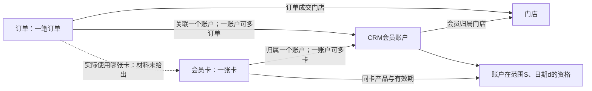

# 推荐的最小模型结构

这是本次独立评审的结构建议，不是新正式模型或完整重写。正式正文仍为本人已采纳的 W02 v0.4。下列“应表达”均指后续草稿应达到的结构，不表示已写入、采纳或执行。

## 1. 业务目的与适用边界

保留两条目的：理解复购变化、支持选择并验证改善措施；减少会员运营中的重复整理和核对。先核范围、口径和记录，是支持原因判断的条件；不能把经营目标缩成完成报表或持续做核查。小林先支持优惠券活动是岗位偏好，不能替沈总决定全部经营优先级。

只需简要说明：本期账户、订单、卡关系来自给定测试材料；会员老化仍为待验证判断，80万活跃与120万全量的历史口径未对齐。合成材料中的关系不证明生产系统已统一身份。无需列38项交付、验收权限或维护过程。

依据：W01立项邮件11–17行；W2沈总01733、01737；小林01637、01925；W03材料07、08；小林03856、03860。

## 2. 核心对象、属性与关系

| 内容 | 最小表达 | 需要避免的误读 |
| --- | --- | --- |
| CRM会员账户 | 本期统计身份；账户标识、注册日期、会员等级、归属门店 | 账户不等于自然人；“免费注册”与“有付费卡”不能未经核实建成互斥账户类 |
| 会员卡 | 独立权益记录；卡标识、持有账户、产品、开始/计划结束/提前终止日期 | 卡不是账户；购卡金额不直接决定本期资格，也不是商品订单收入 |
| 付费资格 | 给定业务范围和判定日，账户是否存在同一张符合产品范围且有效的卡；是派生判断 | 不是永久身份，不是会员等级，也不说明已经购买或活跃 |
| 购买记录/订单 | 本期一笔订单；关联账户、成交门店、渠道、下单日期、支付状态及金额/累计退款、原始件数 | 有支付记录不等于有效购买；不直接建订单实际用卡关系 |
| 门店 | 会员归属与订单成交两个不同角色；需要时说明地区 | 不能用会员归属店替代订单成交店；报表归属不是考核归属 |
| 活跃、复购 | 活跃为需定义的分析属性；复购率是有群体/期间/口径的指标，定义与结果分开 | 不填未经取得的活跃阈值；本期月报定义不追认四季度历史统计 |
| 经营安排、优惠与反馈 | 作为业务流程中的输入/产出和追踪概念，按已有业务含义描述 | 不因出现名词便造活动平台、完整实体表、字段或基数 |

以下实线是**本期字典关系**，箭头是关联方向而非工作流程。卡产品与日期用于资格判断；关系本身不能证明订单使用某一张卡。

依据：W03数据字典3–55行；小林03848、03854；陈姐03886。对象的注册时间、下单日期、权益有效时间分别有用途，不混成一个“业务时间”。本期材料只提供当前等级与归属门店属性，未提供变更历史；不能据此宣称可还原历史等级或历史归属店。

## 3. 可复用的业务规则

正文采用自然语言、带范围的规则即可，不必贴SQL或源码。

1. 本期总部月报的产品范围为悦享年卡、家庭季卡；异业联名卡与体验卡排除。此范围不改其他报表。
2. 在已说明的本期两类卡范围内，开始当天有效；计划结束当天无效；有提前终止的从终止当天无效；空提前终止记录仍受计划结束限制。按指定判定日检查，不能只看当前状态。
3. 同一张卡同时满足产品与日期条件，账户才可据该卡取得资格；其他失效或排除卡不否定一张合格卡，多卡不能重复计账户或订单。
4. 本期资料中，有效购买为已支付且实付扣累计退款后大于零；取消和全额退款不算有效购买。订单原始件数不等于扣退货后的净销量。
5. 购卡付款、商品订单付款、订单优惠、累计退款是不同含义；订单关联到人群不证明营销活动导致购买。
6. 券发放、核销、购买、复购改善分别取证；收到券不自动确定其使用范围或权限。

第1–3项来源：03848、03854、03885–03890。第4–5项来源：W03材料01、02、05。第6项来源：W2小林01648、老周01752及已采纳基线的业务边界。

**另放指标定义/核定记录：** 本期六项采用月末资格选账户、统计整月有效购买，月末生效前的当月购买也可纳入；完整月/全渠道/全门店和分子分母、退款按原订单下单日期归属、观测期首单排序、多月展示、零分母及单位转换。这些完整定义不复制成正文的独立规则表。正文可留一句“各报表如何选择判定日与统计窗口，见对应指标口径”，而非重新写一套公式。

**另放实现：** 字段名、连接与去重方案、日期表达式、排序/汇总、SQL。正文保留业务概念，不要求读者读实现才明白规则。

## 4. 实际业务工作与决策条件

在同一张流程表中表达，不把每条访谈单独设一段。下面是角色描述的**一般工作方式**，并未用同一次活动贯穿核验。

| 触发与输入 | 工作、参与者 | 输出/交接 | 条件与仍缺的信息 |
| --- | --- | --- | --- |
| 未完运营任务、已有反馈 | 小林明确面向谁、准备做什么，准备名单和执行信息 | 与相关同事确认线上或门店执行方式与协作人；门店侧对接陈姐 | 具体活动选人条件、线上经手岗位及最终业务确认人未明 |
| 需门店配合的活动安排 | 陈姐核对人群、参与门店、具体任务，再与门店人员确认安排 | 人员与执行安排；现场问题及门店反馈交小林/运营 | 工作量、现场答复责任与工作记录需讲清；不清或影响考核时先澄清，不能直接执行 |
| 已确认的活动执行安排 | 小林跟进进度、发放及使用反馈；门店记录问题与执行情况 | 结果、反馈及尚未核实的效果信息 | 整理信息不代表执行完成；完成口径仍未核实 |
| 结果及反馈 | 小林整理；与陈姐已有局部对接 | 后续分析、处理答复、下一轮安排的接续未核实 | 缺分析经手者、答复返回门店的记录及下一轮决策依据 |

依据：W2小林01623、01913、01915、01917；陈姐01665、01667、01945、01949、01953；W3小林03858、03860、03862；陈姐03888。

状态词只作对工作条件的解释，不宣称青禾系统已有这些状态字段：**待明确对象/目的 → 待协作确认 → 按安排执行与跟进 → 整理结果及未核问题**。若要求不清或影响门店考核，先澄清再安排。不得把“结果已整理”直接连为“效果已验证”。人群与执行方案仍由业务人员确认，助手不自动发券、联系会员或改记录。

实线是一般做法或局部交接的陈述，不代表同一次活动已完成；虚线是调查方向，不宣称现有组织中不存在这些环节。线上执行另由相关同事协作，岗位未知，不让门店流程代表全部线上工作。

## 5. 决策用途、业务未决与来源索引

按影响业务判断的事项保留未决，不按旧访谈顺序堆积问题：

- 原四季度复购下降的定义、人群、时段、历史报表及会员老化证据仍缺；本期月报可建立当前可核口径，不能直接说明历史原因。
- 具体活动名单来源与筛选条件、业务确认人、反馈分析与返回、完成标准仍缺；阻断自动圈人/触达及效果判断，不阻断本期规则草稿。
- 陈姐已给本期卡日期说明；具体制度文件、办理记录、历史执行凭据及更广范围适用性仍缺。把“已获角色答复”与“凭据未获”分开。
- 测试关系可用，生产系统关联/身份整合及数据可用性另核；接入安排、权限及交付责任留交付记录。

将来源索引、原句、审核理由、修订前后对照放在现有来源与变更记录。正文留最少必要出处即可；不贴候选编号表、审核日志、旧问题纠错、个人表格段落或FDE条款。
